# Proyecto Final AGRA | Semestre 2026-2 Thundercats: Escape of Mum-ra
## Asignatura: Árboles y Grafos

## Docentes:
### Carlos Alberto Ramirez Restrepo
### Carlos Andres Delgado Saavedra

## Integrantes:
### Juan Sebastián Rojas Huerter
### Maria Camila Gaitán Angel 


## Pontificia Universidad Javeriana Cali
## Facultad de Ingeniería y Ciencias
## Noviembre 24, 2026
## Cali, Colombia

## Contenido

- [Primera parte del informe](#primera-parte-del-informe)
  - Introducción y descripción del problema
  - Especificación y casos inventados
  - Ideas consideradas y prototipo inicial
- [Segunda parte del informe](#segunda-parte-del-informe)
  - Estrategia y diagrama del programa
  - Cambios durante el desarrollo
  - Trazas de los casos unificados
  - Complejidad temporal y espacial
  - Cierre, requisitos y bitácora

---

# Primera Parte del Informe
## Introducción
Este documento integra el trabajo iniciado para la primera entrega y lo completa como informe final del proyecto de Árboles y Grafos. Conservamos la descripción, la especificación, los tres casos de prueba iniciales, las ideas consideradas y la bitácora; además, incorporamos la estrategia definitiva, el flujo lógico de la implementación, los cambios frente a la primera versión, las trazas de los 40 casos del archivo unificado y el análisis de complejidad.

## Descripción del Problema
Este Problema nos Plantea un escenario súper chevre en el que el protagonista, Lion-O, es perseguido por Mumm-Ra y sus Mutantes y debe huir rapido por una red de calles hacía unos puertos espaciales donde se encuentran unas naves para poder escapar de la región. El problema es que Mumm-Ra y sus mutantes ya saben dónde está y se preparan para atraparlo. Ambos personajes arrancan exactamente al mismo tiempo y se pueden mover en cualquier dirección, hasta pueden cambiar de sentido en plena calle y no solo en las esquinas. 
Para armar el escenario, el enunciado nos dice cuántas intersecciones hay, cómo se conectan los caminos y qué distancia tiene cada uno. También nos dicen el punto exacto de inicio de Lion-O, desde dónde arrancan los mutantes y en qué puertos están parqueadas las naves de escape. Aparte de todo esto, conocemos un dato clave muy importante, que es la velocidad máxima a la que pueden viajar los villanos. La regla para que Lion-O pierda es super estricta: si él y cualquier mutante llegan a coincidir en el mismo exacto punto, ya sea en un cruce o en el medio de una carretera, Lion-O es capturado inmediatamente. Los enemigos son re avispados y van a usar cualquier estrategia posible para cortarle el paso moviéndose a su velocidad máxima. 
Entonces, nuestro gran objetivo es determinar la velocidad más bajita necesaria para garantizar por completo que Lion-O escapa, esquivando cualquier atajo que tomen los malos. Al final, con los datos que nos dan, vamos a tener que decir exactamente a cuántos kilómetros por hora debe ir para salvarse, o, si la situación está totalmente bloqueada, decir que la captura es inevitable por más que el pobre Lion-O intente acelerar.

## Especificación del problema
### Entrada:
 - Un grafo no dirigido y ponderado $G = (V, E)$ que representa la red de caminos de la Tercera Tierra, donde: 
 $V$ es el conjunto de vértices o nodos (intersecciones), tal que $|V| = n$ y $E \subseteq V \times V$ es el conjunto de aristas (caminos que conectan las intersecciones bidireccionalmente), tal que $|E| = m$.
 - Una función de peso $w: E \to \mathbb{R}^+$ que asigna a cada arista $e \in E$ una longitud conocida $d$.
 - Un vértice inicial $s \in V$, que denota la posición de partida de Lion-O.
 - Un vértice inicial $r \in V$, que denota la posición de partida de los mutantes de Mumm-Ra.
 - Un subconjunto de nodos objetivo $K \subseteq V$, con $|K| = k$, que representa las ubicaciones de las salidas del puerto espacial.
 - Una constante $v \in \mathbb{R}^+$, que indica la velocidad maxima inmutable de la nave de los mutantes.
### Salida:
Se espera obtener un valor $S \in \mathbb{R}^+ \cup \{None\}$, el cual es función estrictamente de los datos definidos en la entrada $(G, w, s, r, K, v)$. El valor de $S$ se define formalmente a través de la siguiente expresión:
$$
S = 
\begin{cases} 
\min(v_L) & \text{si } \exists \gamma \in \Gamma(s, K) \text{ tal que } \forall p \in \gamma, \frac{dist_\gamma(s,p)}{v_L} < \frac{dist_G(r,p)}{v} \\ 
None& \text{si no existe tal } v_L \text{ para ninguna trayectoria } \gamma 
\end{cases}
$$
### **Donde se definen los siguientes términos:**
*   $v_L \in \mathbb{R}^+$ es una velocidad constante hipotética para Lion-O. La salida $S$ busca el mínimo valor posible de esta variable que satisfaga la inecuación.
*   $\Gamma(s, K)$ es el conjunto de todas las trayectorias continuas posibles en el grafo $G$ que inician en $s$ y terminan en algún vértice $k \in K$.
*   $p$ representa cualquier punto continuo (ya sea un vértice o un punto fraccionario intermedio en una arista) que pertenezca a la trayectoria elegida $\gamma$.
*   $dist_\gamma(s, p)$ es la distancia exacta recorrida desde el vértice de inicio $s$ hasta el punto $p$ a lo largo de la ruta específica $\gamma$, evaluada según la función de peso $w$.
*   $dist_G(r, p)$ es la distancia del camino más corto posible en todo el grafo $G$ desde la posición inicial de los mutantes $r$ hasta el punto $p$, evaluada según la función de peso $w$.
*   El valor $None$ es el indicador numérico de fallo, utilizado cuando la inecuación de distancias y tiempos resulta insatisfacible para cualquier trayectoria (es decir, la captura es inminente e inevitable sin importar la velocidad $v_L$).

## Casos de Prueba:
### Caso de Prueba 1: ***Pseudo grafo Ralo con 2 Puertos de Salida***
```text
8 10 2 35 
1 3 6 
4 3 10
3 5 8
1 5 7 
2 3 10
6 8 5
8 7 7
2 4 9
1 7 30
4 7 12
1 6
4 7
```
### **Componentes del Caso:**
* **Grafo:** Contiene 8 intersecciones con 10 carreteras distintas cada una con sus distancias.
* **Velocidad de los enemigos $(v)$:** Los mutantes viajan a una velocidad máxima constante de 35 km/h
* **Posiciones iniciales:** Lion-O arranca su escape desde el nodo 1, mientras que los mutantes comienzan la persecución desde el nodo 6. 
* **Salidas seguras:** Las naves espaciales para escapar están ubicadas en los nodos 4 y 7.
**Explicación y Definición:**
* Este caso de prueba está diseñado para verificar que el sistema no solo evalúe una ruta segura, sino que sepa comparar múltiples opciones de salida para elegir la que exija la menor velocidad posible.
* Al analizar las posiciones en el mapa, Lion-O debe decidir entre escapar por el nodo 4 o por el nodo 7:
### 1. **Intento de escape por el nodo 7:** 
* Los mutantes inician en el nodo 6, por lo que tienen un camino muy corto y directo hacia el nodo 7 (pasando por el 8, recorriendo solo una distancia de 12).
* Lion-O, por su parte, está muy lejos (a una distancia mínima de 28 cruzando por los nodos 3 y 4, o 30 por la ruta directa). 
* Para ganar esta carrera, el vehículo de Lion-O tendría que viajar a velocidades extremas.
### 2. **Intento de escape por el nodo 4:** 
* Si Lion-O se dirige al nodo 4 (pasando por el nodo 3), solo tiene que recorrer una distancia total de 16.
* Para que los mutantes logren alcanzar esa misma intersección desde su punto de inicio, deben recorrer un trayecto más largo (nodos 6 -> 8 -> 7 -> 4) sumando una distancia de 24.

### **Representación del Grafo:**

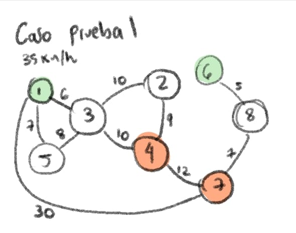

### **Salida Esperada:**
```text
Lion-O can escape at a speed of 23.333333 km/h!
```

### Caso de Prueba 2: ***Pseudo grafo Ralo con 2 Puertos de Salida y Rutas Bloqueadas***
```text
8 12 2 69 
1 5 16 
1 8 14
1 7 12
5 3 10 
5 4 15
5 8 6
3 7 4
3 2 2
7 2 8
2 8 10
8 6 10
6 4 16
7 1
4 6
```
### **Componentes del Caso:**
* **Grafo:** Contiene 8 intersecciones con 12 carreteras distintas cada una con sus distancias.
* **Velocidad de los enemigos $(v)$:** Los mutantes viajan a una velocidad máxima constante de 69 km/h
* **Posiciones iniciales:** Lion-O arranca su escape desde el nodo 7, mientras que los mutantes comienzan la persecución desde el nodo 1. 
* **Salidas seguras:** Las naves espaciales para escapar están ubicadas en los nodos 4 y 6.
**Explicación y Definición:**
* Este caso de prueba está diseñado para evaluar la capacidad del sistema de descartar rutas que están estratégicamente bloqueadas por el enemigo (intercepciones inevitables) y priorizar la supervivencia calculando la velocidad sobre la única ruta viable.
* Al observar el mapa y las distancias, Lion-O tiene dos nodos de salida posibles (6 y 4), pero su viabilidad es drásticamente distinta:
### 1. **Intento de escape por el nodo 6:** 
* Para que Lion-O llegue al nodo 6 por su ruta más corta (7 -> 3 -> 2 -> 8 -> 6), está obligado a pasar por el nodo 8, acumulando una distancia de 16 hasta ese punto.
* Sin embargo, los mutantes comienzan en el nodo 1 y tienen una conexión directa al nodo 8 con una distancia de tan solo 14. 
* Dado que los mutantes pueden llegar al nodo 8 antes que Lion-O (independientemente de la velocidad de este último), intentar huir hacia el nodo 6 garantiza la captura. El sistema debe descartar esta salida por completo.
### 2. **Intento de escape por el nodo 4:** 
* La alternativa es que Lion-O huya hacia el nodo 4 utilizando la ruta (7 -> 3 -> 5 -> 4), lo que suma una distancia total de 29.
* Para interceptarlo en esa salida, los mutantes tomarían su camino más corto (1 -> 5 -> 4), el cual suma una distancia de 31.
* Lion-O debe ser capaz de recorrer sus 29 unidades de distancia antes de que los mutantes recorran sus 31 unidades viajando a 69 km/h. La proporción entre estas distancias dicta la velocidad mínima necesaria.

### **Representación del Grafo:**

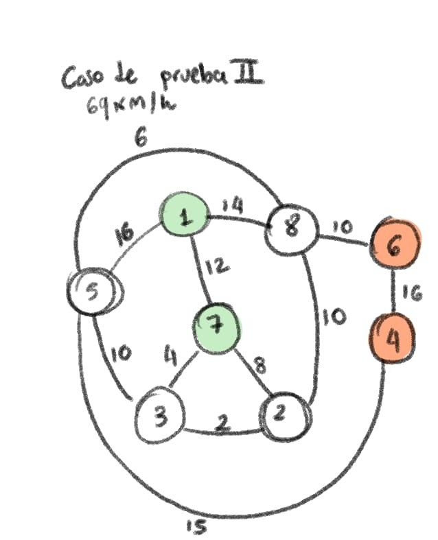

### **Salida Esperada:**
```text
Lion-O can escape at a speed of 64.548387 km/h!
```

### Caso de Prueba 3: ***Pseudo grafo Ralo con 1 Puerto de Salida y Captura Inevitable***
```text
10 14 1 120
1 5 100
2 9 200
4 7 50
1 8 90
8 5 110
10 4 30
6 3 20 
4 1 70
6 7 80
2 5 220
6 9 100
8 10 20
6 8 30
7 2 45
5 6
3
```
### **Componentes del Caso:**
* **Grafo:** Contiene 10 intersecciones con 14 carreteras distintas cada una con sus distancias.
* **Velocidad de los enemigos $(v)$:** Los mutantes viajan a una velocidad máxima constante de 120 km/h
* **Posiciones iniciales:** Lion-O arranca su escape desde el nodo 5, mientras que los mutantes comienzan la persecución desde el nodo 6. 
* **Salida segura:** La nave espacial para escapar está ubicada en el nodo 3.
**Explicación y Definición:**
* Este caso de prueba está diseñado para validar el comportamiento del sistema frente a la imposibilidad del escape. El sistema debe ser capaz de determinar cuándo ninguna velocidad, por más alta que sea, es suficiente para garantizar la supervivencia.
* Al evaluar el mapa, el sistema analizará múltiples rutas desde la posición de Lion-O (nodo 5) hacia el resto del grafo.
* Debido a la forma del Grafo, el nodo 3 (la única salida) es un vértice cuya única conexión al resto del mapa es a través del nodo 6. Esto convierte al nodo 6 en un paso obligatorio.
* Al calcular las distancias, el sistema detectará que la distancia de Lion-O hacia ese punto crítico es de mínimo 140 unidades (pasando por el nodo 8), mientras que la distancia de los mutantes a ese mismo punto es exactamente 0 (ya que inician allí).
* El sistema matemáticamente comprobará que el tiempo que le toma a los mutantes llegar al nodo 6 es $0$ $segundos$, por lo que la velocidad requerida para que Lion-O cruce ese nodo antes que los mutantes tiende a infinito $(V_L = ∞)$. Como la posibilidad de escape se rompe en ese punto, el sistema debe descartar todas las rutas y declarar la captura inevitable.

### **Representación del Grafo:**

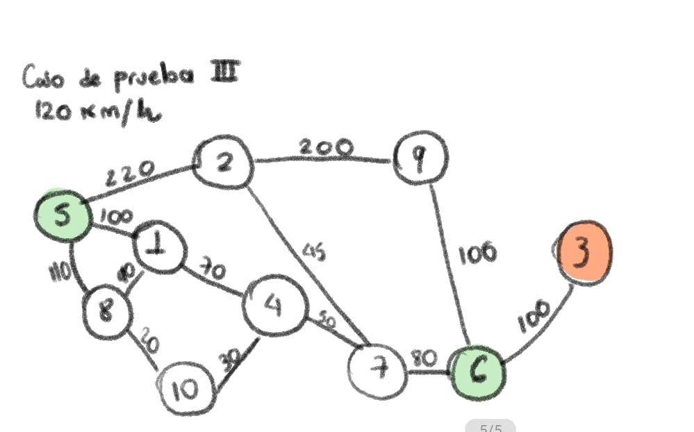

### **Salida Esperada:**
```text
Mumm-Ra captures Lion-O!
```

## Ideas Contempladas
Esta Sección se recopila las ideas que se consideraron en el Transcurso de la Comprensión del Proyecto y explica por qué algunas se descartan. También distingue las que no se han descartado todavía porque podrían formar parte de una estrategia correcta hacia la Solución. Finalmente, se detallan Aquellas que hemos Decidido Incluir en el Desarrollo del Proyecto y la Justificación de esa Decision
## Ideas Descartadas
### Usar BFS para encontrar el camino más corto:
* Descartamos Recorrer el grafo con BFS, ya que este Recorrido depende de que el Grafo tenga Aristas de Igual Peso o Peso Nulo, pues en él se minimiza la cantidad de aristas suponiendo que todas aportan en igual magnitud. Realizar un recorrido de este tipo puede guiar a elegir un camino hacia la salida alcanzada con menos vías, pero no toma en consideración la suma de sus longitudes. Aquí cada vía tiene una longitud relevante, así que los pesos no se pueden ignorar.
### Usar DFS para buscar una ruta y tomar la primera salida encontrada:
* Descartamos Usar DFS para seguir vecinos recursivamente hasta llegar a una salida, ya que aunque DFS encuentra si existe una ruta, el orden de exploración del grafo puede guiar a una ruta larga o insegura aunque haya otra mejor. De esta manera, encontramos que hacer uso este Recorrido no optimiza distancia, tiempo ni garantiza un margen de seguridad respecto a los mutantes.
### Verificar si Lion-O y una salida pertenecen a la misma componente conexa
* Esta Idea que analizamos suponía usar BFS o DFS para decidir si existe alguna ruta desde el inicio de Lion-O hasta una salida. La descartamos, ya que la conectividad no tiene en cuenta las longitudes, la velocidad ni la persecución. Puede existir una ruta y, aun así, que los mutantes puedan capturar a Lion-O antes de que la complete. De esta manera, aunque es una comprobación previa posible para detectar casos sin ninguna salida alcanzable, se descarta porque no decide realmente si se puede escapar con seguridad.
### Elegir la ruta de menor longitud desde Lion-O a una salida
* Para esta Idea se podría ejecutar Dijkstra desde Lion-O y seleccionar la salida con menor distancia. Sin embargo, la ruta más corta para Lion-O no necesariamente es segura, ya que puede acercarlo a una zona a la que los mutantes también llegan con facilidad. De esta manera, el procedimiento debe considerar simultáneamente el avance de Lion-O y el alcance de los mutantes para determinar la Alcanzabilidad de la Salida en Tiempo Real. Se Rescata de esta Idea que Dijkstra puede calcular distancias ponderadas, pero la ruta resultante debe evaluarse según la condición de captura.
### Ir a la salida más cercana por distancia directa
* Esta Idea que analizamos implicaría Calcular la Distancia desde Lion-O a cada salida y escoger la mínima. Tomamos la Decision de descartarla, ya que ignora la posición de los mutantes. La salida más cercana puede estar muy Cerca de Mumm-Ra o exigir atravesar vértices inseguros, y de esta manera en algún caso particular una salida más lejana podría ser la única que permita escapar.
### Comparar solamente el tiempo de Lion-O y los mutantes al llegar a la salida
* Esta Idea que analizamos se basaba en Calcular quién llega primero a una salida y declarar que Lion-O escapa si llega antes. Sin embargo, llegamos a la Conclusion de Descartarla, ya que el enunciado indica que es posible capturar a Lion-O en cualquier punto de una vía o en una intersección, por lo que solo el supuesto de llegar antes a la salida no demuestra que haya sobrevivido al trayecto.
### Revisar solo las distancias desde los mutantes hasta las salidas
* Esta Idea que analizamos implicaría Calcular cuánto tardan los mutantes en llegar a cada salida y comparar ese tiempo con el tiempo de Lion-O. Decidimos descartarla, ya que una comparación en el destino no nos describe lo que ocurre en el camino, pues los mutantes podrían alcanzar a Lion-O antes de que llegue a la salida.
### Suponer que Mumm-Ra sigue la misma ruta que Lion-O
* Esta idea que analizamos se basaba en comparar el tiempo que ambos tardan siguiendo el mismo camino. Decidimos Descartarla ya que el enunciado nos Plantea que los mutantes pueden elegir cualquier estrategia compatible con su velocidad máxima, por lo que no están obligados a perseguir unidireccionalmente o a usar la ruta de Lion-O; podrían tomar un atajo y esperar en un punto para capturarlo.
### Elegir siempre el siguiente vértice que más aumenta la distancia respecto a los mutantes
* En esta Idea Nos Planteamos si Lion-O podría aplicar una regla especial que siempre escoja la vía que contribuya a alejarlo del inicio de Mumm-Ra. Decidimos descartarla porque una decisión asi podría llevarlo a un callejón sin salida, a una vía larga o a una zona peligrosa más adelante. La confiabilidad dependerá de toda la secuencia de movimientos, no solo del siguiente paso.
### Elegir siempre el siguiente vértice más cercano a una salida
* Esta Idea que analizamos se basaba en avanzar en cada vertice hacia el vecino que reduciera más la distancia restante a una salida. Sin embargo, la descartamos, ya que reducir la distancia a la salida no garantiza aumentar la separación respecto a los mutantes, ya que puede producir ciclos o elegir una vía insegura.
### Marcar como prohibido todo vértice que los mutantes puedan alcanzar
* Esta Idea que analizamos se basaba en Calcular qué lugares son alcanzables desde el inicio de los mutantes y eliminarlos del grafo. Sin embargo, decidimos descartarla, ya que en un grafo conectado, los mutantes pueden alcanzar eventualmente muchos o todos los vértices. En este sentido, lo que importa es si pueden llegar al mismo lugar **en el mismo momento** que Lion-O, por lo que la región peligrosa que podrían alcanzar cambia con el tiempo; no es un conjunto estático de vértices prohibidos.
### Marcar como prohibida toda vía conectada al inicio de los mutantes
* Esta idea que nos planteamos se basaba en eliminar las vías que los mutantes pueden recorrer. Decidimos descartarla, ya que en el enunciado nos indican que ambos vehículos comparten la red y las reglas no prohíben que Lion-O circule por una vía que también podrían usar los mutantes. La Viabilidad depende solo de la coincidencia espacial y temporal.
### Simular solo la trayectoria más rápida de los mutantes
* Esta Idea que analizamos se basaba en elegir una trayectoria predeterminada de Mumm-Ra y simular si alcanza a Lion-O. Decidimos descartarla, ya que el problema pide garantizar la posibilidad del escape frente a cualquier estrategia de los mutantes. Simular una sola trayectoria no nos representa todas las posiciones a las que pueden llegar.
### Enumerar todas las estrategias posibles de Mumm-Ra
* Esta idea que nos planteamos se basaba en probar cada ruta, cada velocidad y cada cambio de dirección de los mutantes. La descartamos, porque llegamos a la conclusion de que hay infinitas trayectorias posibles porque pueden cambiar de dirección y de velocidad en cualquier punto. Una enumeración directa no es posible de realizar, por lo que nos conviene más resumir sus posibilidades con distancias mínimas o regiones alcanzables en cada instante.
### Enumerar todas las rutas posibles de Lion-O
* En esta idea, al igual que la anterior, contemplamos listar cada secuencia de vías desde el inicio de Lion-O hasta una salida y comparar su seguridad. Sin embargo, terminamos descartándola, ya que los ciclos permiten generar cantidades enormes de recorridos y podríamos tener infinitos recorridos posibles. En este sentido concluimos que nos hace falta buscar lograr una búsqueda que evite explorar caminos redundantes.
### Suponer que cualquier punto dentro de una vía solo puede alcanzarse desde un extremo específico
* Esta idea que nos planteamos se basaba en medir la distancia a un punto usando únicamente el extremo por el que Lion-O entró. Sin embargo, después de revisarla con detenimiento llegamos al consenso de descartarla, ya que los mutantes pueden llegar al punto por cualquiera de los dos extremos, y el camino más corto podría entrar por el extremo opuesto. En este sentido para evaluar la Viabilidad de un punto interior de la trayectoria entre 2 nodos, creemos que sería bueno considerar la mejor de las rutas que llegan desde ambos extremos.
### Usar Floyd-Warshall para calcular todas las distancias por defecto
* Esta idea que se nos ocurrió se basaba en calcular distancias entre todos los pares de intersecciones. Sin embargo, la descartamos debido a que Floyd-Warshall cuesta del orden de `n³` tiempo y `n²` memoria. Además, el enunciado solo da un origen para los mutantes, así que calcular todas las parejas podría ser trabajo innecesario si basta una búsqueda de fuente única. Sin embargo, lo que sí se puede rescatar es que Floyd-Warshall puede ser útil como referencia para grafos pequeños o si una solución futura necesitara de muchas consultas entre pares.
### Usar Bellman-Ford para las distancias
*  Esta Idea que analizamos se Basaba en Relajar Todas las Vías repetidamente para calcular caminos mínimos usando Bellman-Ford. La contemplamos detenidamente, ya que las longitudes representan distancias y son no negativas. Sin embargo, concluimos que si se requiere una sola fuente, Dijkstra podría ser una herramienta más adecuada, pues Bellman-Ford sería más lento y podría hacer procesos innecesarios. También contemplamos en un momento dado si su detección de ciclos negativos podría aportarnos información util, pero concordamos en que no corresponde a la necesidad particular del problema.
### Usar orden topológico de Kahn o DFS
* Esta Idea que analizamos se descartó porque el grafo de carreteras es no dirigido y puede contener ciclos. Dado que el orden topológico se aplica a grafos dirigidos acíclicos, no podemos usarlo en este caso, pues no nos permite modelar el movimiento por una red de vías con ciclos.
### Usar componentes fuertemente conexas
* Esta idea que pensamos consistía en Dividir el grafo en Componentes Fuertemente Conexas. Sin embargo, como el problema describe vías transitables en ambas direcciones, no es posible hacer uso de este concepto, ya que no aplica para este tipo de grafos porque el grafo es no dirigido. Además, los componentes fuertemente conexos no nos representan tiempos de llegada ni riesgo de captura.
### Tratar el grafo como si Lion-O y los mutantes solo pudieran moverse entre intersecciones
* Aca analizamos esta opción, pero creemos que cometeríamos un error al solo permitir cambios de dirección únicamente al llegar a un vértice, ya que según lo que nos plantea el enunciado, se permite cambiar de dirección o cambiar de vía en cualquier punto de una carretera. Ignorar esta premisa podría excluirnos estrategias permitidas o encuentros de captura posibles.
### Tratar la velocidad `v` como si estuviera en cientos de metros por hora
* Este Caso es Muy Importante y corresponde a una conclusion a la que llegamos analizando los casos de prueba y su salida esperada. Es muy importante tener en cuenta que usar el valor numérico de `v` directamente como si sus unidades fueran las mismas que las longitudes correspondería a un error gravísimo, pues en el enunciado las longitudes están en cientos de metros, mientras que el formato de salida expresa la velocidad en km/h. En este sentido para los cálculos de tiempo hay que usar unidades compatibles, para garantizar que al imprimir, el valor siga en las unidades adecuadas.
### Redondear las velocidades durante los cálculos
* Una idea que consideramos llevar a cabo era redondear distancias, tiempos o velocidades a pocos decimales en cada paso. Sin embargo, los errores acumulados que podríamos llegar a descartar pueden cambiar la decision de Viabilidad. Y además dado que la salida exige un error absoluto menor que `10⁻⁶`, se deben conservar suficientes decimales y redondear solo al presentar la respuesta.

## Ideas que no se descartan todavía
### Calcular distancias mínimas desde el inicio de los mutantes
* Esta Idea que contemplamos nos Otorgaría para cada intersección `w`, el cálculo de `D[w]`, que corresponderá a la suma mínima de longitudes que deben recorrer los mutantes desde su inicio `r` hasta `w`. Puede ser util considerarla, ya que con velocidad máxima `v`, `D[w]` da el menor tiempo en que pueden llegar a esa intersección. En este caso, al ser distancias estrictamente positivas, Dijkstra podría ser una candidata natural, pues se calcularía una sola vez por caso de prueba y sirve para muchas pruebas de velocidad y de alcanzabilidad para nuestro Personaje Lion-O. Por otra parte, el arreglo `D` que obtendríamos podría alimentar el modelo de región alcanzable por tiempo y ayudar a plantear la parte segura para cada vértice y ayudarnos quizás a hacer algo como una "prueba de alcanzabilidad".
### Modelar el conjunto de puntos alcanzables por los mutantes según el tiempo
* Tras analizarla, creemos que la regla de captura tiene una base temporal, por lo que una hipótesis sobre la que trabajamos es que un punto del grafo es alcanzable por los mutantes en un tiempo `t` si la distancia mínima desde su inicio hasta ese punto es como máximo `v·t`. Comparar este resultado con la posición de Lion-O es una interpretación que consideramos validar para Evaluar su Posible Uso.
### Buscar el umbral de velocidad de Lion-O
* Creemos que una Posibilidad sería realizar una búsqueda binaria sobre la velocidad podría ser posible. Esto dependería de que se demuestre bajo monotonía matematica de que, cuando una velocidad permite escapar, cualquier velocidad mayor también lo permite. Nos parece una idea razonable porque Lion-O podría avanzar más rápido o elegir no usar toda su capacidad, pero la prueba exacta de esta posibilidad todavía está pendiente.

## Ideas a Aplicar
### Representar el mapa como un grafo ponderado no dirigido
* Esta Representación nos permite extrapolar cada intersección como un vértice y cada vía como una arista con su longitud. Al ser no dirigido, cada vía se almacena en las listas de adyacencia de sus dos extremos. En esta Interpretación toda ruta posible de cada vehículo corresponderá a una secuencia de aristas y las longitudes son claramente necesarias para calcular cuánto tarda cada vehículo en alcanzar un Punto. Además, dado que estamos Considerando el Uso de Dijkstra, esta seria la estructura base para hacer uso de Dijkstra desde el inicio de los mutantes y para la posible "prueba de alcanzabilidad" de las salidas desde las posiciones de Lion-O.
### Usar listas de adyacencia
* Esta Representación guarda para cada intersección solo las vías que salen de ella, por lo que para el Contexto del Problema es una Estructura Óptima y además Dijkstra junto con otros recorridos y procedimientos usan recorridos sobre vecinos. Por otro lado, la lista de adyacencia también permite recorrer cada vía en tiempo proporcional al tamaño de la red. Por estas Razones Creemos que puede Ser Util para Nuestro Caso su Uso.

## Desarrollo Inicial Entrada de Datos del Programa
```text
from sys import stdin
def main():
    entrada = stdin.readline()
    t = int(entrada)
    for _ in range(t):
        n, m, k, v = map(int, stdin.readline().split())
        grafo = [[] for _ in range(n)]
        for _ in range(m):
            a, b, d = map(int, stdin.readline().split())
            a -= 1
            b -= 1
            grafo[a].append((b, d))
            grafo[b].append((a, d))
        lion, mumm_ra = map(int, stdin.readline().split())
        salidas = list(map(int, stdin.readline().split()))
        print(f"m:{m},n:{n},k:{k},v:{v}")
        print(*grafo)
        print(f"lion:{lion}  mumm_ra:{mumm_ra}")
        print(*salidas)
if __name__ == "__main__":
    main()
```
# Segunda parte del informe

En esta parte presentamos la estrategia de la solución final, la evolución de las ideas y las trazas de los 40 casos unificados.

## Precisiones para leer la solución

Usamos $s$ para el inicio de Lion-O, $r$ para el inicio de Mumm-Ra, $K$ para el conjunto de salidas y $v_M$ para la velocidad máxima de los mutantes. Para cada nodo $x$, $D_M(x)$ representa la distancia mínima desde $r$ hasta $x$, y $L(x)$ representa la distancia acumulada de Lion-O por la ruta que está recorriendo.

En cada nodo, la condición de seguridad exige que Lion-O llegue estrictamente antes que los mutantes:

$$
\frac{L(x)}{v_L} < \frac{D_M(x)}{v_M}
\quad\Longleftrightarrow\quad
L(x) < \frac{v_L D_M(x)}{v_M}.
$$

Para una velocidad candidata $v_L$, el programa calcula la cota $\frac{v_L D_M(x)}{v_M}$ y solo acepta relajar la distancia hacia $x$ si la distancia acumulada de Lion-O es menor. La desigualdad es estricta porque un empate implica captura.

Aunque la prueba de Dijkstra de Lion-O comprueba las intersecciones, también queda cubierta la seguridad dentro de cada vía. Si una carretera de longitud $w$ conecta los nodos $u$ y $z$, y Lion-O la recorre desde $u$, para un punto situado a distancia $x$ sobre esa carretera las distancias relevantes son $L(u)+x$ para Lion-O y $\min(D_M(u)+x,\,D_M(z)+w-x)$ para Mumm-Ra. Estas expresiones son lineales por tramos. En cada tramo, si Lion-O cumple la cota de seguridad en ambos extremos, también la cumple en el interior. Así justificamos la comprobación por vértices sin asumir que los encuentros solo ocurren en intersecciones.

Si Mumm-Ra no puede llegar a un nodo, usamos $D_M(x)=\infty$; ese nodo no impone una cota finita. Si Lion-O y Mumm-Ra comienzan en el mismo nodo, la captura es inmediata. Si Lion-O ya comienza en una salida distinta de $r$, no recorre ninguna vía: el umbral matemático es cero y la versión final informa $10^{-7}\,\text{km/h}$, dentro del error permitido.

## Estrategia final y flujo del programa

Primero construimos el grafo no dirigido mediante listas de adyacencia, convertimos los nodos a índices desde cero y guardamos las salidas en un conjunto. Si Lion-O empieza en una salida, el programa responde sin ejecutar la búsqueda: informa captura si $s=r$ y, en caso contrario, informa $10^{-7}\,\text{km/h}$.

En los demás casos, BFS busca una salida sin pasar por el nodo inicial de Mumm-Ra. Este paso descarta situaciones sin una ruta estructural admisible; no decide por sí solo si la persecución es segura. Cuando BFS encuentra una salida, Dijkstra calcula una sola vez $D_M(x)$ para todos los nodos.

Para cada velocidad candidata $q$, calculamos la cota $\frac{qD_M(x)}{v_M}$ y ejecutamos Dijkstra desde Lion-O. Solo aceptamos una llegada a un nodo cuando su distancia acumulada es estrictamente menor que esa cota. Si el recorrido alcanza una salida, $q$ es factible.

La factibilidad es monótona respecto a $q$: al aumentar la velocidad, las cotas no disminuyen. La búsqueda empieza con la cota superior $U_0=10^{12}$ y la duplica mientras la prueba no sea factible. Con una cota factible, reducimos el intervalo desde cero hasta que su ancho sea como máximo $\epsilon=10^{-7}$; también detenemos la búsqueda si el punto medio ya no se representa como un valor distinto de los extremos. Al final se informa el resultado con siete decimales. La prueba de factibilidad devuelve si existe una ruta, no conserva un camino testigo; las rutas que incluimos en las trazas sirven para explicar una forma de escape.

Como ejemplo representativo, tomamos el caso U01. Lion-O parte del nodo 1 y puede llegar a la salida 4 por una ruta de longitud acumulada $L=5$. Dijkstra desde el nodo 2, donde comienza Mumm-Ra, da $D_M(4)=40$, y la velocidad de los mutantes es $v_M=150\,\text{km/h}$. Para esta ruta, la razón crítica es

$$
\frac{v_M L}{D_M(4)}=\frac{150\cdot 5}{40}=18.75\,\text{km/h}.
$$

Por eso concluimos que el umbral es $18.75\,\text{km/h}$. El programa valida la cota superior y luego realiza 64 pasos de búsqueda binaria. En la traza U01 detallamos las funciones llamadas, las distancias y la salida final `Lion-O can escape at a speed of 18.7500000 km/h!`.

### Diagrama del flujo lógico implementado

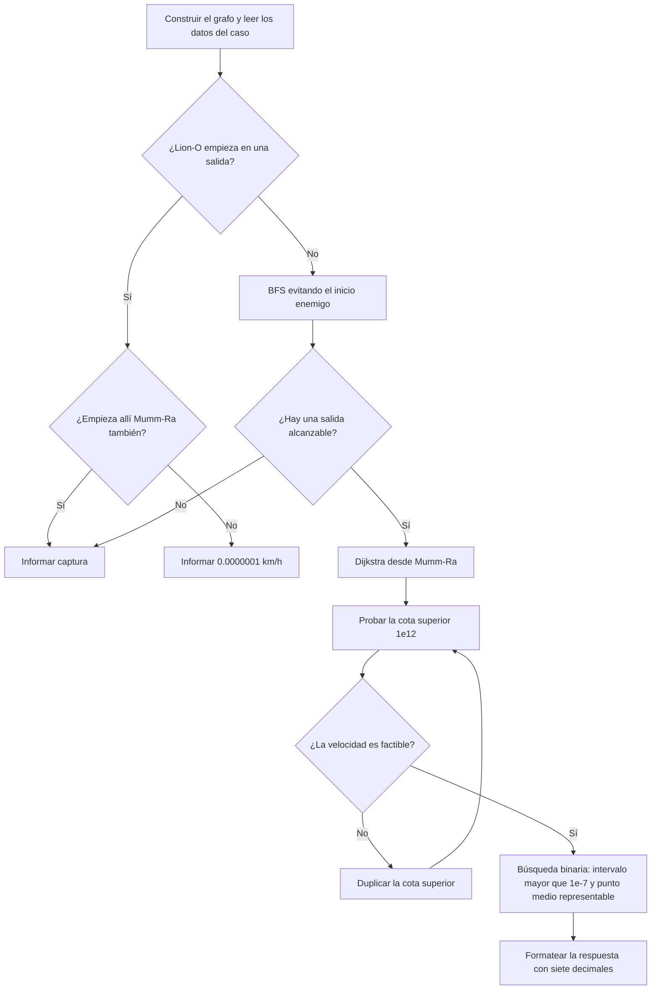

### Funciones y estructuras de la versión final

| Elemento | Función en la solución |
| --- | --- |
| `funcion_que_ejecuta_todo_el_programa` | Construye el grafo no dirigido, convierte índices, crea el conjunto de salidas, llama al solucionador y acumula las respuestas. |
| `funcion_que_indica_si_existe_una_ruta_de_escape_posible` | Recorre el grafo con BFS y evita el inicio de Mumm-Ra; descarta casos sin salida estructural admisible. |
| `funcion_para_calcular_distancias_minimas` | Ejecuta Dijkstra desde Mumm-Ra y devuelve $D_M(x)$ para cada nodo. |
| `funcion_que_indica_si_se_puede_escapar_con_una_velocidad_dada` | Calcula las cotas de seguridad y ejecuta Dijkstra desde Lion-O para determinar si la velocidad candidata llega a una salida. |
| `funcion_que_encuentra_la_velocidad_minima_necesaria_para_que_lion_pueda_escapar` | Resuelve casos directos, combina BFS y Dijkstra, verifica o amplía la cota superior y aplica la búsqueda binaria. |
| Lista de adyacencia, `set`, arreglos, `deque` y heap de `heapq` | Almacenan las carreteras y salidas, registran distancias y estados, permiten BFS y extraen el nodo con menor distancia provisional. |

## Cómo evolucionaron las ideas hasta la solución final

1. **Representamos el mapa con un grafo ponderado no dirigido.** Las carreteras quedan en las listas de adyacencia de ambos extremos.
2. **Separamos conectividad y seguridad.** BFS detecta si hay una salida sin pasar por el nodo inicial enemigo; luego la persecución se analiza con distancias ponderadas.
3. **Resumimos las opciones de Mumm-Ra con distancias mínimas.** Ejecutamos Dijkstra desde su origen una sola vez por caso.
4. **Convertimos la seguridad en una prueba para una velocidad fija.** Dijkstra desde Lion-O recorre solo los nodos donde su llegada es estrictamente anterior a la de los mutantes.
5. **Buscamos el umbral en lugar de enumerar rutas.** Usamos la monotonía de la factibilidad, una cota superior ampliable y búsqueda binaria.
6. **Resolvimos los casos límite.** Tratamos el inicio compartido, el inicio en una salida y los nodos inalcanzables para Mumm-Ra.

Así cerramos las preguntas que habían quedado abiertas en la primera entrega. La solución final combina el filtro BFS, las distancias de Dijkstra y la búsqueda del umbral de velocidad.

## Cambios durante el desarrollo

Al probar los casos de tipo B observamos diferencias en las últimas cifras de algunas respuestas y un estado de «No recibido» en la arena. Revisamos el requisito de error absoluto y comparamos las salidas de referencia para entender el comportamiento numérico.

Durante la evolución del código revisamos la cota inicial de la búsqueda, el criterio de parada, la salida con siete decimales y el caso en que Lion-O comienza en una salida distinta de Mumm-Ra. También verificamos que la ampliación de la cota continuara disponible si una prueba inicial no era factible y añadimos una condición para detener la búsqueda cuando el punto medio ya no se representa como un valor diferente de los extremos.

A través de las funciones de Dijkstra, de prueba de factibilidad y del solucionador general, iteramos hasta consolidar la lógica que describimos en este informe: BFS para la conectividad admisible, distancias mínimas desde Mumm-Ra, Dijkstra restringido para cada velocidad candidata, búsqueda de una cota superior factible y búsqueda binaria. Después subimos la versión final y el equipo observó su aceptación en la arena.

## Trazas de los casos unificados

Seguimos el orden de los 40 casos unificados. Las respuestas de referencia están escritas con seis decimales, mientras que el código final imprime siete. Por eso mostramos la salida exacta que produce la implementación final en cada traza. Al comparar las respuestas, las frases coincidieron en todos los casos y el mayor error numérico fue menor que `3 × 10⁻⁷`, por debajo de `10⁻⁶`. En cada caso presentamos las llamadas, las distancias relevantes, la ruta testigo cuando aplica y las decisiones del código.

Ignoramos las líneas en blanco que separaban algunos casos durante la comparación local. Las imágenes de los 40 grafos están enlazadas en las trazas.

### Referencia de llamadas usada en cada traza

- **MAIN** = `funcion_que_ejecuta_todo_el_programa`.
- **SOLVE** = `funcion_que_encuentra_la_velocidad_minima_necesaria_para_que_lion_pueda_escapar`.
- **BFS** = `funcion_que_indica_si_existe_una_ruta_de_escape_posible`.
- **DIJKSTRA** = `funcion_para_calcular_distancias_minimas`.
- **PRUEBA(q)** = `funcion_que_indica_si_se_puede_escapar_con_una_velocidad_dada`, invocada para la velocidad `q`.

### Caso U01

**Entrada:** `n=5`, `m=5`, `k=2`, `v_M=150`, Lion-O `s=1`, Mumm-Ra `r=2`, salidas `K=[4, 5]`.

**Decisión que observamos:** Observamos que BFS encuentra salida estructural; calculamos D_M con Dijkstra y buscamos la menor cota factible mediante pruebas de velocidad.

**Llamadas:** `MAIN → SOLVE → BFS (sí) → DIJKSTRA (desde nodo 2) → PRUEBA(q) para la cota y la búsqueda binaria`.

**Vector completo $D_M(1,\ldots,n)$:** `[45, 0, 46, 40, 30]`.

**Ruta testigo ilustrativa:** `1 → 4`.

**Longitudes de los tramos:** `1→4: 5`. Suma recorrida hasta la salida: `L=5`.

| Nodo visitado | $L(x)$ acumulada | $D_M(x)$ | $v_M \cdot L(x)/D_M(x)$ (km/h) |
| ---: | ---: | ---: | ---: |
| 1 | 0 | 45 | 0.000000 |
| 4 | 5 | 40 | 18.750000 |

**Lectura de la decisión:** al comparar las razones, concluimos que la mayor es `18.750000 km/h`. Verificamos que la ruta pasa las comprobaciones para una velocidad apenas superior a ese umbral; nuestro código conserva la cota superior al terminar la búsqueda.

**Búsqueda numérica:** cota superior inicial $U_0=10^{12}$; la primera prueba fue factible, así que no duplicamos la cota ($d=0$). Reducimos el intervalo con $B=64$ iteraciones binarias hasta que su ancho fue como máximo $10^{-7}$. En total hicimos `65` pruebas de velocidad: una para validar la cota y 64 en la búsqueda binaria.

**Salida del programa final:** `Lion-O can escape at a speed of 18.7500000 km/h!`

**Imagen del grafo:**

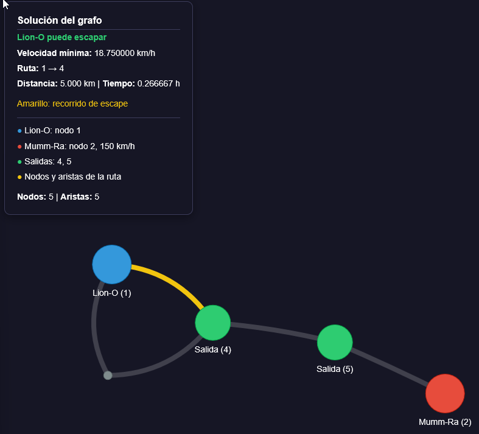


### Caso U02

**Entrada:** `n=3`, `m=2`, `k=1`, `v_M=160`, Lion-O `s=3`, Mumm-Ra `r=2`, salidas `K=[1]`.

**Decisión que observamos:** Observamos que BFS no encuentra una salida alcanzable sin entrar al nodo inicial enemigo; por eso concluimos que hay captura y omitimos el cálculo de distancias y las pruebas de velocidad.

**Llamadas:** `MAIN → SOLVE → BFS (sin salida estructural)`.

**Vector de Dijkstra:** No se calcula porque el flujo termina antes de llamar a DIJKSTRA.

**Ruta testigo:** No encontramos una ruta admisible; BFS descarta el caso antes del análisis de velocidades.

**Búsqueda numérica:** no se ejecuta en esta rama.

**Salida del programa final:** `Mumm-Ra captures Lion-O!`

**Imagen del Grafo:**

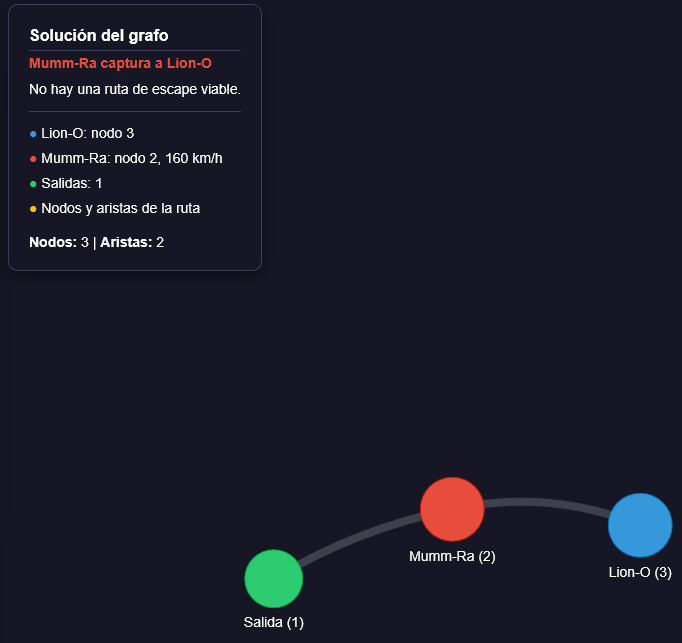


### Caso U03

**Entrada:** `n=4`, `m=3`, `k=1`, `v_M=120`, Lion-O `s=1`, Mumm-Ra `r=2`, salidas `K=[4]`.

**Decisión que observamos:** Observamos que BFS encuentra salida estructural; calculamos D_M con Dijkstra y buscamos la menor cota factible mediante pruebas de velocidad.

**Llamadas:** `MAIN → SOLVE → BFS (sí) → DIJKSTRA (desde nodo 2) → PRUEBA(q) para la cota y la búsqueda binaria`.

**Vector completo $D_M(1,\ldots,n)$:** `[24, 0, 20, 18]`.

**Ruta testigo ilustrativa:** `1 → 3 → 4`.

**Longitudes de los tramos:** `1→3: 4; 3→4: 2`. Suma recorrida hasta la salida: `L=6`.

| Nodo visitado | $L(x)$ acumulada | $D_M(x)$ | $v_M \cdot L(x)/D_M(x)$ (km/h) |
| ---: | ---: | ---: | ---: |
| 1 | 0 | 24 | 0.000000 |
| 3 | 4 | 20 | 24.000000 |
| 4 | 6 | 18 | 40.000000 |

**Lectura de la decisión:** al comparar las razones, concluimos que la mayor es `40.000000 km/h`. Verificamos que la ruta pasa las comprobaciones para una velocidad apenas superior a ese umbral; nuestro código conserva la cota superior al terminar la búsqueda.

**Búsqueda numérica:** cota superior inicial $U_0=10^{12}$; la primera prueba fue factible, así que no duplicamos la cota ($d=0$). Reducimos el intervalo con $B=64$ iteraciones binarias hasta que su ancho fue como máximo $10^{-7}$. En total hicimos `65` pruebas de velocidad: una para validar la cota y 64 en la búsqueda binaria.

**Salida del programa final:** `Lion-O can escape at a speed of 40.0000000 km/h!`

**Imagen del Grafo:**

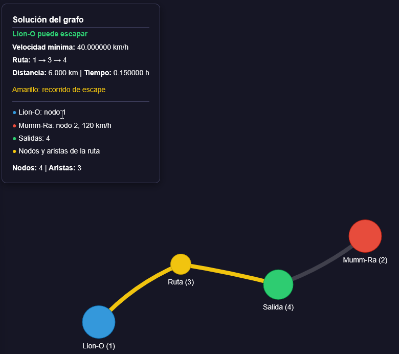


### Caso U04

**Entrada:** `n=8`, `m=13`, `k=2`, `v_M=100`, Lion-O `s=1`, Mumm-Ra `r=3`, salidas `K=[7, 8]`.

**Decisión que observamos:** Observamos que BFS encuentra salida estructural; calculamos D_M con Dijkstra y buscamos la menor cota factible mediante pruebas de velocidad.

**Llamadas:** `MAIN → SOLVE → BFS (sí) → DIJKSTRA (desde nodo 3) → PRUEBA(q) para la cota y la búsqueda binaria`.

**Vector completo $D_M(1,\ldots,n)$:** `[5, 1, 0, 7, 12, 12, 11, 5]`.

**Ruta testigo ilustrativa:** `1 → 4 → 5 → 6 → 7`.

**Longitudes de los tramos:** `1→4: 5; 4→5: 5; 5→6: 5; 6→7: 5`. Suma recorrida hasta la salida: `L=20`.

| Nodo visitado | $L(x)$ acumulada | $D_M(x)$ | $v_M \cdot L(x)/D_M(x)$ (km/h) |
| ---: | ---: | ---: | ---: |
| 1 | 0 | 5 | 0.000000 |
| 4 | 5 | 7 | 71.428571 |
| 5 | 10 | 12 | 83.333333 |
| 6 | 15 | 12 | 125.000000 |
| 7 | 20 | 11 | 181.818182 |

**Lectura de la decisión:** al comparar las razones, concluimos que la mayor es `181.818182 km/h`. Verificamos que la ruta pasa las comprobaciones para una velocidad apenas superior a ese umbral; nuestro código conserva la cota superior al terminar la búsqueda.

**Búsqueda numérica:** cota superior inicial $U_0=10^{12}$; la primera prueba fue factible, así que no duplicamos la cota ($d=0$). Reducimos el intervalo con $B=64$ iteraciones binarias hasta que su ancho fue como máximo $10^{-7}$. En total hicimos `65` pruebas de velocidad: una para validar la cota y 64 en la búsqueda binaria.

**Salida del programa final:** `Lion-O can escape at a speed of 181.8181818 km/h!`

**Imagen del Grafo:**

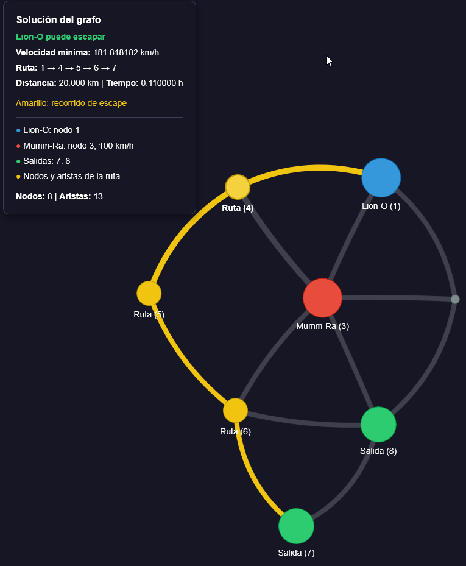


### Caso U05

**Entrada:** `n=9`, `m=14`, `k=3`, `v_M=200`, Lion-O `s=5`, Mumm-Ra `r=5`, salidas `K=[1, 5, 9]`.

**Decisión que observamos:** Identificamos que Lion-O y Mumm-Ra empiezan en el mismo nodo y que ese nodo es una salida. SOLVE entra por la rama de salida, comprueba `s != r`, no asignamos velocidad y el resultado es captura.

**Llamadas:** `MAIN → SOLVE (rama de salida; misma posición)`.

**Vector de Dijkstra:** No se calcula porque el flujo termina antes de llamar a DIJKSTRA.

**Ruta testigo:** Determinamos que no hay una salida segura que Lion-O pueda alcanzar desde el punto ocupado por Mumm-Ra; la captura es inmediata.

**Búsqueda numérica:** no se ejecuta en esta rama.

**Salida del programa final:** `Mumm-Ra captures Lion-O!`

**Imagen del Grafo:**

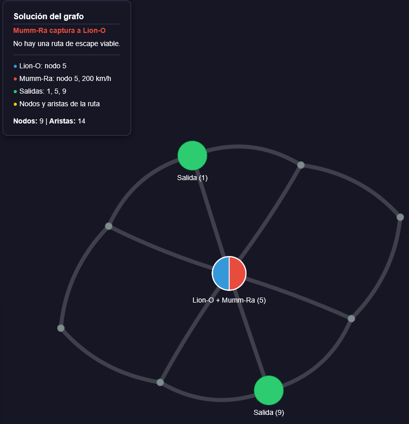


### Caso U06

**Entrada:** `n=10`, `m=16`, `k=2`, `v_M=800`, Lion-O `s=1`, Mumm-Ra `r=9`, salidas `K=[10, 8]`.

**Decisión que observamos:** Observamos que BFS encuentra salida estructural; calculamos D_M con Dijkstra y buscamos la menor cota factible mediante pruebas de velocidad.

**Llamadas:** `MAIN → SOLVE → BFS (sí) → DIJKSTRA (desde nodo 9) → PRUEBA(q) para la cota y la búsqueda binaria`.

**Vector completo $D_M(1,\ldots,n)$:** `[110, 86, 41, 30, 51, 70, 51, 1, 0, 1]`.

**Ruta testigo ilustrativa:** `1 → 2 → 7 → 8`.

**Longitudes de los tramos:** `1→2: 45; 2→7: 35; 7→8: 50`. Suma recorrida hasta la salida: `L=130`.

| Nodo visitado | $L(x)$ acumulada | $D_M(x)$ | $v_M \cdot L(x)/D_M(x)$ (km/h) |
| ---: | ---: | ---: | ---: |
| 1 | 0 | 110 | 0.000000 |
| 2 | 45 | 86 | 418.604651 |
| 7 | 80 | 51 | 1254.901961 |
| 8 | 130 | 1 | 104000.000000 |

**Lectura de la decisión:** al comparar las razones, concluimos que la mayor es `104000.000000 km/h`. Verificamos que la ruta pasa las comprobaciones para una velocidad apenas superior a ese umbral; nuestro código conserva la cota superior al terminar la búsqueda.

**Búsqueda numérica:** cota superior inicial $U_0=10^{12}$; la primera prueba fue factible, así que no duplicamos la cota ($d=0$). Reducimos el intervalo con $B=64$ iteraciones binarias hasta que su ancho fue como máximo $10^{-7}$. En total hicimos `65` pruebas de velocidad: una para validar la cota y 64 en la búsqueda binaria.

**Salida del programa final:** `Lion-O can escape at a speed of 104000.0000000 km/h!`

**Imagen del Grafo:**

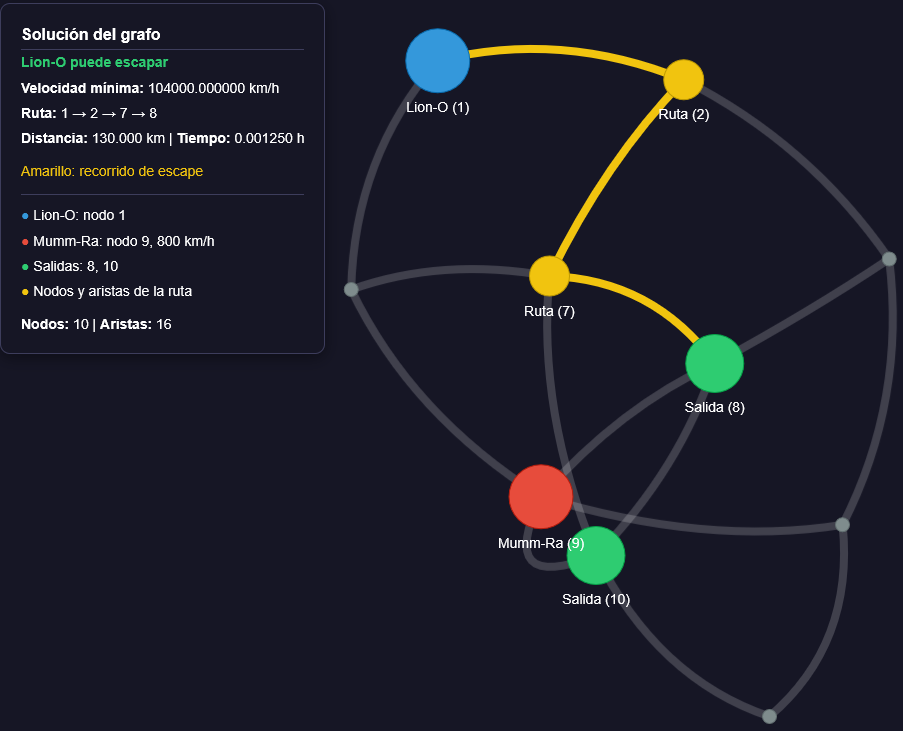


### Caso U07

**Entrada:** `n=11`, `m=15`, `k=2`, `v_M=120`, Lion-O `s=1`, Mumm-Ra `r=7`, salidas `K=[6, 11]`.

**Decisión que observamos:** Observamos que BFS encuentra salida estructural; calculamos D_M con Dijkstra y buscamos la menor cota factible mediante pruebas de velocidad.

**Llamadas:** `MAIN → SOLVE → BFS (sí) → DIJKSTRA (desde nodo 7) → PRUEBA(q) para la cota y la búsqueda binaria`.

**Vector completo $D_M(1,\ldots,n)$:** `[∞, ∞, ∞, ∞, ∞, ∞, 0, 4, 7, 8, 4]`.

**Ruta testigo ilustrativa:** `1 → 6`.

**Longitudes de los tramos:** `1→6: 5`. Suma recorrida hasta la salida: `L=5`.

| Nodo visitado | $L(x)$ acumulada | $D_M(x)$ | $v_M \cdot L(x)/D_M(x)$ (km/h) |
| ---: | ---: | ---: | ---: |
| 1 | 0 | ∞ | 0 (D=∞) |
| 6 | 5 | ∞ | 0 (D=∞) |

**Lectura de la decisión:** al comparar las razones, concluimos que la mayor es `0` como ínfimo porque Mumm-Ra no alcanza estos nodos. Verificamos que la ruta pasa las comprobaciones para una velocidad apenas superior a ese umbral; nuestro código conserva la cota superior al terminar la búsqueda.

**Búsqueda numérica:** cota superior inicial $U_0=10^{12}$; la primera prueba fue factible, así que no duplicamos la cota ($d=0$). Reducimos el intervalo con $B=64$ iteraciones binarias hasta que su ancho fue como máximo $10^{-7}$. En total hicimos `65` pruebas de velocidad: una para validar la cota y 64 en la búsqueda binaria.

**Salida del programa final:** `Lion-O can escape at a speed of 0.0000001 km/h!`

**Imagen del Grafo:**

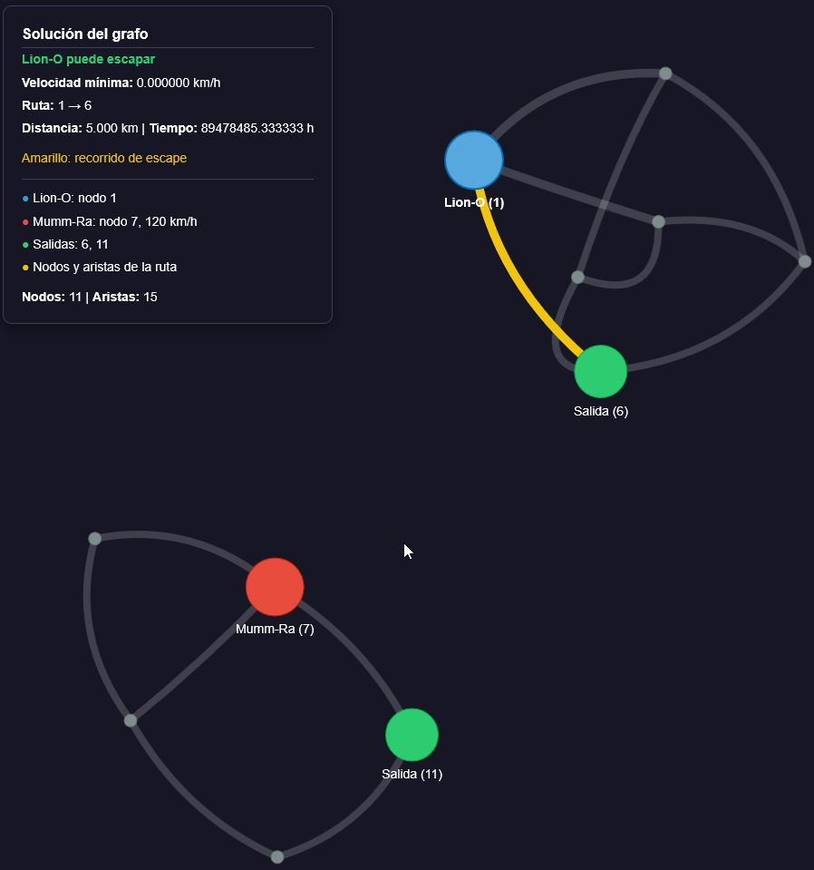


### Caso U08

**Entrada:** `n=12`, `m=17`, `k=3`, `v_M=150`, Lion-O `s=1`, Mumm-Ra `r=6`, salidas `K=[8, 10, 12]`.

**Decisión que observamos:** Observamos que BFS no encuentra una salida alcanzable sin entrar al nodo inicial enemigo; por eso concluimos que hay captura y omitimos el cálculo de distancias y las pruebas de velocidad.

**Llamadas:** `MAIN → SOLVE → BFS (sin salida estructural)`.

**Vector de Dijkstra:** No se calcula porque el flujo termina antes de llamar a DIJKSTRA.

**Ruta testigo:** No encontramos una ruta admisible; BFS descarta el caso antes del análisis de velocidades.

**Búsqueda numérica:** no se ejecuta en esta rama.

**Salida del programa final:** `Mumm-Ra captures Lion-O!`

**Imagen del Grafo:**

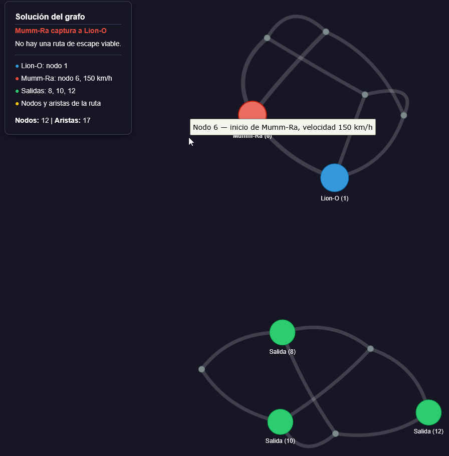


### Caso U09

**Entrada:** `n=14`, `m=24`, `k=2`, `v_M=120`, Lion-O `s=1`, Mumm-Ra `r=4`, salidas `K=[7, 14]`.

**Decisión que observamos:** Observamos que BFS encuentra salida estructural; calculamos D_M con Dijkstra y buscamos la menor cota factible mediante pruebas de velocidad.

**Llamadas:** `MAIN → SOLVE → BFS (sí) → DIJKSTRA (desde nodo 4) → PRUEBA(q) para la cota y la búsqueda binaria`.

**Vector completo $D_M(1,\ldots,n)$:** `[17, 15, 7, 0, 9, 10, 2, 17, 21, 16, 12, 17, 16, 11]`.

**Ruta testigo ilustrativa:** `1 → 8 → 14`.

**Longitudes de los tramos:** `1→8: 7; 8→14: 6`. Suma recorrida hasta la salida: `L=13`.

| Nodo visitado | $L(x)$ acumulada | $D_M(x)$ | $v_M \cdot L(x)/D_M(x)$ (km/h) |
| ---: | ---: | ---: | ---: |
| 1 | 0 | 17 | 0.000000 |
| 8 | 7 | 17 | 49.411765 |
| 14 | 13 | 11 | 141.818182 |

**Lectura de la decisión:** al comparar las razones, concluimos que la mayor es `141.818182 km/h`. Verificamos que la ruta pasa las comprobaciones para una velocidad apenas superior a ese umbral; nuestro código conserva la cota superior al terminar la búsqueda.

**Búsqueda numérica:** cota superior inicial $U_0=10^{12}$; la primera prueba fue factible, así que no duplicamos la cota ($d=0$). Reducimos el intervalo con $B=64$ iteraciones binarias hasta que su ancho fue como máximo $10^{-7}$. En total hicimos `65` pruebas de velocidad: una para validar la cota y 64 en la búsqueda binaria.

**Salida del programa final:** `Lion-O can escape at a speed of 141.8181818 km/h!`

**Imagen del Grafo:**

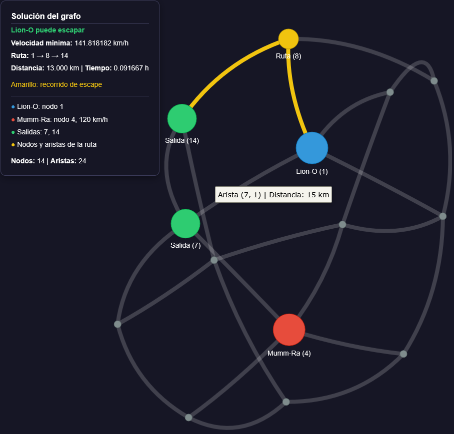


### Caso U10

**Entrada:** `n=15`, `m=25`, `k=3`, `v_M=180`, Lion-O `s=1`, Mumm-Ra `r=8`, salidas `K=[13, 14, 15]`.

**Decisión que observamos:** Observamos que BFS encuentra salida estructural; calculamos D_M con Dijkstra y buscamos la menor cota factible mediante pruebas de velocidad.

**Llamadas:** `MAIN → SOLVE → BFS (sí) → DIJKSTRA (desde nodo 8) → PRUEBA(q) para la cota y la búsqueda binaria`.

**Vector completo $D_M(1,\ldots,n)$:** `[19, 25, 19, 21, 16, 10, 12, 0, 2, 5, 7, 11, 9, 16, 14]`.

**Ruta testigo ilustrativa:** `1 → 7 → 9 → 11 → 13`.

**Longitudes de los tramos:** `1→7: 7; 7→9: 10; 9→11: 5; 11→13: 6`. Suma recorrida hasta la salida: `L=28`.

| Nodo visitado | $L(x)$ acumulada | $D_M(x)$ | $v_M \cdot L(x)/D_M(x)$ (km/h) |
| ---: | ---: | ---: | ---: |
| 1 | 0 | 19 | 0.000000 |
| 7 | 7 | 12 | 105.000000 |
| 9 | 17 | 2 | 1530.000000 |
| 11 | 22 | 7 | 565.714286 |
| 13 | 28 | 9 | 560.000000 |

**Lectura de la decisión:** al comparar las razones, concluimos que la mayor es `1530.000000 km/h`. Verificamos que la ruta pasa las comprobaciones para una velocidad apenas superior a ese umbral; nuestro código conserva la cota superior al terminar la búsqueda.

**Búsqueda numérica:** cota superior inicial $U_0=10^{12}$; la primera prueba fue factible, así que no duplicamos la cota ($d=0$). Reducimos el intervalo con $B=64$ iteraciones binarias hasta que su ancho fue como máximo $10^{-7}$. En total hicimos `65` pruebas de velocidad: una para validar la cota y 64 en la búsqueda binaria.

**Salida del programa final:** `Lion-O can escape at a speed of 1530.0000000 km/h!`

**Imagen del Grafo:**

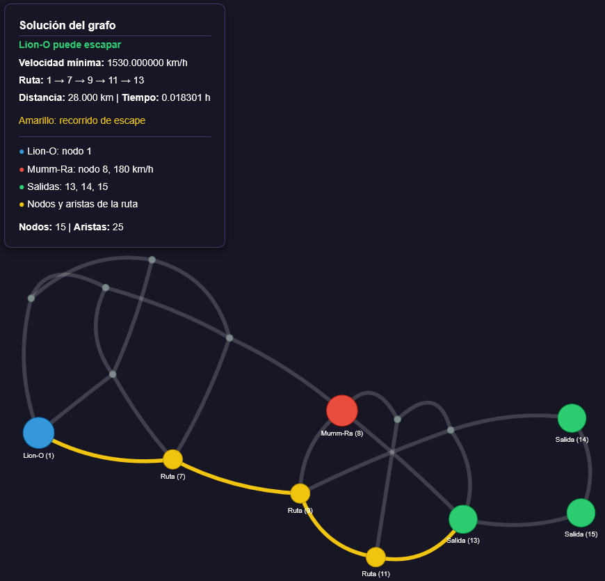


### Caso U11

**Entrada:** `n=16`, `m=28`, `k=2`, `v_M=950`, Lion-O `s=1`, Mumm-Ra `r=15`, salidas `K=[16, 12]`.

**Decisión que observamos:** Observamos que BFS encuentra salida estructural; calculamos D_M con Dijkstra y buscamos la menor cota factible mediante pruebas de velocidad.

**Llamadas:** `MAIN → SOLVE → BFS (sí) → DIJKSTRA (desde nodo 15) → PRUEBA(q) para la cota y la búsqueda binaria`.

**Vector completo $D_M(1,\ldots,n)$:** `[315, 285, 255, 167, 285, 205, 175, 87, 255, 175, 90, 2, 165, 85, 0, 1]`.

**Ruta testigo ilustrativa:** `1 → 6 → 11 → 12`.

**Longitudes de los tramos:** `1→6: 110; 6→11: 115; 11→12: 90`. Suma recorrida hasta la salida: `L=315`.

| Nodo visitado | $L(x)$ acumulada | $D_M(x)$ | $v_M \cdot L(x)/D_M(x)$ (km/h) |
| ---: | ---: | ---: | ---: |
| 1 | 0 | 315 | 0.000000 |
| 6 | 110 | 205 | 509.756098 |
| 11 | 225 | 90 | 2375.000000 |
| 12 | 315 | 2 | 149625.000000 |

**Lectura de la decisión:** al comparar las razones, concluimos que la mayor es `149625.000000 km/h`. Verificamos que la ruta pasa las comprobaciones para una velocidad apenas superior a ese umbral; nuestro código conserva la cota superior al terminar la búsqueda.

**Búsqueda numérica:** cota superior inicial $U_0=10^{12}$; la primera prueba fue factible, así que no duplicamos la cota ($d=0$). Reducimos el intervalo con $B=64$ iteraciones binarias hasta que su ancho fue como máximo $10^{-7}$. En total hicimos `65` pruebas de velocidad: una para validar la cota y 64 en la búsqueda binaria.

**Salida del programa final:** `Lion-O can escape at a speed of 149625.0000000 km/h!`

**Imagen del Grafo:**

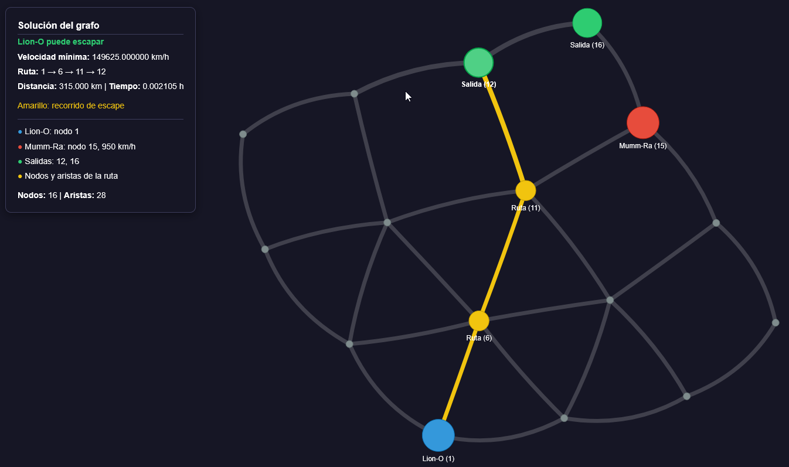


### Caso U12

**Entrada:** `n=16`, `m=27`, `k=3`, `v_M=140`, Lion-O `s=8`, Mumm-Ra `r=8`, salidas `K=[1, 8, 16]`.

**Decisión que observamos:** Identificamos que Lion-O y Mumm-Ra empiezan en el mismo nodo y que ese nodo es una salida. SOLVE entra por la rama de salida, comprueba `s != r`, no asignamos velocidad y el resultado es captura.

**Llamadas:** `MAIN → SOLVE (rama de salida; misma posición)`.

**Vector de Dijkstra:** No se calcula porque el flujo termina antes de llamar a DIJKSTRA.

**Ruta testigo:** Determinamos que no hay una salida segura que Lion-O pueda alcanzar desde el punto ocupado por Mumm-Ra; la captura es inmediata.

**Búsqueda numérica:** no se ejecuta en esta rama.

**Salida del programa final:** `Mumm-Ra captures Lion-O!`

**Imagen del Grafo:**

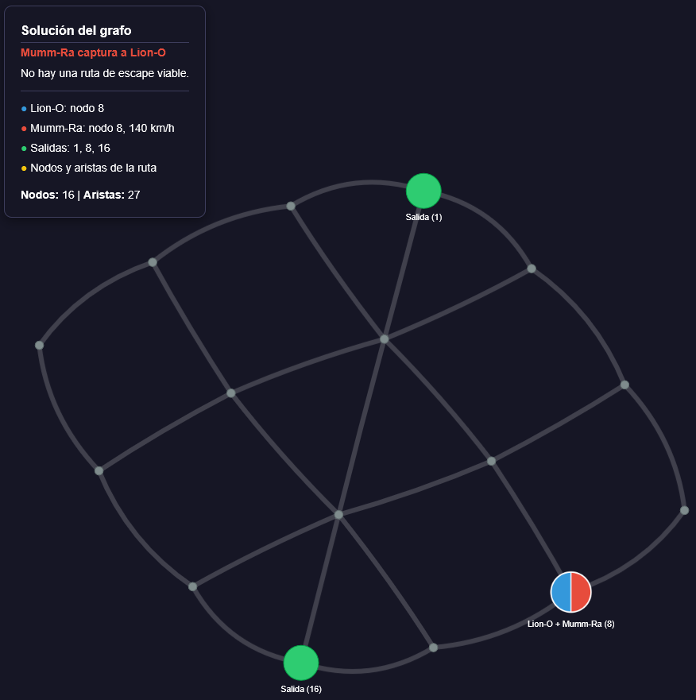


### Caso U13

**Entrada:** `n=18`, `m=28`, `k=3`, `v_M=250`, Lion-O `s=1`, Mumm-Ra `r=12`, salidas `K=[9, 10, 18]`.

**Decisión que observamos:** Observamos que BFS encuentra salida estructural; calculamos D_M con Dijkstra y buscamos la menor cota factible mediante pruebas de velocidad.

**Llamadas:** `MAIN → SOLVE → BFS (sí) → DIJKSTRA (desde nodo 12) → PRUEBA(q) para la cota y la búsqueda binaria`.

**Vector completo $D_M(1,\ldots,n)$:** `[∞, ∞, ∞, ∞, ∞, ∞, ∞, ∞, ∞, ∞, 4, 0, 4, 8, 11, 7, 11, 9]`.

**Ruta testigo ilustrativa:** `1 → 10`.

**Longitudes de los tramos:** `1→10: 7`. Suma recorrida hasta la salida: `L=7`.

| Nodo visitado | $L(x)$ acumulada | $D_M(x)$ | $v_M \cdot L(x)/D_M(x)$ (km/h) |
| ---: | ---: | ---: | ---: |
| 1 | 0 | ∞ | 0 (D=∞) |
| 10 | 7 | ∞ | 0 (D=∞) |

**Lectura de la decisión:** al comparar las razones, concluimos que la mayor es `0` como ínfimo porque Mumm-Ra no alcanza estos nodos. Verificamos que la ruta pasa las comprobaciones para una velocidad apenas superior a ese umbral; nuestro código conserva la cota superior al terminar la búsqueda.

**Búsqueda numérica:** cota superior inicial $U_0=10^{12}$; la primera prueba fue factible, así que no duplicamos la cota ($d=0$). Reducimos el intervalo con $B=64$ iteraciones binarias hasta que su ancho fue como máximo $10^{-7}$. En total hicimos `65` pruebas de velocidad: una para validar la cota y 64 en la búsqueda binaria.

**Salida del programa final:** `Lion-O can escape at a speed of 0.0000001 km/h!`

**Imagen del Grafo:**

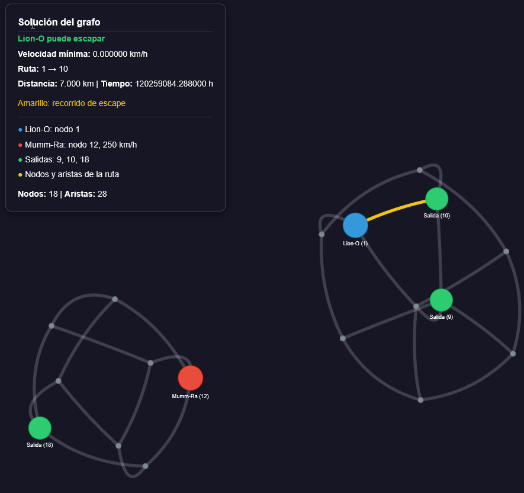


### Caso U14

**Entrada:** `n=18`, `m=27`, `k=4`, `v_M=110`, Lion-O `s=1`, Mumm-Ra `r=9`, salidas `K=[12, 14, 16, 18]`.

**Decisión que observamos:** Observamos que BFS no encuentra una salida alcanzable sin entrar al nodo inicial enemigo; por eso concluimos que hay captura y omitimos el cálculo de distancias y las pruebas de velocidad.

**Llamadas:** `MAIN → SOLVE → BFS (sin salida estructural)`.

**Vector de Dijkstra:** No se calcula porque el flujo termina antes de llamar a DIJKSTRA.

**Ruta testigo:** No encontramos una ruta admisible; BFS descarta el caso antes del análisis de velocidades.

**Búsqueda numérica:** no se ejecuta en esta rama.

**Salida del programa final:** `Mumm-Ra captures Lion-O!`

**Imagen del Grafo:**

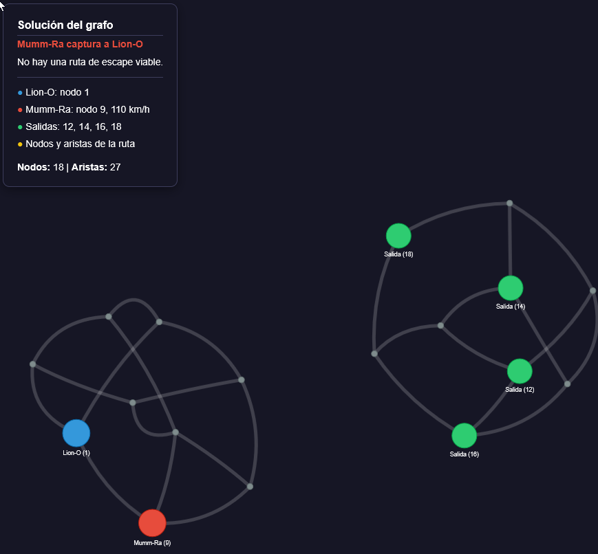


### Caso U15

**Entrada:** `n=20`, `m=34`, `k=4`, `v_M=160`, Lion-O `s=1`, Mumm-Ra `r=14`, salidas `K=[5, 15, 19, 20]`.

**Decisión que observamos:** Observamos que BFS encuentra salida estructural; calculamos D_M con Dijkstra y buscamos la menor cota factible mediante pruebas de velocidad.

**Llamadas:** `MAIN → SOLVE → BFS (sí) → DIJKSTRA (desde nodo 14) → PRUEBA(q) para la cota y la búsqueda binaria`.

**Vector completo $D_M(1,\ldots,n)$:** `[23, 20, 17, 11, 16, 20, 14, 11, 5, 10, 17, 11, 5, 0, 5, 23, 17, 11, 5, 10]`.

**Ruta testigo ilustrativa:** `1 → 2 → 3 → 4 → 5`.

**Longitudes de los tramos:** `1→2: 6; 2→3: 6; 3→4: 6; 4→5: 6`. Suma recorrida hasta la salida: `L=24`.

| Nodo visitado | $L(x)$ acumulada | $D_M(x)$ | $v_M \cdot L(x)/D_M(x)$ (km/h) |
| ---: | ---: | ---: | ---: |
| 1 | 0 | 23 | 0.000000 |
| 2 | 6 | 20 | 48.000000 |
| 3 | 12 | 17 | 112.941176 |
| 4 | 18 | 11 | 261.818182 |
| 5 | 24 | 16 | 240.000000 |

**Lectura de la decisión:** al comparar las razones, concluimos que la mayor es `261.818182 km/h`. Verificamos que la ruta pasa las comprobaciones para una velocidad apenas superior a ese umbral; nuestro código conserva la cota superior al terminar la búsqueda.

**Búsqueda numérica:** cota superior inicial $U_0=10^{12}$; la primera prueba fue factible, así que no duplicamos la cota ($d=0$). Reducimos el intervalo con $B=64$ iteraciones binarias hasta que su ancho fue como máximo $10^{-7}$. En total hicimos `65` pruebas de velocidad: una para validar la cota y 64 en la búsqueda binaria.

**Salida del programa final:** `Lion-O can escape at a speed of 261.8181818 km/h!`

**Imagen del Grafo:**

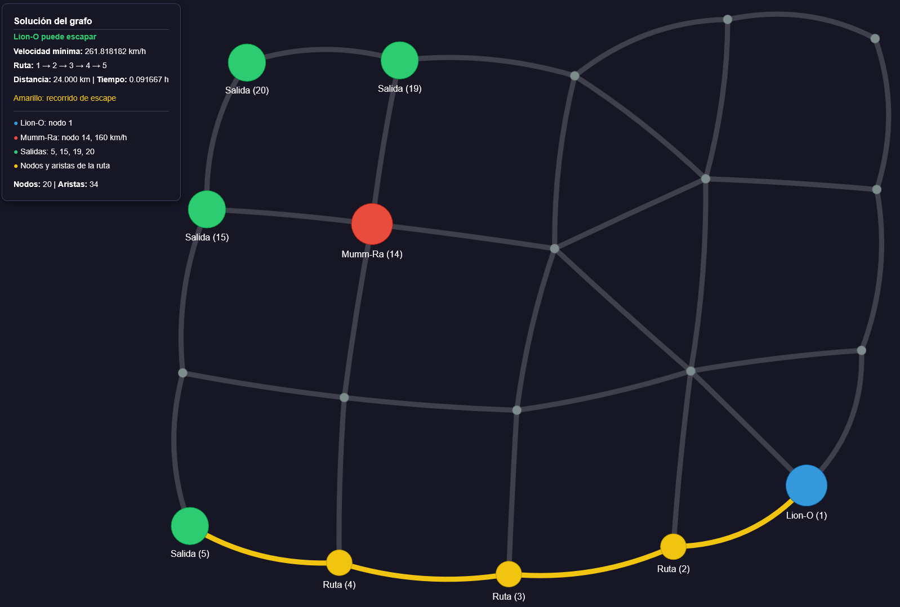


### Caso U16

**Entrada:** `n=20`, `m=35`, `k=3`, `v_M=300`, Lion-O `s=3`, Mumm-Ra `r=18`, salidas `K=[3, 10, 20]`.

**Decisión que observamos:** Vemos que Lion-O ya está en una salida distinta del nodo de Mumm-Ra; por eso SOLVE devuelve $10^{-7}$ sin BFS, Dijkstra ni búsqueda binaria.

**Llamadas:** `MAIN → SOLVE (retorno directo $10^{-7}$)`.

**Vector de Dijkstra:** No se calcula porque el flujo termina antes de llamar a DIJKSTRA.

**Cálculo inmediato:** Lion-O ya está en la salida del nodo `3`, así que la distancia pendiente es `L=0`. Como $s\ne r$, no hay captura al inicio y no se recorre ninguna arista; el solucionador informa velocidad `0.0000001 km/h`. No se necesita calcular una razón crítica ni ejecutar Dijkstra.

**Búsqueda numérica:** no se ejecuta en esta rama.

**Salida del programa final:** `Lion-O can escape at a speed of 0.0000001 km/h!`

**Imagen del Grafo:**

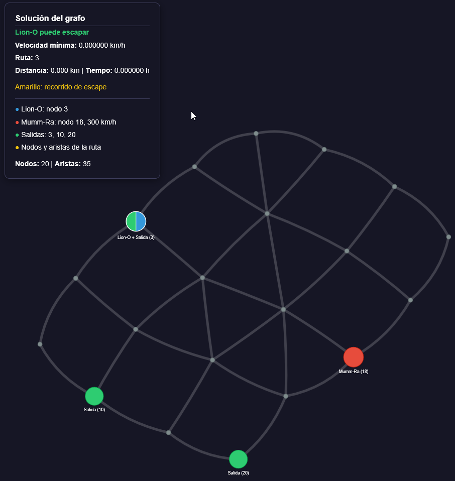


### Caso U17

**Entrada:** `n=25`, `m=44`, `k=2`, `v_M=130`, Lion-O `s=1`, Mumm-Ra `r=13`, salidas `K=[25, 21]`.

**Decisión que observamos:** Observamos que BFS encuentra salida estructural; calculamos D_M con Dijkstra y buscamos la menor cota factible mediante pruebas de velocidad.

**Llamadas:** `MAIN → SOLVE → BFS (sí) → DIJKSTRA (desde nodo 13) → PRUEBA(q) para la cota y la búsqueda binaria`.

**Vector completo $D_M(1,\ldots,n)$:** `[23, 16, 11, 16, 23, 16, 9, 4, 9, 16, 11, 4, 0, 4, 11, 16, 9, 4, 9, 16, 23, 16, 11, 16, 23]`.

**Ruta testigo ilustrativa:** `1 → 21`.

**Longitudes de los tramos:** `1→21: 22`. Suma recorrida hasta la salida: `L=22`.

| Nodo visitado | $L(x)$ acumulada | $D_M(x)$ | $v_M \cdot L(x)/D_M(x)$ (km/h) |
| ---: | ---: | ---: | ---: |
| 1 | 0 | 23 | 0.000000 |
| 21 | 22 | 23 | 124.347826 |

**Lectura de la decisión:** al comparar las razones, concluimos que la mayor es `124.347826 km/h`. Verificamos que la ruta pasa las comprobaciones para una velocidad apenas superior a ese umbral; nuestro código conserva la cota superior al terminar la búsqueda.

**Búsqueda numérica:** cota superior inicial $U_0=10^{12}$; la primera prueba fue factible, así que no duplicamos la cota ($d=0$). Reducimos el intervalo con $B=64$ iteraciones binarias hasta que su ancho fue como máximo $10^{-7}$. En total hicimos `65` pruebas de velocidad: una para validar la cota y 64 en la búsqueda binaria.

**Salida del programa final:** `Lion-O can escape at a speed of 124.3478261 km/h!`

**Imagen del Grafo:**

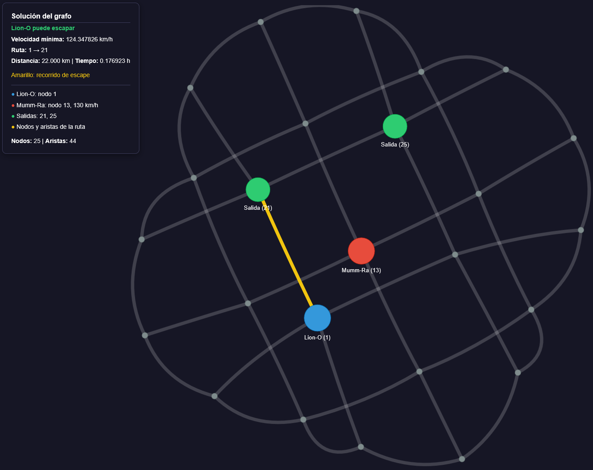


### Caso U18

**Entrada:** `n=28`, `m=47`, `k=3`, `v_M=220`, Lion-O `s=1`, Mumm-Ra `r=15`, salidas `K=[26, 27, 28]`.

**Decisión que observamos:** Observamos que BFS no encuentra una salida alcanzable sin entrar al nodo inicial enemigo; por eso concluimos que hay captura y omitimos el cálculo de distancias y las pruebas de velocidad.

**Llamadas:** `MAIN → SOLVE → BFS (sin salida estructural)`.

**Vector de Dijkstra:** No se calcula porque el flujo termina antes de llamar a DIJKSTRA.

**Ruta testigo:** No encontramos una ruta admisible; BFS descarta el caso antes del análisis de velocidades.

**Búsqueda numérica:** no se ejecuta en esta rama.

**Salida del programa final:** `Mumm-Ra captures Lion-O!`

**Imagen del Grafo:**

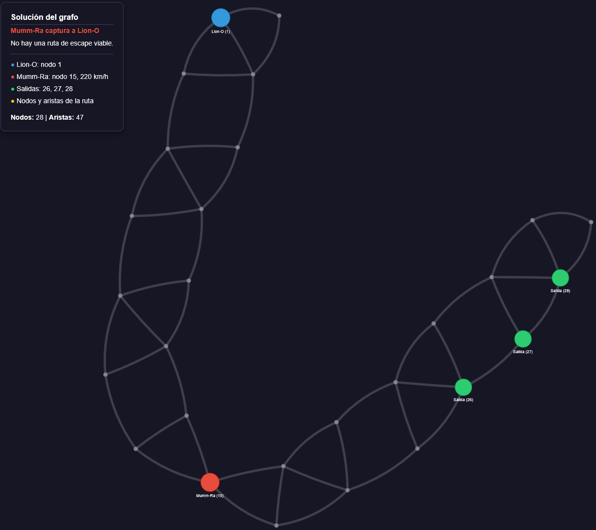


### Caso U19

**Entrada:** `n=30`, `m=53`, `k=2`, `v_M=1200`, Lion-O `s=1`, Mumm-Ra `r=29`, salidas `K=[30, 25]`.

**Decisión que observamos:** Observamos que BFS encuentra salida estructural; calculamos D_M con Dijkstra y buscamos la menor cota factible mediante pruebas de velocidad.

**Llamadas:** `MAIN → SOLVE → BFS (sí) → DIJKSTRA (desde nodo 29) → PRUEBA(q) para la cota y la búsqueda binaria`.

**Vector completo $D_M(1,\ldots,n)$:** `[555, 520, 485, 450, 451, 520, 430, 395, 360, 361, 485, 395, 305, 270, 271, 450, 360, 270, 180, 181, 360, 270, 180, 90, 91, 270, 180, 90, 0, 1]`.

**Ruta testigo ilustrativa:** `1 → 7 → 13 → 19 → 24 → 25`.

**Longitudes de los tramos:** `1→7: 125; 7→13: 125; 13→19: 125; 19→24: 90; 24→25: 1`. Suma recorrida hasta la salida: `L=466`.

| Nodo visitado | $L(x)$ acumulada | $D_M(x)$ | $v_M \cdot L(x)/D_M(x)$ (km/h) |
| ---: | ---: | ---: | ---: |
| 1 | 0 | 555 | 0.000000 |
| 7 | 125 | 430 | 348.837209 |
| 13 | 250 | 305 | 983.606557 |
| 19 | 375 | 180 | 2500.000000 |
| 24 | 465 | 90 | 6200.000000 |
| 25 | 466 | 91 | 6145.054945 |

**Lectura de la decisión:** al comparar las razones, concluimos que la mayor es `6200.000000 km/h`. Verificamos que la ruta pasa las comprobaciones para una velocidad apenas superior a ese umbral; nuestro código conserva la cota superior al terminar la búsqueda.

**Búsqueda numérica:** cota superior inicial $U_0=10^{12}$; la primera prueba fue factible, así que no duplicamos la cota ($d=0$). Reducimos el intervalo con $B=64$ iteraciones binarias hasta que su ancho fue como máximo $10^{-7}$. En total hicimos `65` pruebas de velocidad: una para validar la cota y 64 en la búsqueda binaria.

**Salida del programa final:** `Lion-O can escape at a speed of 6200.0000000 km/h!`

**Imagen del Grafo:**

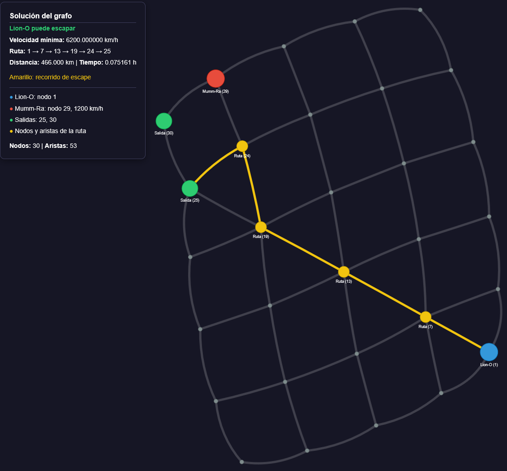


### Caso U20

**Entrada:** `n=35`, `m=62`, `k=4`, `v_M=150`, Lion-O `s=18`, Mumm-Ra `r=18`, salidas `K=[1, 7, 29, 35]`.

**Decisión que observamos:** Identificamos que ambos empiezan en el mismo nodo, que no es salida. SOLVE llama a BFS; BFS detecta `s == r` y devuelve falso sin iniciar la cola.

**Llamadas:** `MAIN → SOLVE → BFS (falso por inicios iguales)`.

**Vector de Dijkstra:** No se calcula porque el flujo termina antes de llamar a DIJKSTRA.

**Ruta testigo:** Determinamos que no hay una salida segura que Lion-O pueda alcanzar desde el punto ocupado por Mumm-Ra; la captura es inmediata.

**Búsqueda numérica:** no se ejecuta en esta rama.

**Salida del programa final:** `Mumm-Ra captures Lion-O!`

**Imagen del Grafo:**

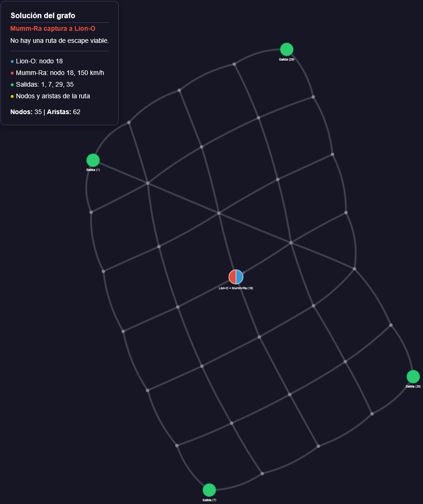


### Caso U21

**Entrada:** `n=36`, `m=60`, `k=4`, `v_M=190`, Lion-O `s=1`, Mumm-Ra `r=15`, salidas `K=[12, 24, 30, 36]`.

**Decisión que observamos:** Observamos que BFS encuentra salida estructural; calculamos D_M con Dijkstra y buscamos la menor cota factible mediante pruebas de velocidad.

**Llamadas:** `MAIN → SOLVE → BFS (sí) → DIJKSTRA (desde nodo 15) → PRUEBA(q) para la cota y la búsqueda binaria`.

**Vector completo $D_M(1,\ldots,n)$:** `[∞, ∞, ∞, ∞, ∞, ∞, ∞, ∞, ∞, ∞, ∞, ∞, 10, 5, 0, 5, 15, 10, 5, 10, 20, 15, 10, 15, ∞, ∞, ∞, ∞, ∞, ∞, ∞, ∞, ∞, ∞, ∞, ∞]`.

**Ruta testigo ilustrativa:** `1 → 6 → 11 → 12`.

**Longitudes de los tramos:** `1→6: 7; 6→11: 7; 11→12: 5`. Suma recorrida hasta la salida: `L=19`.

| Nodo visitado | $L(x)$ acumulada | $D_M(x)$ | $v_M \cdot L(x)/D_M(x)$ (km/h) |
| ---: | ---: | ---: | ---: |
| 1 | 0 | ∞ | 0 (D=∞) |
| 6 | 7 | ∞ | 0 (D=∞) |
| 11 | 14 | ∞ | 0 (D=∞) |
| 12 | 19 | ∞ | 0 (D=∞) |

**Lectura de la decisión:** al comparar las razones, concluimos que la mayor es `0` como ínfimo porque Mumm-Ra no alcanza estos nodos. Verificamos que la ruta pasa las comprobaciones para una velocidad apenas superior a ese umbral; nuestro código conserva la cota superior al terminar la búsqueda.

**Búsqueda numérica:** cota superior inicial $U_0=10^{12}$; la primera prueba fue factible, así que no duplicamos la cota ($d=0$). Reducimos el intervalo con $B=64$ iteraciones binarias hasta que su ancho fue como máximo $10^{-7}$. En total hicimos `65` pruebas de velocidad: una para validar la cota y 64 en la búsqueda binaria.

**Salida del programa final:** `Lion-O can escape at a speed of 0.0000001 km/h!`

**Imagen del Grafo:**

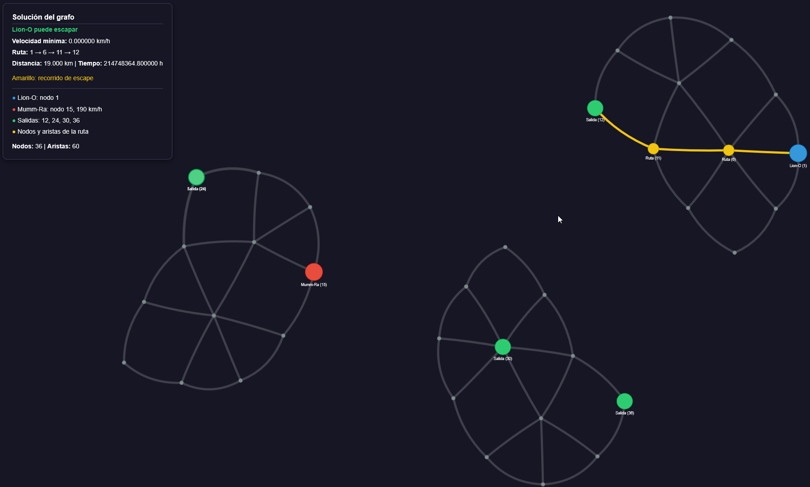


### Caso U22

**Entrada:** `n=40`, `m=68`, `k=4`, `v_M=175`, Lion-O `s=1`, Mumm-Ra `r=20`, salidas `K=[25, 30, 35, 40]`.

**Decisión que observamos:** Observamos que BFS no encuentra una salida alcanzable sin entrar al nodo inicial enemigo; por eso concluimos que hay captura y omitimos el cálculo de distancias y las pruebas de velocidad.

**Llamadas:** `MAIN → SOLVE → BFS (sin salida estructural)`.

**Vector de Dijkstra:** No se calcula porque el flujo termina antes de llamar a DIJKSTRA.

**Ruta testigo:** No encontramos una ruta admisible; BFS descarta el caso antes del análisis de velocidades.

**Búsqueda numérica:** no se ejecuta en esta rama.

**Salida del programa final:** `Mumm-Ra captures Lion-O!`

**Imagen del Grafo:**

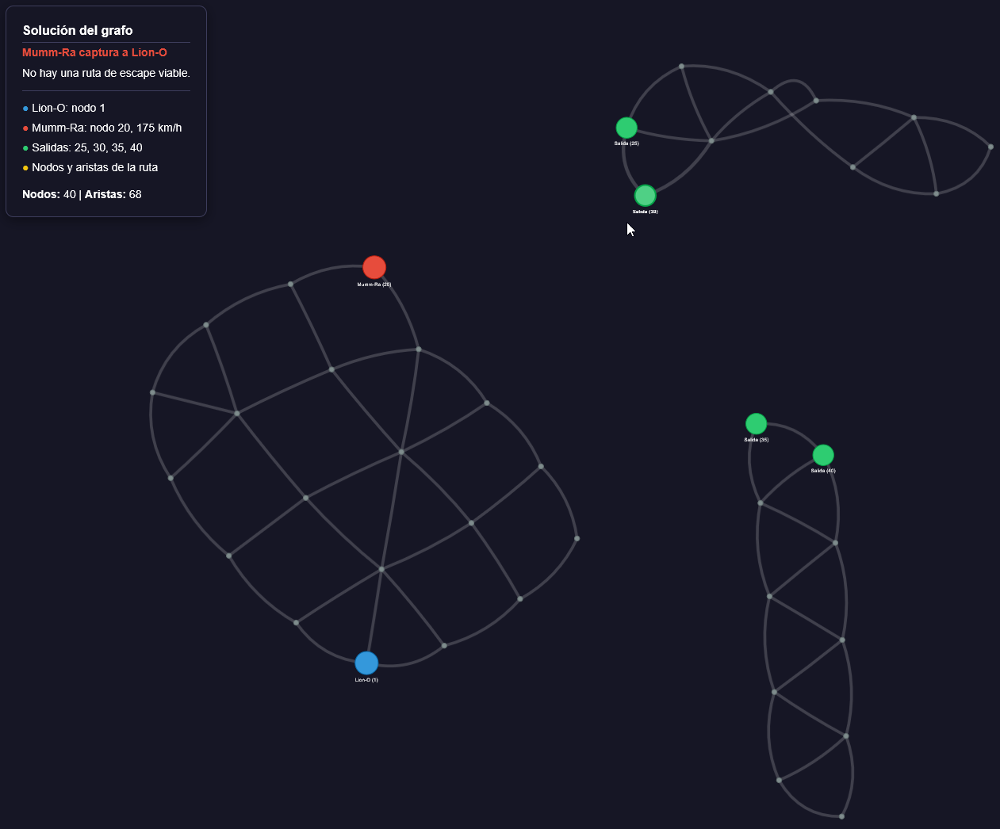


### Caso U23

**Entrada:** `n=48`, `m=86`, `k=5`, `v_M=140`, Lion-O `s=1`, Mumm-Ra `r=28`, salidas `K=[8, 24, 40, 45, 48]`.

**Decisión que observamos:** Observamos que BFS encuentra salida estructural; calculamos D_M con Dijkstra y buscamos la menor cota factible mediante pruebas de velocidad.

**Llamadas:** `MAIN → SOLVE → BFS (sí) → DIJKSTRA (desde nodo 28) → PRUEBA(q) para la cota y la búsqueda binaria`.

**Vector completo $D_M(1,\ldots,n)$:** `[38, 31, 24, 17, 22, 29, 36, 43, 31, 24, 17, 10, 15, 22, 29, 36, 25, 18, 11, 5, 10, 16, 23, 30, 18, 11, 5, 0, 5, 11, 18, 25, 23, 16, 10, 5, 10, 16, 23, 30, 30, 23, 17, 12, 17, 23, 30, 37]`.

**Ruta testigo ilustrativa:** `1 → 8`.

**Longitudes de los tramos:** `1→8: 40`. Suma recorrida hasta la salida: `L=40`.

| Nodo visitado | $L(x)$ acumulada | $D_M(x)$ | $v_M \cdot L(x)/D_M(x)$ (km/h) |
| ---: | ---: | ---: | ---: |
| 1 | 0 | 38 | 0.000000 |
| 8 | 40 | 43 | 130.232558 |

**Lectura de la decisión:** al comparar las razones, concluimos que la mayor es `130.232558 km/h`. Verificamos que la ruta pasa las comprobaciones para una velocidad apenas superior a ese umbral; nuestro código conserva la cota superior al terminar la búsqueda.

**Búsqueda numérica:** cota superior inicial $U_0=10^{12}$; la primera prueba fue factible, así que no duplicamos la cota ($d=0$). Reducimos el intervalo con $B=64$ iteraciones binarias hasta que su ancho fue como máximo $10^{-7}$. En total hicimos `65` pruebas de velocidad: una para validar la cota y 64 en la búsqueda binaria.

**Salida del programa final:** `Lion-O can escape at a speed of 130.2325582 km/h!`

**Imagen del Grafo:**

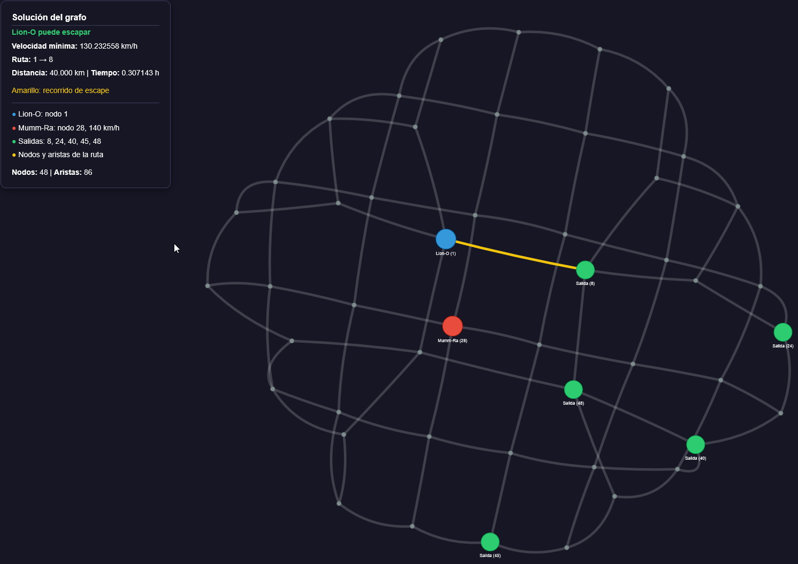


### Caso U24

**Entrada:** `n=50`, `m=90`, `k=4`, `v_M=250`, Lion-O `s=10`, Mumm-Ra `r=41`, salidas `K=[10, 20, 30, 50]`.

**Decisión que observamos:** Vemos que Lion-O ya está en una salida distinta del nodo de Mumm-Ra; por eso SOLVE devuelve $10^{-7}$ sin BFS, Dijkstra ni búsqueda binaria.

**Llamadas:** `MAIN → SOLVE (retorno directo $10^{-7}$)`.

**Vector de Dijkstra:** No se calcula porque el flujo termina antes de llamar a DIJKSTRA.

**Cálculo inmediato:** Lion-O ya está en la salida del nodo `10`, así que la distancia pendiente es `L=0`. Como $s\ne r$, no hay captura al inicio y no se recorre ninguna arista; el solucionador informa velocidad `0.0000001 km/h`. No se necesita calcular una razón crítica ni ejecutar Dijkstra.

**Búsqueda numérica:** no se ejecuta en esta rama.

**Salida del programa final:** `Lion-O can escape at a speed of 0.0000001 km/h!`

**Imagen del Grafo:**

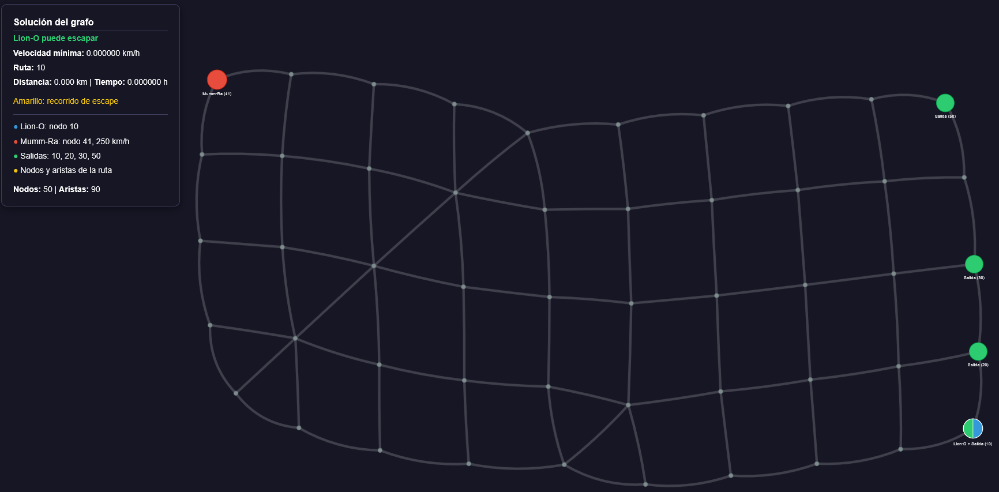


### Caso U25

**Entrada:** `n=60`, `m=97`, `k=4`, `v_M=60`, Lion-O `s=1`, Mumm-Ra `r=20`, salidas `K=[27, 38, 42, 52]`.

**Decisión que observamos:** Observamos que BFS encuentra salida estructural; calculamos D_M con Dijkstra y buscamos la menor cota factible mediante pruebas de velocidad.

**Llamadas:** `MAIN → SOLVE → BFS (sí) → DIJKSTRA (desde nodo 20) → PRUEBA(q) para la cota y la búsqueda binaria`.

**Vector completo $D_M(1,\ldots,n)$:** `[32, 29, 23, 31, 39, 38, 28, 25, 20, 12, 20, 26, 19, 29, 22, 6, 14, 15, 8, 0, 7, 12, 16, 14, 10, 6, 12, 16, 37, 42, 47, 51, 57, 60, 58, 65, 65, 58, 66, 75, 72, 69, 36, 30, 36, 26, 18, 28, 37, 40, 30, 40, 43, 48, 54, 64, 68, 31, 39, 45]`.

**Ruta testigo ilustrativa:** `1 → 11 → 44 → 48 → 52`.

**Longitudes de los tramos:** `1→11: 12; 11→44: 10; 44→48: 15; 48→52: 15`. Suma recorrida hasta la salida: `L=52`.

| Nodo visitado | $L(x)$ acumulada | $D_M(x)$ | $v_M \cdot L(x)/D_M(x)$ (km/h) |
| ---: | ---: | ---: | ---: |
| 1 | 0 | 32 | 0.000000 |
| 11 | 12 | 20 | 36.000000 |
| 44 | 22 | 30 | 44.000000 |
| 48 | 37 | 28 | 79.285714 |
| 52 | 52 | 40 | 78.000000 |

**Lectura de la decisión:** al comparar las razones, concluimos que la mayor es `79.285714 km/h`. Verificamos que la ruta pasa las comprobaciones para una velocidad apenas superior a ese umbral; nuestro código conserva la cota superior al terminar la búsqueda.

**Búsqueda numérica:** cota superior inicial $U_0=10^{12}$; la primera prueba fue factible, así que no duplicamos la cota ($d=0$). Reducimos el intervalo con $B=64$ iteraciones binarias hasta que su ancho fue como máximo $10^{-7}$. En total hicimos `65` pruebas de velocidad: una para validar la cota y 64 en la búsqueda binaria.

**Salida del programa final:** `Lion-O can escape at a speed of 79.2857143 km/h!`

**Imagen del Grafo:**

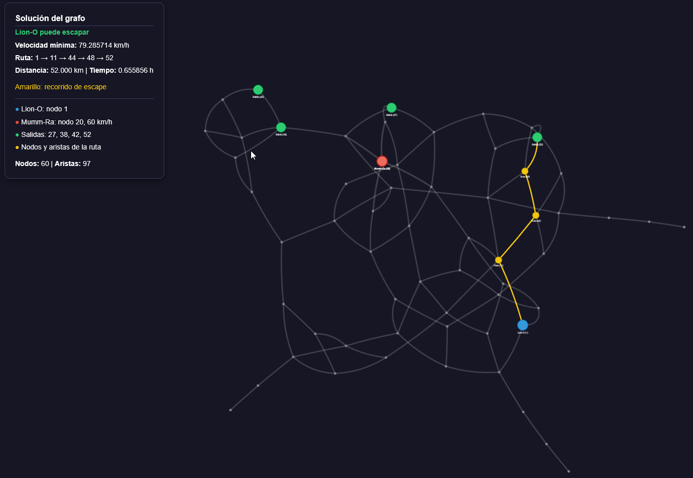


### Caso U26

**Entrada:** `n=61`, `m=108`, `k=4`, `v_M=200`, Lion-O `s=1`, Mumm-Ra `r=31`, salidas `K=[55, 58, 60, 61]`.

**Decisión que observamos:** Observamos que BFS no encuentra una salida alcanzable sin entrar al nodo inicial enemigo; por eso concluimos que hay captura y omitimos el cálculo de distancias y las pruebas de velocidad.

**Llamadas:** `MAIN → SOLVE → BFS (sin salida estructural)`.

**Vector de Dijkstra:** No se calcula porque el flujo termina antes de llamar a DIJKSTRA.

**Ruta testigo:** No encontramos una ruta admisible; BFS descarta el caso antes del análisis de velocidades.

**Búsqueda numérica:** no se ejecuta en esta rama.

**Salida del programa final:** `Mumm-Ra captures Lion-O!`

**Imagen del Grafo:**

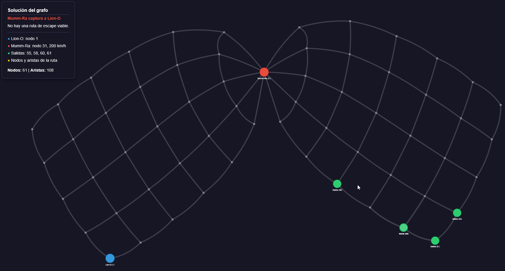


### Caso U27

**Entrada:** `n=70`, `m=128`, `k=3`, `v_M=1500`, Lion-O `s=1`, Mumm-Ra `r=69`, salidas `K=[70, 60, 50]`.

**Decisión que observamos:** Observamos que BFS encuentra salida estructural; calculamos D_M con Dijkstra y buscamos la menor cota factible mediante pruebas de velocidad.

**Llamadas:** `MAIN → SOLVE → BFS (sí) → DIJKSTRA (desde nodo 69) → PRUEBA(q) para la cota y la búsqueda binaria`.

**Vector completo $D_M(1,\ldots,n)$:** `[1001, 961, 921, 881, 841, 801, 701, 601, 501, 502, 961, 861, 821, 781, 741, 701, 601, 501, 401, 402, 921, 821, 721, 681, 641, 601, 501, 401, 301, 302, 881, 781, 681, 581, 541, 501, 401, 301, 201, 202, 841, 741, 641, 541, 441, 401, 301, 201, 101, 102, 801, 701, 601, 501, 401, 301, 201, 101, 1, 2, 800, 700, 600, 500, 400, 300, 200, 100, 0, 1]`.

**Ruta testigo ilustrativa:** `1 → 12 → 23 → 34 → 45 → 46 → 47 → 48 → 49 → 50`.

**Longitudes de los tramos:** `1→12: 140; 12→23: 140; 23→34: 140; 34→45: 140; 45→46: 100; 46→47: 100; 47→48: 100; 48→49: 100; 49→50: 100`. Suma recorrida hasta la salida: `L=1060`.

| Nodo visitado | $L(x)$ acumulada | $D_M(x)$ | $v_M \cdot L(x)/D_M(x)$ (km/h) |
| ---: | ---: | ---: | ---: |
| 1 | 0 | 1001 | 0.000000 |
| 12 | 140 | 861 | 243.902439 |
| 23 | 280 | 721 | 582.524272 |
| 34 | 420 | 581 | 1084.337349 |
| 45 | 560 | 441 | 1904.761905 |
| 46 | 660 | 401 | 2468.827930 |
| 47 | 760 | 301 | 3787.375415 |
| 48 | 860 | 201 | 6417.910448 |
| 49 | 960 | 101 | 14257.425743 |
| 50 | 1060 | 102 | 15588.235294 |

**Lectura de la decisión:** al comparar las razones, concluimos que la mayor es `15588.235294 km/h`. Verificamos que la ruta pasa las comprobaciones para una velocidad apenas superior a ese umbral; nuestro código conserva la cota superior al terminar la búsqueda.

**Búsqueda numérica:** cota superior inicial $U_0=10^{12}$; la primera prueba fue factible, así que no duplicamos la cota ($d=0$). Reducimos el intervalo con $B=64$ iteraciones binarias hasta que su ancho fue como máximo $10^{-7}$. En total hicimos `65` pruebas de velocidad: una para validar la cota y 64 en la búsqueda binaria.

**Salida del programa final:** `Lion-O can escape at a speed of 15588.2352942 km/h!`

**Imagen del Grafo:**

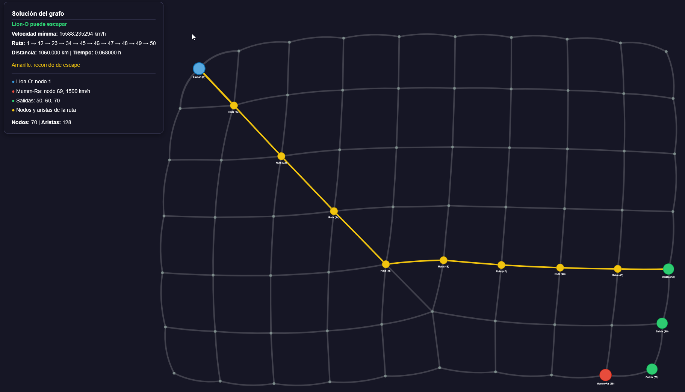


### Caso U28

**Entrada:** `n=80`, `m=148`, `k=5`, `v_M=180`, Lion-O `s=45`, Mumm-Ra `r=45`, salidas `K=[1, 10, 45, 71, 80]`.

**Decisión que observamos:** Identificamos que Lion-O y Mumm-Ra empiezan en el mismo nodo y que ese nodo es una salida. SOLVE entra por la rama de salida, comprueba `s != r`, no asignamos velocidad y el resultado es captura.

**Llamadas:** `MAIN → SOLVE (rama de salida; misma posición)`.

**Vector de Dijkstra:** No se calcula porque el flujo termina antes de llamar a DIJKSTRA.

**Ruta testigo:** Determinamos que no hay una salida segura que Lion-O pueda alcanzar desde el punto ocupado por Mumm-Ra; la captura es inmediata.

**Búsqueda numérica:** no se ejecuta en esta rama.

**Salida del programa final:** `Mumm-Ra captures Lion-O!`

**Imagen del Grafo:**

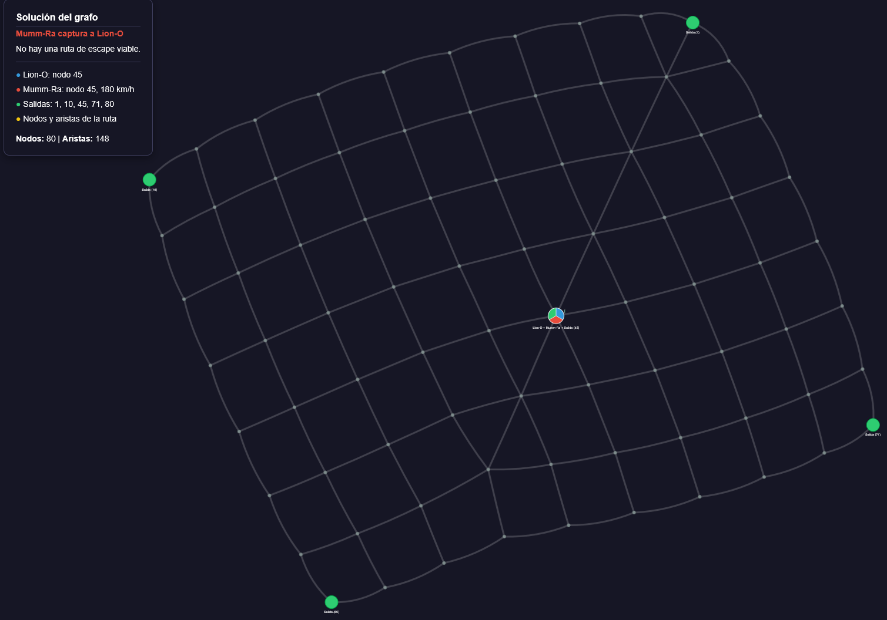


### Caso U29

**Entrada:** `n=84`, `m=147`, `k=5`, `v_M=210`, Lion-O `s=1`, Mumm-Ra `r=35`, salidas `K=[28, 50, 56, 75, 84]`.

**Decisión que observamos:** Observamos que BFS encuentra salida estructural; calculamos D_M con Dijkstra y buscamos la menor cota factible mediante pruebas de velocidad.

**Llamadas:** `MAIN → SOLVE → BFS (sí) → DIJKSTRA (desde nodo 35) → PRUEBA(q) para la cota y la búsqueda binaria`.

**Vector completo $D_M(1,\ldots,n)$:** `[∞, ∞, ∞, ∞, ∞, ∞, ∞, ∞, ∞, ∞, ∞, ∞, ∞, ∞, ∞, ∞, ∞, ∞, ∞, ∞, ∞, ∞, ∞, ∞, ∞, ∞, ∞, ∞, 36, 30, 24, 18, 12, 6, 0, 38, 32, 26, 20, 14, 8, 6, 44, 38, 32, 26, 20, 14, 12, 50, 44, 38, 32, 26, 20, 18, ∞, ∞, ∞, ∞, ∞, ∞, ∞, ∞, ∞, ∞, ∞, ∞, ∞, ∞, ∞, ∞, ∞, ∞, ∞, ∞, ∞, ∞, ∞, ∞, ∞, ∞, ∞, ∞]`.

**Ruta testigo ilustrativa:** `1 → 9 → 17 → 25 → 26 → 27 → 28`.

**Longitudes de los tramos:** `1→9: 8; 9→17: 8; 17→25: 8; 25→26: 6; 26→27: 6; 27→28: 6`. Suma recorrida hasta la salida: `L=42`.

| Nodo visitado | $L(x)$ acumulada | $D_M(x)$ | $v_M \cdot L(x)/D_M(x)$ (km/h) |
| ---: | ---: | ---: | ---: |
| 1 | 0 | ∞ | 0 (D=∞) |
| 9 | 8 | ∞ | 0 (D=∞) |
| 17 | 16 | ∞ | 0 (D=∞) |
| 25 | 24 | ∞ | 0 (D=∞) |
| 26 | 30 | ∞ | 0 (D=∞) |
| 27 | 36 | ∞ | 0 (D=∞) |
| 28 | 42 | ∞ | 0 (D=∞) |

**Lectura de la decisión:** al comparar las razones, concluimos que la mayor es `0` como ínfimo porque Mumm-Ra no alcanza estos nodos. Verificamos que la ruta pasa las comprobaciones para una velocidad apenas superior a ese umbral; nuestro código conserva la cota superior al terminar la búsqueda.

**Búsqueda numérica:** cota superior inicial $U_0=10^{12}$; la primera prueba fue factible, así que no duplicamos la cota ($d=0$). Reducimos el intervalo con $B=64$ iteraciones binarias hasta que su ancho fue como máximo $10^{-7}$. En total hicimos `65` pruebas de velocidad: una para validar la cota y 64 en la búsqueda binaria.

**Salida del programa final:** `Lion-O can escape at a speed of 0.0000001 km/h!`

**Imagen del Grafo:**

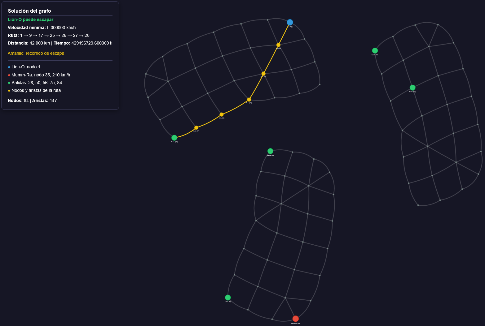


### Caso U30

**Entrada:** `n=90`, `m=159`, `k=6`, `v_M=165`, Lion-O `s=1`, Mumm-Ra `r=30`, salidas `K=[35, 45, 60, 70, 80, 90]`.

**Decisión que observamos:** Observamos que BFS no encuentra una salida alcanzable sin entrar al nodo inicial enemigo; por eso concluimos que hay captura y omitimos el cálculo de distancias y las pruebas de velocidad.

**Llamadas:** `MAIN → SOLVE → BFS (sin salida estructural)`.

**Vector de Dijkstra:** No se calcula porque el flujo termina antes de llamar a DIJKSTRA.

**Ruta testigo:** No encontramos una ruta admisible; BFS descarta el caso antes del análisis de velocidades.

**Búsqueda numérica:** no se ejecuta en esta rama.

**Salida del programa final:** `Mumm-Ra captures Lion-O!`

**Imagen del Grafo:**

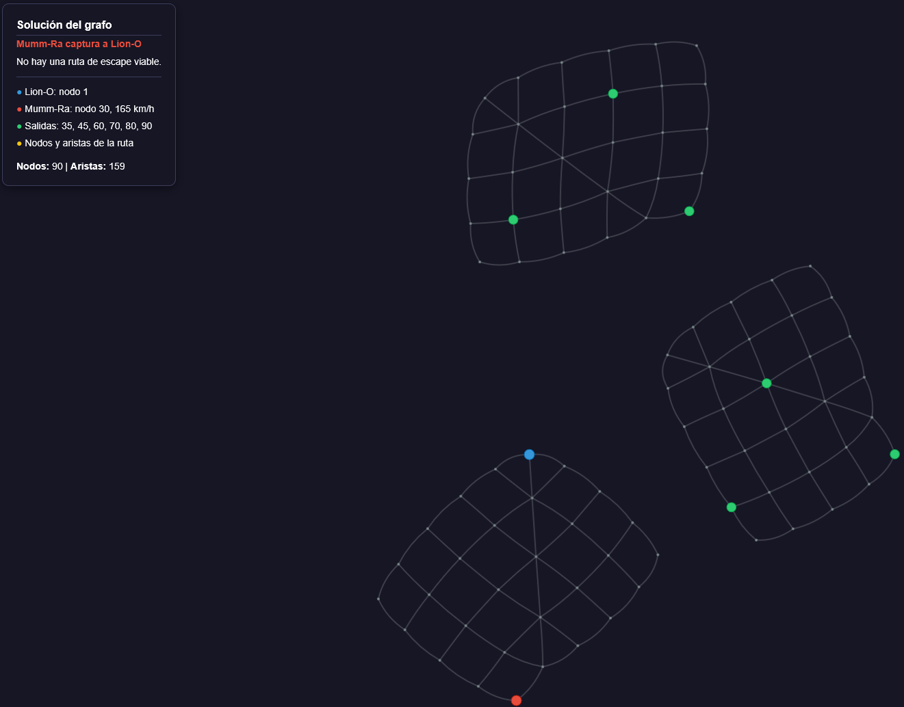


### Caso U31

**Entrada:** `n=96`, `m=178`, `k=6`, `v_M=145`, Lion-O `s=1`, Mumm-Ra `r=54`, salidas `K=[12, 48, 60, 84, 90, 96]`.

**Decisión que observamos:** Observamos que BFS encuentra salida estructural; calculamos D_M con Dijkstra y buscamos la menor cota factible mediante pruebas de velocidad.

**Llamadas:** `MAIN → SOLVE → BFS (sí) → DIJKSTRA (desde nodo 54) → PRUEBA(q) para la cota y la búsqueda binaria`.

**Vector completo $D_M(1,\ldots,n)$:** `[47, 39, 44, 36, 29, 23, 29, 36, 44, 52, 60, 68, 52, 44, 36, 28, 21, 15, 21, 28, 36, 44, 52, 60, 44, 36, 28, 21, 14, 9, 14, 21, 28, 36, 44, 52, 38, 30, 22, 15, 9, 4, 9, 15, 22, 30, 38, 46, 32, 24, 16, 9, 4, 0, 4, 9, 16, 24, 32, 40, 38, 30, 22, 15, 9, 4, 9, 15, 22, 30, 38, 46, 46, 38, 30, 22, 16, 10, 16, 22, 30, 38, 46, 54, 54, 46, 38, 30, 24, 18, 24, 30, 38, 46, 41, 49]`.

**Ruta testigo ilustrativa:** `1 → 12`.

**Longitudes de los tramos:** `1→12: 65`. Suma recorrida hasta la salida: `L=65`.

| Nodo visitado | $L(x)$ acumulada | $D_M(x)$ | $v_M \cdot L(x)/D_M(x)$ (km/h) |
| ---: | ---: | ---: | ---: |
| 1 | 0 | 47 | 0.000000 |
| 12 | 65 | 68 | 138.602941 |

**Lectura de la decisión:** al comparar las razones, concluimos que la mayor es `138.602941 km/h`. Verificamos que la ruta pasa las comprobaciones para una velocidad apenas superior a ese umbral; nuestro código conserva la cota superior al terminar la búsqueda.

**Búsqueda numérica:** cota superior inicial $U_0=10^{12}$; la primera prueba fue factible, así que no duplicamos la cota ($d=0$). Reducimos el intervalo con $B=64$ iteraciones binarias hasta que su ancho fue como máximo $10^{-7}$. En total hicimos `65` pruebas de velocidad: una para validar la cota y 64 en la búsqueda binaria.

**Salida del programa final:** `Lion-O can escape at a speed of 138.6029412 km/h!`

**Imagen del Grafo:**

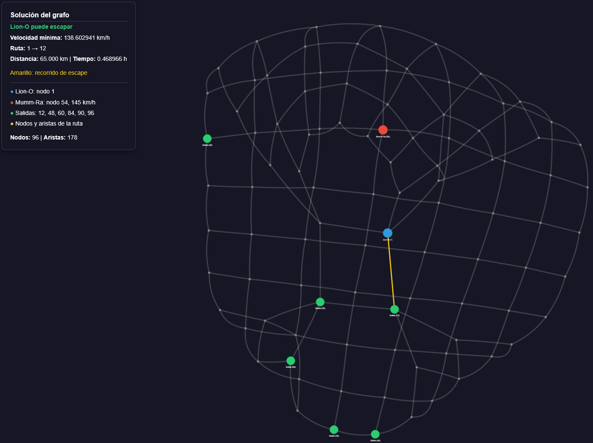


### Caso U32

**Entrada:** `n=100`, `m=188`, `k=5`, `v_M=300`, Lion-O `s=50`, Mumm-Ra `r=51`, salidas `K=[1, 10, 50, 91, 100]`.

**Decisión que observamos:** Vemos que Lion-O ya está en una salida distinta del nodo de Mumm-Ra; por eso SOLVE devuelve $10^{-7}$ sin BFS, Dijkstra ni búsqueda binaria.

**Llamadas:** `MAIN → SOLVE (retorno directo $10^{-7}$)`.

**Vector de Dijkstra:** No se calcula porque el flujo termina antes de llamar a DIJKSTRA.

**Cálculo inmediato:** Lion-O ya está en la salida del nodo `50`, así que la distancia pendiente es `L=0`. Como $s\ne r$, no hay captura al inicio y no se recorre ninguna arista; el solucionador informa velocidad `0.0000001 km/h`. No se necesita calcular una razón crítica ni ejecutar Dijkstra.

**Búsqueda numérica:** no se ejecuta en esta rama.

**Salida del programa final:** `Lion-O can escape at a speed of 0.0000001 km/h!`

**Imagen del Grafo:**

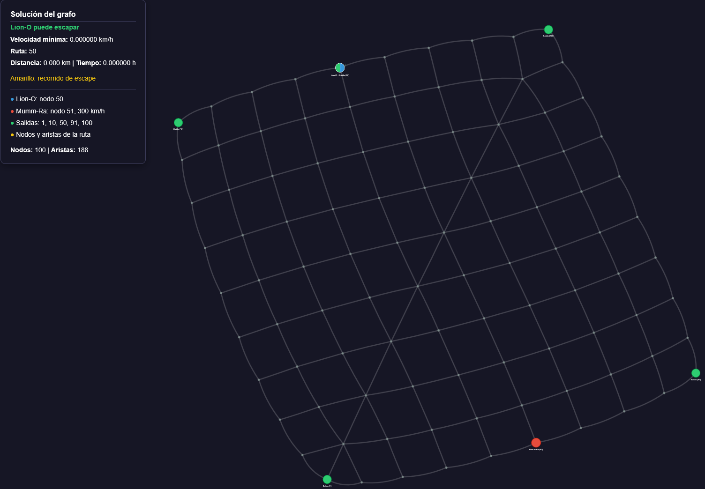


### Caso U33

**Entrada:** `n=105`, `m=194`, `k=4`, `v_M=135`, Lion-O `s=1`, Mumm-Ra `r=53`, salidas `K=[15, 90, 100, 105]`.

**Decisión que observamos:** Observamos que BFS encuentra salida estructural; calculamos D_M con Dijkstra y buscamos la menor cota factible mediante pruebas de velocidad.

**Llamadas:** `MAIN → SOLVE → BFS (sí) → DIJKSTRA (desde nodo 53) → PRUEBA(q) para la cota y la búsqueda binaria`.

**Vector completo $D_M(1,\ldots,n)$:** `[60, 52, 49, 41, 33, 26, 20, 15, 20, 26, 33, 41, 49, 57, 65, 57, 49, 41, 33, 25, 18, 12, 7, 12, 18, 25, 33, 41, 49, 57, 49, 41, 33, 25, 18, 12, 7, 3, 7, 12, 18, 25, 33, 41, 49, 43, 35, 27, 19, 12, 7, 3, 0, 3, 7, 12, 19, 27, 35, 43, 49, 41, 33, 25, 18, 12, 7, 3, 7, 12, 18, 25, 33, 41, 49, 57, 49, 41, 33, 25, 18, 12, 7, 12, 18, 25, 33, 41, 49, 57, 65, 57, 49, 41, 33, 26, 20, 15, 20, 26, 33, 41, 49, 57, 65]`.

**Ruta testigo ilustrativa:** `1 → 15`.

**Longitudes de los tramos:** `1→15: 80`. Suma recorrida hasta la salida: `L=80`.

| Nodo visitado | $L(x)$ acumulada | $D_M(x)$ | $v_M \cdot L(x)/D_M(x)$ (km/h) |
| ---: | ---: | ---: | ---: |
| 1 | 0 | 60 | 0.000000 |
| 15 | 80 | 65 | 166.153846 |

**Lectura de la decisión:** al comparar las razones, concluimos que la mayor es `166.153846 km/h`. Verificamos que la ruta pasa las comprobaciones para una velocidad apenas superior a ese umbral; nuestro código conserva la cota superior al terminar la búsqueda.

**Búsqueda numérica:** cota superior inicial $U_0=10^{12}$; la primera prueba fue factible, así que no duplicamos la cota ($d=0$). Reducimos el intervalo con $B=64$ iteraciones binarias hasta que su ancho fue como máximo $10^{-7}$. En total hicimos `65` pruebas de velocidad: una para validar la cota y 64 en la búsqueda binaria.

**Salida del programa final:** `Lion-O can escape at a speed of 166.1538462 km/h!`

**Imagen del Grafo:**

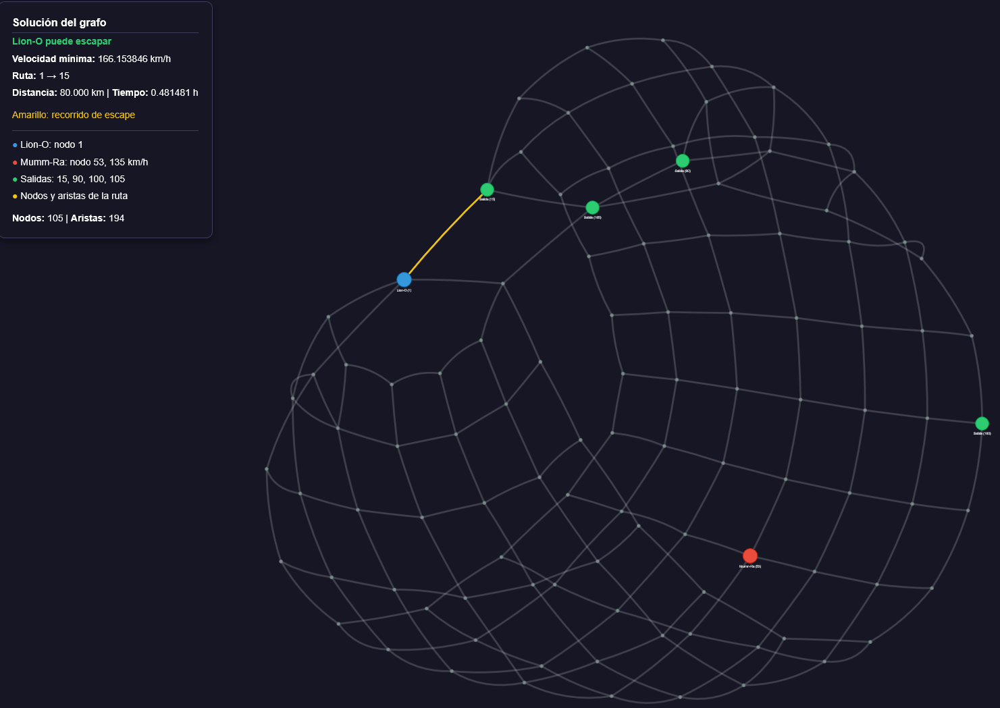


### Caso U34

**Entrada:** `n=113`, `m=204`, `k=5`, `v_M=240`, Lion-O `s=1`, Mumm-Ra `r=57`, salidas `K=[100, 105, 110, 112, 113]`.

**Decisión que observamos:** Observamos que BFS no encuentra una salida alcanzable sin entrar al nodo inicial enemigo; por eso concluimos que hay captura y omitimos el cálculo de distancias y las pruebas de velocidad.

**Llamadas:** `MAIN → SOLVE → BFS (sin salida estructural)`.

**Vector de Dijkstra:** No se calcula porque el flujo termina antes de llamar a DIJKSTRA.

**Ruta testigo:** No encontramos una ruta admisible; BFS descarta el caso antes del análisis de velocidades.

**Búsqueda numérica:** no se ejecuta en esta rama.

**Salida del programa final:** `Mumm-Ra captures Lion-O!`

**Imagen del Grafo:**

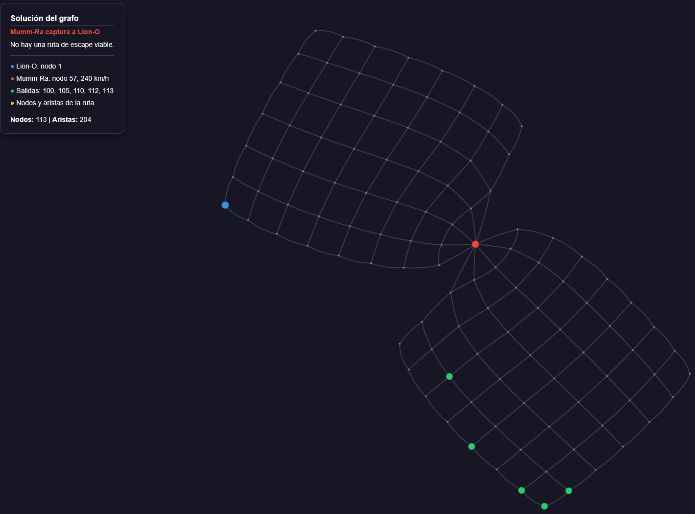


### Caso U35

**Entrada:** `n=120`, `m=225`, `k=3`, `v_M=2000`, Lion-O `s=1`, Mumm-Ra `r=119`, salidas `K=[120, 105, 90]`.

**Decisión que observamos:** Observamos que BFS encuentra salida estructural; calculamos D_M con Dijkstra y buscamos la menor cota factible mediante pruebas de velocidad.

**Llamadas:** `MAIN → SOLVE → BFS (sí) → DIJKSTRA (desde nodo 119) → PRUEBA(q) para la cota y la búsqueda binaria`.

**Vector completo $D_M(1,\ldots,n)$:** `[1502, 1462, 1422, 1382, 1342, 1302, 1202, 1102, 1002, 902, 802, 702, 602, 502, 540, 1462, 1362, 1322, 1282, 1242, 1202, 1102, 1002, 902, 802, 702, 602, 502, 402, 440, 1422, 1322, 1222, 1182, 1142, 1102, 1002, 902, 802, 702, 602, 502, 402, 302, 340, 1382, 1282, 1182, 1082, 1042, 1002, 902, 802, 702, 602, 502, 402, 302, 202, 240, 1342, 1242, 1142, 1042, 942, 902, 802, 702, 602, 502, 402, 302, 202, 102, 140, 1302, 1202, 1102, 1002, 902, 802, 702, 602, 502, 402, 302, 202, 102, 2, 102, 1301, 1201, 1101, 1001, 901, 801, 701, 601, 501, 401, 301, 201, 101, 1, 2, 1300, 1200, 1100, 1000, 900, 800, 700, 600, 500, 400, 300, 200, 100, 0, 1]`.

**Ruta testigo ilustrativa:** `1 → 17 → 33 → 49 → 65 → 66 → 67 → 68 → 69 → 70 → 71 → 72 → 73 → 74 → 75 → 90`.

**Longitudes de los tramos:** `1→17: 140; 17→33: 140; 33→49: 140; 49→65: 140; 65→66: 100; 66→67: 100; 67→68: 100; 68→69: 100; 69→70: 100; 70→71: 100; 71→72: 100; 72→73: 100; 73→74: 100; 74→75: 100; 75→90: 100`. Suma recorrida hasta la salida: `L=1660`.

| Nodo visitado | $L(x)$ acumulada | $D_M(x)$ | $v_M \cdot L(x)/D_M(x)$ (km/h) |
| ---: | ---: | ---: | ---: |
| 1 | 0 | 1502 | 0.000000 |
| 17 | 140 | 1362 | 205.580029 |
| 33 | 280 | 1222 | 458.265139 |
| 49 | 420 | 1082 | 776.340111 |
| 65 | 560 | 942 | 1188.959660 |
| 66 | 660 | 902 | 1463.414634 |
| 67 | 760 | 802 | 1895.261845 |
| 68 | 860 | 702 | 2450.142450 |
| 69 | 960 | 602 | 3189.368771 |
| 70 | 1060 | 502 | 4223.107570 |
| 71 | 1160 | 402 | 5771.144279 |
| 72 | 1260 | 302 | 8344.370861 |
| 73 | 1360 | 202 | 13465.346535 |
| 74 | 1460 | 102 | 28627.450980 |
| 75 | 1560 | 140 | 22285.714286 |
| 90 | 1660 | 102 | 32549.019608 |

**Lectura de la decisión:** al comparar las razones, concluimos que la mayor es `32549.019608 km/h`. Verificamos que la ruta pasa las comprobaciones para una velocidad apenas superior a ese umbral; nuestro código conserva la cota superior al terminar la búsqueda.

**Búsqueda numérica:** cota superior inicial $U_0=10^{12}$; la primera prueba fue factible, así que no duplicamos la cota ($d=0$). Reducimos el intervalo con $B=64$ iteraciones binarias hasta que su ancho fue como máximo $10^{-7}$. En total hicimos `65` pruebas de velocidad: una para validar la cota y 64 en la búsqueda binaria.

**Salida del programa final:** `Lion-O can escape at a speed of 32549.0196079 km/h!`

**Imagen del Grafo:**

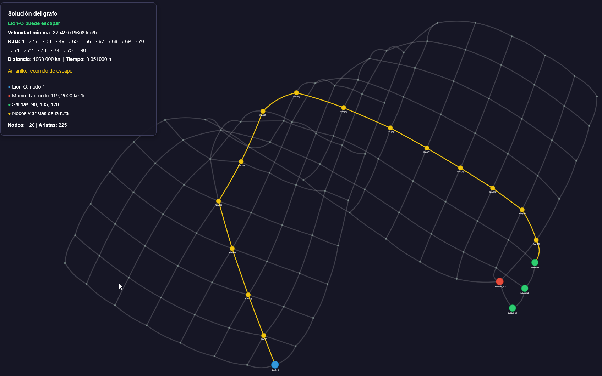


### Caso U36

**Entrada:** `n=125`, `m=226`, `k=6`, `v_M=175`, Lion-O `s=63`, Mumm-Ra `r=63`, salidas `K=[1, 25, 63, 101, 120, 125]`.

**Decisión que observamos:** Identificamos que Lion-O y Mumm-Ra empiezan en el mismo nodo y que ese nodo es una salida. SOLVE entra por la rama de salida, comprueba `s != r`, no asignamos velocidad y el resultado es captura.

**Llamadas:** `MAIN → SOLVE (rama de salida; misma posición)`.

**Vector de Dijkstra:** No se calcula porque el flujo termina antes de llamar a DIJKSTRA.

**Ruta testigo:** Determinamos que no hay una salida segura que Lion-O pueda alcanzar desde el punto ocupado por Mumm-Ra; la captura es inmediata.

**Búsqueda numérica:** no se ejecuta en esta rama.

**Salida del programa final:** `Mumm-Ra captures Lion-O!`

**Imagen del Grafo:**

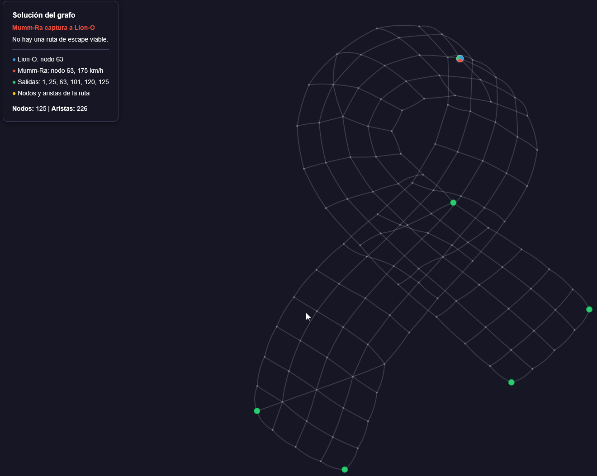


### Caso U37

**Entrada:** `n=132`, `m=234`, `k=6`, `v_M=220`, Lion-O `s=1`, Mumm-Ra `r=66`, salidas `K=[44, 70, 88, 100, 120, 132]`.

**Decisión que observamos:** Observamos que BFS encuentra salida estructural; calculamos D_M con Dijkstra y buscamos la menor cota factible mediante pruebas de velocidad.

**Llamadas:** `MAIN → SOLVE → BFS (sí) → DIJKSTRA (desde nodo 66) → PRUEBA(q) para la cota y la búsqueda binaria`.

**Vector completo $D_M(1,\ldots,n)$:** `[∞, ∞, ∞, ∞, ∞, ∞, ∞, ∞, ∞, ∞, ∞, ∞, ∞, ∞, ∞, ∞, ∞, ∞, ∞, ∞, ∞, ∞, ∞, ∞, ∞, ∞, ∞, ∞, ∞, ∞, ∞, ∞, ∞, ∞, ∞, ∞, ∞, ∞, ∞, ∞, ∞, ∞, ∞, ∞, 62, 56, 50, 44, 38, 32, 30, 24, 18, 12, 6, 60, 54, 48, 42, 36, 30, 24, 18, 12, 6, 0, 66, 60, 54, 48, 42, 36, 30, 24, 18, 12, 6, 72, 66, 60, 54, 48, 42, 36, 30, 24, 18, 12, ∞, ∞, ∞, ∞, ∞, ∞, ∞, ∞, ∞, ∞, ∞, ∞, ∞, ∞, ∞, ∞, ∞, ∞, ∞, ∞, ∞, ∞, ∞, ∞, ∞, ∞, ∞, ∞, ∞, ∞, ∞, ∞, ∞, ∞, ∞, ∞, ∞, ∞, ∞, ∞, ∞, ∞, ∞, ∞]`.

**Ruta testigo ilustrativa:** `1 → 13 → 25 → 37 → 38 → 39 → 40 → 41 → 42 → 43 → 44`.

**Longitudes de los tramos:** `1→13: 8; 13→25: 8; 25→37: 8; 37→38: 6; 38→39: 6; 39→40: 6; 40→41: 6; 41→42: 6; 42→43: 6; 43→44: 6`. Suma recorrida hasta la salida: `L=66`.

| Nodo visitado | $L(x)$ acumulada | $D_M(x)$ | $v_M \cdot L(x)/D_M(x)$ (km/h) |
| ---: | ---: | ---: | ---: |
| 1 | 0 | ∞ | 0 (D=∞) |
| 13 | 8 | ∞ | 0 (D=∞) |
| 25 | 16 | ∞ | 0 (D=∞) |
| 37 | 24 | ∞ | 0 (D=∞) |
| 38 | 30 | ∞ | 0 (D=∞) |
| 39 | 36 | ∞ | 0 (D=∞) |
| 40 | 42 | ∞ | 0 (D=∞) |
| 41 | 48 | ∞ | 0 (D=∞) |
| 42 | 54 | ∞ | 0 (D=∞) |
| 43 | 60 | ∞ | 0 (D=∞) |
| 44 | 66 | ∞ | 0 (D=∞) |

**Lectura de la decisión:** al comparar las razones, concluimos que la mayor es `0` como ínfimo porque Mumm-Ra no alcanza estos nodos. Verificamos que la ruta pasa las comprobaciones para una velocidad apenas superior a ese umbral; nuestro código conserva la cota superior al terminar la búsqueda.

**Búsqueda numérica:** cota superior inicial $U_0=10^{12}$; la primera prueba fue factible, así que no duplicamos la cota ($d=0$). Reducimos el intervalo con $B=64$ iteraciones binarias hasta que su ancho fue como máximo $10^{-7}$. En total hicimos `65` pruebas de velocidad: una para validar la cota y 64 en la búsqueda binaria.

**Salida del programa final:** `Lion-O can escape at a speed of 0.0000001 km/h!`

**Imagen del Grafo:**

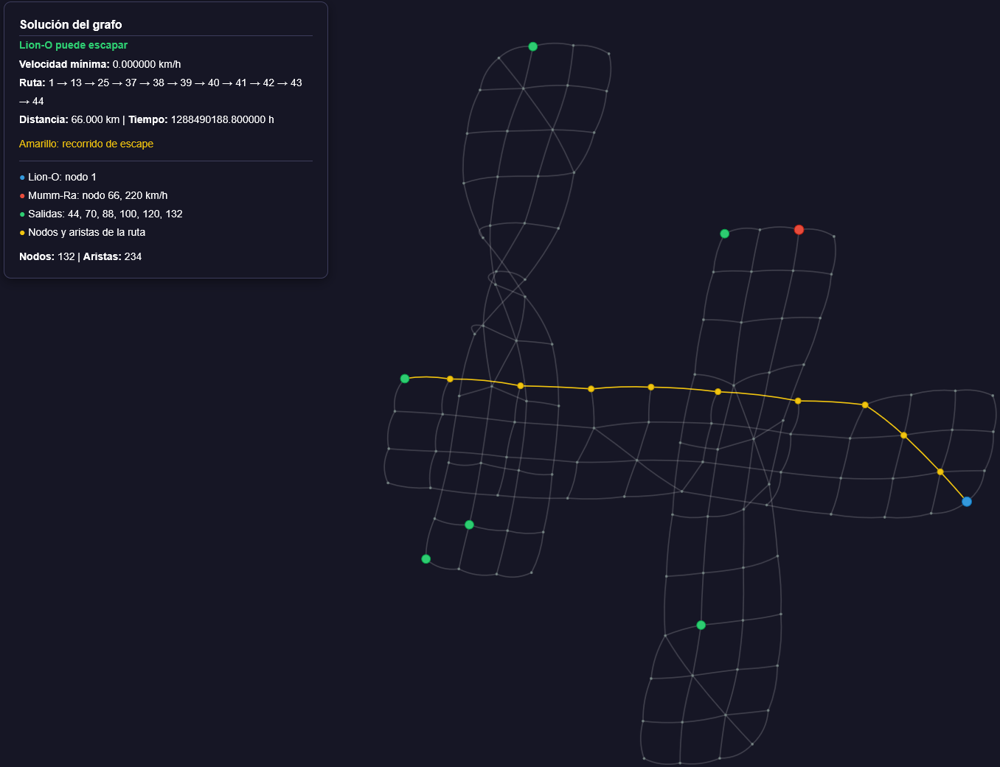


### Caso U38

**Entrada:** `n=138`, `m=246`, `k=6`, `v_M=195`, Lion-O `s=1`, Mumm-Ra `r=48`, salidas `K=[60, 80, 96, 110, 125, 138]`.

**Decisión que observamos:** Observamos que BFS no encuentra una salida alcanzable sin entrar al nodo inicial enemigo; por eso concluimos que hay captura y omitimos el cálculo de distancias y las pruebas de velocidad.

**Llamadas:** `MAIN → SOLVE → BFS (sin salida estructural)`.

**Vector de Dijkstra:** No se calcula porque el flujo termina antes de llamar a DIJKSTRA.

**Ruta testigo:** No encontramos una ruta admisible; BFS descarta el caso antes del análisis de velocidades.

**Búsqueda numérica:** no se ejecuta en esta rama.

**Salida del programa final:** `Mumm-Ra captures Lion-O!`

**Imagen del Grafo:**

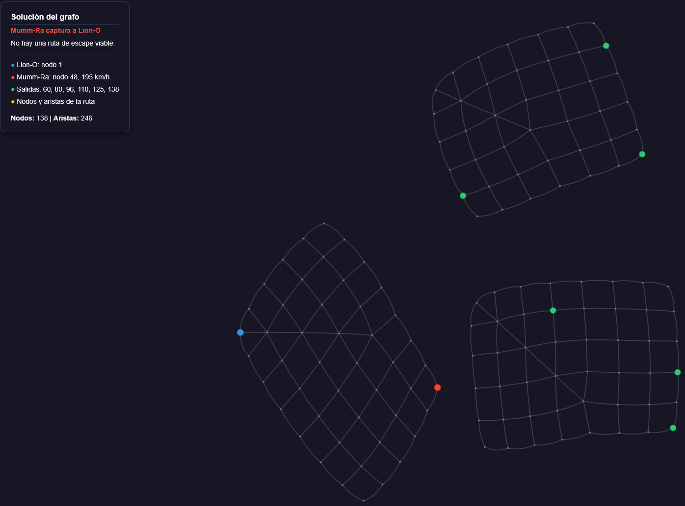


### Caso U39

**Entrada:** `n=140`, `m=262`, `k=6`, `v_M=160`, Lion-O `s=1`, Mumm-Ra `r=77`, salidas `K=[14, 56, 98, 127, 135, 140]`.

**Decisión que observamos:** Observamos que BFS encuentra salida estructural; calculamos D_M con Dijkstra y buscamos la menor cota factible mediante pruebas de velocidad.

**Llamadas:** `MAIN → SOLVE → BFS (sí) → DIJKSTRA (desde nodo 77) → PRUEBA(q) para la cota y la búsqueda binaria`.

**Vector completo $D_M(1,\ldots,n)$:** `[62, 54, 58, 50, 42, 34, 29, 32, 38, 46, 54, 62, 70, 78, 66, 58, 50, 42, 34, 26, 21, 24, 30, 38, 46, 54, 62, 70, 58, 50, 42, 34, 26, 19, 14, 17, 23, 30, 38, 46, 54, 62, 50, 42, 34, 26, 19, 13, 8, 11, 17, 24, 32, 40, 48, 56, 44, 36, 28, 20, 13, 8, 4, 7, 12, 19, 27, 35, 43, 51, 39, 31, 23, 15, 8, 3, 0, 3, 8, 15, 23, 31, 39, 47, 45, 37, 29, 21, 14, 8, 5, 8, 13, 20, 28, 36, 44, 52, 53, 45, 37, 29, 21, 14, 11, 14, 19, 26, 34, 42, 50, 58, 61, 53, 45, 37, 29, 21, 18, 21, 26, 34, 42, 50, 58, 66, 69, 61, 53, 45, 37, 29, 26, 29, 34, 42, 50, 58, 57, 65]`.

**Ruta testigo ilustrativa:** `1 → 127`.

**Longitudes de los tramos:** `1→127: 60`. Suma recorrida hasta la salida: `L=60`.

| Nodo visitado | $L(x)$ acumulada | $D_M(x)$ | $v_M \cdot L(x)/D_M(x)$ (km/h) |
| ---: | ---: | ---: | ---: |
| 1 | 0 | 62 | 0.000000 |
| 127 | 60 | 69 | 139.130435 |

**Lectura de la decisión:** al comparar las razones, concluimos que la mayor es `139.130435 km/h`. Verificamos que la ruta pasa las comprobaciones para una velocidad apenas superior a ese umbral; nuestro código conserva la cota superior al terminar la búsqueda.

**Búsqueda numérica:** cota superior inicial $U_0=10^{12}$; la primera prueba fue factible, así que no duplicamos la cota ($d=0$). Reducimos el intervalo con $B=64$ iteraciones binarias hasta que su ancho fue como máximo $10^{-7}$. En total hicimos `65` pruebas de velocidad: una para validar la cota y 64 en la búsqueda binaria.

**Salida del programa final:** `Lion-O can escape at a speed of 139.1304348 km/h!`

**Imagen del Grafo:**

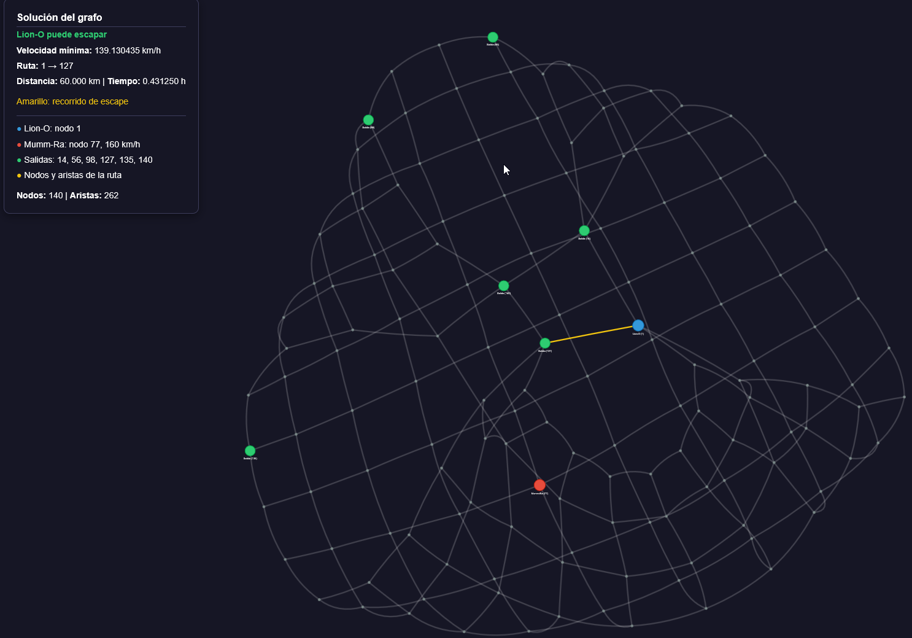


### Caso U40

**Entrada:** `n=150`, `m=285`, `k=6`, `v_M=350`, Lion-O `s=75`, Mumm-Ra `r=76`, salidas `K=[1, 15, 75, 136, 145, 150]`.

**Decisión que observamos:** Vemos que Lion-O ya está en una salida distinta del nodo de Mumm-Ra; por eso SOLVE devuelve $10^{-7}$ sin BFS, Dijkstra ni búsqueda binaria.

**Llamadas:** `MAIN → SOLVE (retorno directo $10^{-7}$)`.

**Vector de Dijkstra:** No se calcula porque el flujo termina antes de llamar a DIJKSTRA.

**Cálculo inmediato:** Lion-O ya está en la salida del nodo `75`, así que la distancia pendiente es `L=0`. Como $s\ne r$, no hay captura al inicio y no se recorre ninguna arista; el solucionador informa velocidad `0.0000001 km/h`. No se necesita calcular una razón crítica ni ejecutar Dijkstra.

**Búsqueda numérica:** no se ejecuta en esta rama.

**Salida del programa final:** `Lion-O can escape at a speed of 0.0000001 km/h!`

**Imagen del Grafo:**

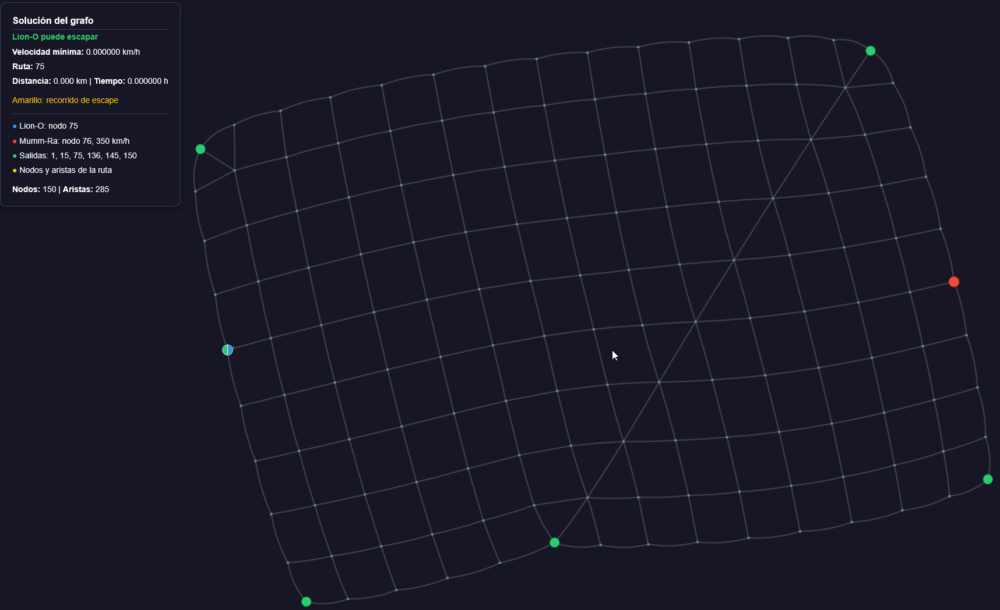


## Análisis de complejidad temporal y espacial

Analizamos únicamente las operaciones del algoritmo; excluimos la lectura y la impresión. Sea $n$ el número de intersecciones, $m$ el número de caminos y $k$ el número de salidas. Para Dijkstra usamos un heap con inserciones perezosas: puede contener hasta $O(n+m)$ entradas durante el recorrido.

### Aporte temporal y espacial de cada función

| Función o etapa | Tiempo | Espacio adicional | Aporte al problema |
| --- | --- | --- | --- |
| Construcción del grafo y del conjunto de salidas | $O(n+m+k)$ | $O(n+m+k)$ | Guarda cada camino en las listas de adyacencia y organiza las salidas en un conjunto. |
| `funcion_que_indica_si_existe_una_ruta_de_escape_posible` (BFS) | $O(n+m)$ | $O(n)$ | Recorre nodos y caminos una vez para descartar casos sin una salida estructural admisible. |
| `funcion_para_calcular_distancias_minimas` (Dijkstra desde Mumm-Ra) | $O((n+m)\log(n+m))$ | $O(n+m)$ | Calcula una vez las distancias mínimas $D_M(x)$ desde el inicio enemigo. |
| `funcion_que_indica_si_se_puede_escapar_con_una_velocidad_dada` | $O(n+(n+m)\log(n+m))=O((n+m)\log(n+m))$ | $O(n+m)$ | Forma las cotas de seguridad por nodo y ejecuta Dijkstra desde Lion-O para una velocidad candidata. |
| Ampliación de la cota superior | $O(d(n+m)\log(n+m))$ | $O(n+m)$ | Ejecuta la prueba de velocidad hasta encontrar una cota factible; $d$ cuenta las duplicaciones. |
| Búsqueda binaria | $O(B(n+m)\log(n+m))$ | $O(n+m)$ | Hace una prueba por punto medio y reduce el intervalo; $B$ cuenta esas pruebas. |
| `funcion_que_encuentra_la_velocidad_minima_necesaria_para_que_lion_pueda_escapar` | $O(n+m+k+(d+B+1)(n+m)\log(n+m))$ | $O(n+m+k)$ | Coordina los casos directos, BFS, Dijkstra, la ampliación de la cota y la búsqueda binaria. | 

La búsqueda comienza con $U_0=10^{12}$ y duplica esta cota si aún no es factible. Si $U$ es la cota factible alcanzada, el número de duplicaciones cumple $d=O(\max(0,\log_2(U/U_0)) )$. La búsqueda binaria reduce un intervalo inicial de ancho $U$ hasta alcanzar la precisión $\epsilon=10^{-7}$, por lo que $B=O(\max(0,\log_2(U/\epsilon)))$. El control del punto medio no aumenta estas cotas y puede hacer que la búsqueda termine antes.

La construcción y BFS recorren el grafo linealmente. Dijkstra cuesta más por las operaciones del heap; la prueba de una velocidad repite ese recorrido, y la ampliación y la búsqueda binaria ejecutan varias pruebas. Por eso el número de pruebas de factibilidad multiplica el costo de Dijkstra.

### Cota general de la solución

Para un caso, al combinar las funciones obtenemos la cota temporal

$$
T(n,m,k)=O\!\left(n+m+k+(d+B+1)(n+m)\log(n+m)\right),
$$

que, al expresar el número de iteraciones según la búsqueda numérica, también puede escribirse como

$$
T(n,m,k,U,\epsilon)=O\!\left(n+m+k+(n+m)\log(n+m)\left[1+\log\frac{U}{U_0}+\log\frac{U}{\epsilon}\right]\right).
$$

El espacio de trabajo por caso es

$$
S(n,m,k)=O(n+m+k).
$$

Si consideramos fijo el rango numérico de búsqueda y la precisión utilizada, el número de pruebas de velocidad queda acotado. Como $k\leq n$, la cota final expresada en función del tamaño del grafo se simplifica a

$$
\boxed{T(n,m)=O((n+m)\log(n+m)),\qquad S(n,m)=O(n+m).}
$$

Si procesamos varios casos, el tiempo es la suma de las cotas de cada caso y el espacio de trabajo corresponde al caso más grande.

## Cierre

Concluimos que la solución final combina una representación adecuada del mapa, las distancias mínimas de Mumm-Ra, una prueba de seguridad para cada velocidad candidata y una búsqueda binaria del umbral. Las 40 trazas muestran cuándo terminamos por un caso directo, cuándo descartamos una salida mediante BFS y cuándo ejecutamos Dijkstra. La comparación con las respuestas de referencia confirmó que todas las frases coincidieron y que el error numérico quedó por debajo de la tolerancia del enunciado.

# Bitácora del proyecto

| Día / hora | Actividades | Trabajo y conclusiones |
| --- | --- | --- |
| **Oct. 28, 9:00–10:00 a. m.** | Primera lectura del documento. | Leímos el enunciado y reconocimos que se trataba de una persecución por una red de caminos, con Lion-O buscando llegar a una salida antes de ser capturado. |
| **Oct. 28, 1:00–2:30 p. m.** | Lectura detallada del enunciado. | Identificamos las intersecciones, los caminos y sus longitudes, los inicios, las salidas y la velocidad de los mutantes. Anotamos la duda de si podía ocurrir una captura en medio de una vía. |
| **Oct. 29, 9:00–10:00 a. m.** | Análisis del problema y de los ejemplos. | Aclaramos las dudas sobre el movimiento continuo, revisamos los ejemplos del enunciado y bosquejamos sus entradas y salidas. |
| **Nov. 3, 9:00–10:00 a. m.** | Discusión de ideas. | Comparamos alternativas iniciales y acordamos empezar por la especificación formal del problema. |
| **Nov. 4, 9:00 a. m.–6:00 p. m.** | Especificación de la entrada y primer caso inventado. | Escribimos la entrada como la tupla `(G, w, s, r, K, v)` y definimos el significado de cada elemento. Diseñamos un caso pequeño que pudimos revisar manualmente. |
| **Nov. 5, 8:00 a. m.–12:00 p. m.** | Cierre de la especificación, segundo caso y repositorio. | Completamos la entrada y la salida, corregimos el primer caso, diseñamos el segundo, creamos el repositorio y empezamos a redactar el informe de la primera entrega. |
| **Nov. 8, 9:00 a. m.–9:00 p. m.** | Correcciones, tercer caso y primeras pruebas de implementación. | Ajustamos la especificación y el segundo caso, diseñamos un tercero para situaciones límite y subimos el avance al repositorio. Empezamos a construir el grafo desde la entrada y discutimos qué algoritmos podían resolver el problema. |
| **Nov. 9, 10:00–11:00 a. m.** | Revisión de redacción. | Leímos el informe completo, corregimos errores de escritura y unificamos la notación de la especificación y los casos. |
| **Nov. 10, 9:00–10:00 a. m.** | Cierre de la primera entrega. | Completamos la bitácora y las secciones pendientes del informe, y revisamos el documento antes de entregarlo. |
| **Nov. 15, 9:00–10:00 a. m.** | Selección del enfoque algorítmico. | Elegimos Dijkstra para las distancias porque las longitudes son no negativas y solo necesitamos una fuente. Analizamos la monotonía de la prueba de escape y planteamos la búsqueda binaria sobre la velocidad de Lion-O. |
| **Nov. 16, 9:30 a. m.–12:30 p. m.** | Entrada y primer algoritmo. | Organizamos el programa alrededor de una función principal e implementamos Dijkstra desde Mumm-Ra. Concluimos que sus distancias mínimas podían reutilizarse en todas las pruebas de velocidad del caso. |
| **Nov. 17, 10:30 a. m.–4:30 p. m.** | Dijkstra restringido para Lion-O. | Implementamos la prueba de factibilidad: desde Lion-O, Dijkstra solo acepta una llegada a un nodo si ocurre estrictamente antes que la de los mutantes para la velocidad evaluada. Revisamos que la condición de los extremos también cubriera el interior de las vías. |
| **Nov. 18, 10:10–11:09 a. m.** | Pruebas de empates y casi empates. | Revisamos los casos en que las llegadas coinciden o difieren por poco. Confirmamos que un empate no se acepta y que la condición estricta se mantiene en las comparaciones decimales. |
| **Nov. 19, 10:00 a. m.–2:00 p. m.** | BFS estructural e integración de la búsqueda de velocidad. | Implementamos BFS para descartar casos sin salida admisible y la función que combina los casos límite, Dijkstra desde Mumm-Ra, la ampliación de la cota y la búsqueda binaria. Corregimos los errores encontrados en las pruebas. |
| **Nov. 20, 4:24–5:09 p. m.** | Respaldo del avance. | Subimos las primeras funciones al repositorio para que el equipo trabajara sobre una versión compartida. |
| **Nov. 22, 10:00 a. m.–7:00 p. m.** | Casos de prueba adicionales. | Completamos la segunda función en el repositorio y diseñamos casos de tipos A, B, C y D para revisar resultados y exigencia de ejecución. |
| **Nov. 23, 9:30–11:30 a. m.** | Integración, selección de ejemplos y consulta de dudas. | Subimos BFS, escogimos ejemplos para el informe y comparamos los tipos A y B con nuestros cálculos. Consultamos al docente las dudas que teníamos sobre los resultados esperados de C y D. |
| **Nov. 24, 10:00 a. m.–3:00 p. m.** | Versión completa, corrección de casos imposibles y análisis. | Integramos las funciones y detectamos que, sin una salida alcanzable, la ampliación de la cota podía continuar indefinidamente. Añadimos la comprobación estructural antes de buscar velocidades, completamos la complejidad y corregimos la visualización de las fórmulas del informe. |
| **Nov 25** | Revisión de las diferencias en los casos B y del estado de la arena. | Revisamos los casos tipo B, sus resultados de referencia, el diff local y el mensaje de la arena. Distinguimos el estado «No recibido» de un veredicto del juez y comprobamos las condiciones de precisión del enunciado. También comparamos las variantes del código para entender las diferencias en la cota, el criterio de parada, los casos límite y el formato numérico. |
| **Nov 25** | Integración de la lógica revisada en el código final. | Integramos los cambios en el código: cota superior inicial $U_0=10^{12}$ con ampliación si hace falta, $\epsilon=10^{-7}$, protección frente a un punto medio que ya no se representa y salida con siete decimales. Revisamos también la rama de Lion-O cuando ya empieza en una salida distinta del inicio enemigo. |
| **Nov 25** | Verificación de las referencias y carga final. | Comparamos el código integrado con 100 resultados de referencia y obtuvimos coincidencia exacta en todas las líneas. Contrastamos los 40 casos unificados con sus resultados de referencia: las frases coincidieron y el máximo error numérico fue menor que `3 × 10⁻⁷`. Después subimos la versión final y el equipo observó su aceptación en la arena. |

## Evidencias de la revisión final en la arena

> 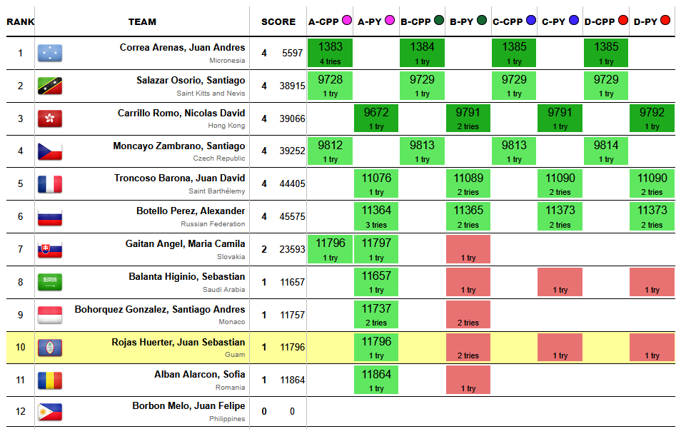

> 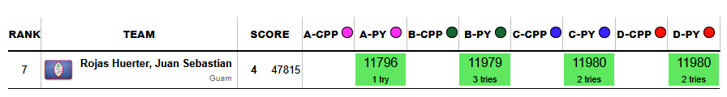

## Estructura general del programa

```text
funcion_que_ejecuta_todo_el_programa
├─ construye el grafo no dirigido y el conjunto de salidas
└─ funcion_que_encuentra_la_velocidad_minima_necesaria_para_que_lion_pueda_escapar
     ├─ resuelve el inicio compartido o el inicio de Lion-O en una salida
     ├─ funcion_que_indica_si_existe_una_ruta_de_escape_posible (BFS)
     ├─ funcion_para_calcular_distancias_minimas (Dijkstra desde Mumm-Ra)
     ├─ amplía la cota superior si la primera prueba no es factible
     │    └─ funcion_que_indica_si_se_puede_escapar_con_una_velocidad_dada
     └─ búsqueda binaria hasta epsilon = 1e-7
          └─ funcion_que_indica_si_se_puede_escapar_con_una_velocidad_dada
```

## Pseudocódigo de la versión final

```text
para cada caso de prueba:
    construir la lista de adyacencia y el conjunto de salidas
    si Lion-O empieza en una salida:
        si Lion-O y Mumm-Ra empiezan en el mismo nodo:
            informar captura
        si no:
            informar 0.0000001 km/h
    si no:
        ejecutar BFS desde Lion-O sin entrar al inicio de Mumm-Ra
        si no se encuentra una salida:
            informar captura
        si se encuentra una salida:
            D_M <- Dijkstra desde Mumm-Ra
            inferior <- 0
            superior <- 1e12
            mientras la prueba de superior no sea factible:
                superior <- 2 * superior
            mientras superior - inferior > 1e-7
                    y el punto medio sea distinto de ambos extremos:
                medio <- (inferior + superior) / 2
                si medio es factible:
                    superior <- medio
                si no:
                    inferior <- medio
            informar superior con siete decimales
```
