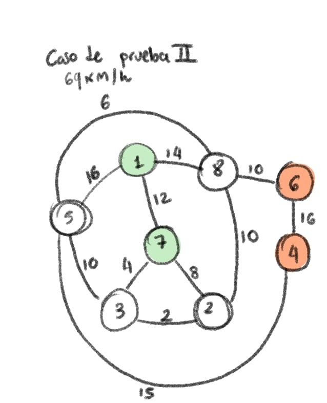

# Proyecto Final AGRA | Semestre 2026-2 Thundercats: Escape of Mum-ra
## Asignatura: Árboles y Grafos

## Docentes:
### Carlos Alberto Ramirez Restrepo
### Carlos Andres Delgado Saavedra

## Integrantes:
### Juan Sebastián Rojas Huerter
### Maria Camila Gaitán 


## Pontificia Universidad Javeriana Cali
## Facultad de Ingeniería y Ciencias
## Noviembre 11, 2026
## Cali, Colombia

## Introducción
El presente documento constituye la Primera Entrega del Proyecto de la Asignatura Árboles y Grafos. En él se detalla primero la Descripción General del Problema, expresada con Nuestras Propias Palabras. Tras ello se muestra la Especificación del Problema. Luego se describen los 3 Casos de Prueba Planteados por Nosotros junto a su Resultado Esperado. Siguiente a esto, planteamos la Explicación General de las Ideas que se han Considerado para Resolver el Problema, indicando los aspectos que aún debemos perfeccionar y las dificultades que todavía no sabemos cómo resolver. Finalmente, se listan los Registros de la Bitácora correspondientes al Trabajo Realizado hasta la Fecha.

## Descripción del Problema
Este Problema nos Plantea un escenario súper chevre en el que el protagonista, Lion-O, es perseguido por Mumm-Ra y sus Mutantes y debe huir rapido por una red de calles hacía unos puertos espaciales donde se encuentran unas naves para poder escapar de la región. El problema es que Mumm-Ra y sus mutantes ya saben dónde está y se preparan para atraparlo. Ambos personajes arrancan exactamente al mismo tiempo y se pueden mover en cualquier dirección, hasta pueden cambiar de sentido en plena calle y no solo en las esquinas. 
Para armar el escenario, el enunciado nos dice cuántas intersecciones hay, cómo se conectan los caminos y qué distancia tiene cada uno. También nos dicen el punto exacto de inicio de Lion-O, desde dónde arrancan los mutantes y en qué puertos están parqueadas las naves de escape. Aparte de todo esto, conocemos un dato clave muy importante, que es la velocidad máxima a la que pueden viajar los villanos. La regla para que Lion-O pierda es super estricta: si él y cualquier mutante llegan a coincidir en el mismo exacto punto, ya sea en un cruce o en el medio de una carretera, Lion-O es capturado inmediatamente. Los enemigos son re avispados y van a usar cualquier estrategia posible para cortarle el paso moviéndose a su velocidad máxima. 
Entonces, nuestro gran objetivo es determinar la velocidad más bajita necesaria para garantizar por completo que Lion-O escapa, esquivando cualquier atajo que tomen los malos. Al final, con los datos que nos dan, vamos a tener que decir exactamente a cuántos kilómetros por hora debe ir para salvarse, o, si la situación está totalmente bloqueada, decir que la captura es inevitable por más que el pobre Lion-O intente acelerar.

## Especificación del problema
### Entrada:
 - Un grafo no dirigido y ponderado $G = (V, E)$ que representa la red de caminos de la Tercera Tierra, donde: 
 $V$ es el conjunto de vértices o nodos (intersecciones), tal que $|V| = n$ y $E \subseteq V \times V$ es el conjunto de aristas (caminos que conectan las intersecciones bidireccionalmente), tal que $|E| = m$.
 - Una función de peso $w: E \to \mathbb{R}^+$ que asigna a cada arista $e \in E$ una longitud conocida $d$.
 - Un vértice inicial $s \in V$, que denota la posición de partida de Lion-O.
 - Un vértice inicial $r \in V$, que denota la posición de partida de los mutantes de Mumm-Ra.
 - Un subconjunto de nodos objetivo $K \subseteq V$, con $|K| = k$, que representa las ubicaciones de las salidas del puerto espacial.
 - Una constante $v \in \mathbb{R}^+$, que indica la velocidad maxima inmutable de la nave de los mutantes.
### Salida:
Se espera obtener un valor $S \in \mathbb{R}^+ \cup \{-1\}$, el cual es función estrictamente de los datos definidos en la entrada $(G, w, s, r, K, v)$. El valor de $S$ se define formalmente a través de la siguiente expresión:
$$
S = 
\begin{cases} 
\min(v_L) & \text{si } \exists \gamma \in \Gamma(s, K) \text{ tal que } \forall p \in \gamma, \frac{dist_\gamma(s,p)}{v_L} < \frac{dist_G(r,p)}{v} \\ 
-1 & \text{si no existe tal } v_L \text{ para ninguna trayectoria } \gamma 
\end{cases}
$$
### **Donde se definen los siguientes términos:**
*   $v_L \in \mathbb{R}^+$ es una velocidad constante hipotética para Lion-O. La salida $S$ busca el mínimo valor posible de esta variable que satisfaga la inecuación.
*   $\Gamma(s, K)$ es el conjunto de todas las trayectorias continuas posibles en el grafo $G$ que inician en $s$ y terminan en algún vértice $k \in K$.
*   $p$ representa cualquier punto continuo (ya sea un vértice o un punto fraccionario intermedio en una arista) que pertenezca a la trayectoria elegida $\gamma$.
*   $dist_\gamma(s, p)$ es la distancia exacta recorrida desde el vértice de inicio $s$ hasta el punto $p$ a lo largo de la ruta específica $\gamma$, evaluada según la función de peso $w$.
*   $dist_G(r, p)$ es la distancia del camino más corto posible en todo el grafo $G$ desde la posición inicial de los mutantes $r$ hasta el punto $p$, evaluada según la función de peso $w$.
*   El valor $-1$ es el indicador numérico de fallo, utilizado cuando la inecuación de distancias y tiempos resulta insatisfacible para cualquier trayectoria (es decir, la captura es inminente e inevitable sin importar la velocidad $v_L$).

## Casos de Prueba:
### Caso de Prueba 1: ***Pseudo grafo Ralo con 2 Puertos de Salida***
```text
8 10 2 35 
1 3 6 
4 3 10
3 5 8
1 5 7 
2 3 10
6 8 5
8 7 7
2 4 9
1 7 30
4 7 12
1 6
4 7
```
### **Componentes del Caso:**
* **Grafo:** Contiene 8 intersecciones con 10 carreteras distintas cada una con sus distancias.
* **Velocidad de los enemigos $(v)$:** Los mutantes viajan a una velocidad máxima constante de 35 km/h
* **Posiciones iniciales:** Lion-O arranca su escape desde el nodo 1, mientras que los mutantes comienzan la persecución desde el nodo 6. 
* **Salidas seguras:** Las naves espaciales para escapar están ubicadas en los nodos 4 y 7.
**Explicación y Definición:**
* Este caso de prueba está diseñado para verificar que el sistema no solo evalúe una ruta segura, sino que sepa comparar múltiples opciones de salida para elegir la que exija la menor velocidad posible.
* Al analizar las posiciones en el mapa, Lion-O debe decidir entre escapar por el nodo 4 o por el nodo 7:
### 1. **Intento de escape por el nodo 7:** 
* Los mutantes inician en el nodo 6, por lo que tienen un camino muy corto y directo hacia el nodo 7 (pasando por el 8, recorriendo solo una distancia de 12).
* Lion-O, por su parte, está muy lejos (a una distancia mínima de 28 cruzando por los nodos 3 y 4, o 30 por la ruta directa). 
* Para ganar esta carrera, el vehículo de Lion-O tendría que viajar a velocidades extremas.
### 2. **Intento de escape por el nodo 4:** 
* Si Lion-O se dirige al nodo 4 (pasando por el nodo 3), solo tiene que recorrer una distancia total de 16.
* Para que los mutantes logren alcanzar esa misma intersección desde su punto de inicio, deben recorrer un trayecto más largo (nodos 6 -> 8 -> 7 -> 4) sumando una distancia de 24.

### **Representación del Grafo:**


### **Salida Esperada:**
```text
Lion-O can escape at a speed of 23.333333 km/h!
```

### Caso de Prueba 2: ***Pseudo grafo Ralo con 2 Puertos de Salida y Rutas Bloqueadas***
```text
8 12 2 69 
1 5 16 
1 8 14
1 7 12
5 3 10 
5 4 15
5 8 6
3 7 4
3 2 2
7 2 8
2 8 10
8 6 10
6 4 16
7 1
4 6
```
### **Componentes del Caso:**
* **Grafo:** Contiene 8 intersecciones con 12 carreteras distintas cada una con sus distancias.
* **Velocidad de los enemigos $(v)$:** Los mutantes viajan a una velocidad máxima constante de 69 km/h
* **Posiciones iniciales:** Lion-O arranca su escape desde el nodo 7, mientras que los mutantes comienzan la persecución desde el nodo 1. 
* **Salidas seguras:** Las naves espaciales para escapar están ubicadas en los nodos 4 y 6.
**Explicación y Definición:**
* Este caso de prueba está diseñado para evaluar la capacidad del sistema de descartar rutas que están estratégicamente bloqueadas por el enemigo (intercepciones inevitables) y priorizar la supervivencia calculando la velocidad sobre la única ruta viable.
* Al observar el mapa y las distancias, Lion-O tiene dos nodos de salida posibles (6 y 4), pero su viabilidad es drásticamente distinta:
### 1. **Intento de escape por el nodo 6:** 
* Para que Lion-O llegue al nodo 6 por su ruta más corta (7 -> 3 -> 2 -> 8 -> 6), está obligado a pasar por el nodo 8, acumulando una distancia de 16 hasta ese punto.
* Sin embargo, los mutantes comienzan en el nodo 1 y tienen una conexión directa al nodo 8 con una distancia de tan solo 14. 
* Dado que los mutantes pueden llegar al nodo 8 antes que Lion-O (independientemente de la velocidad de este último), intentar huir hacia el nodo 6 garantiza la captura. El sistema debe descartar esta salida por completo.
### 2. **Intento de escape por el nodo 4:** 
* La alternativa es que Lion-O huya hacia el nodo 4 utilizando la ruta (7 -> 3 -> 5 -> 4), lo que suma una distancia total de 29.
* Para interceptarlo en esa salida, los mutantes tomarían su camino más corto (1 -> 5 -> 4), el cual suma una distancia de 31.
* Lion-O debe ser capaz de recorrer sus 29 unidades de distancia antes de que los mutantes recorran sus 31 unidades viajando a 69 km/h. La proporción entre estas distancias dicta la velocidad mínima necesaria.

### **Representación del Grafo:**



### **Salida Esperada:**
```text
Lion-O can escape at a speed of 64.548387 km/h!
```

### Caso de Prueba 3: ***Pseudo grafo Ralo con 1 Puerto de Salida y Captura Inevitable***
```text
10 14 1 120
1 5 100
2 9 200
4 7 50
1 8 90
8 5 110
10 4 30
6 3 20 
4 1 70
6 7 80
2 5 220
6 9 100
8 10 20
6 8 30
7 2 45
5 6
3
```
### **Componentes del Caso:**
* **Grafo:** Contiene 10 intersecciones con 14 carreteras distintas cada una con sus distancias.
* **Velocidad de los enemigos $(v)$:** Los mutantes viajan a una velocidad máxima constante de 120 km/h
* **Posiciones iniciales:** Lion-O arranca su escape desde el nodo 5, mientras que los mutantes comienzan la persecución desde el nodo 6. 
* **Salida segura:** La nave espacial para escapar está ubicada en el nodo 3.
**Explicación y Definición:**
* Este caso de prueba está diseñado para validar el comportamiento del sistema frente a la imposibilidad del escape. El sistema debe ser capaz de determinar cuándo ninguna velocidad, por más alta que sea, es suficiente para garantizar la supervivencia.
* Al evaluar el mapa, el sistema analizará múltiples rutas desde la posición de Lion-O (nodo 5) hacia el resto del grafo.
* Debido a la forma del Grafo, el nodo 3 (la única salida) es un vértice cuya única conexión al resto del mapa es a través del nodo 6. Esto convierte al nodo 6 en un paso obligatorio.
* Al calcular las distancias, el sistema detectará que la distancia de Lion-O hacia ese punto crítico es de mínimo 140 unidades (pasando por el nodo 8), mientras que la distancia de los mutantes a ese mismo punto es exactamente 0 (ya que inician allí).
* El sistema matemáticamente comprobará que el tiempo que le toma a los mutantes llegar al nodo 6 es $0$ $segundos$, por lo que la velocidad requerida para que Lion-O cruce ese nodo antes que los mutantes tiende a infinito $(V_L = ∞)$. Como la posibilidad de escape se rompe en ese punto, el sistema debe descartar todas las rutas y declarar la captura inevitable.

### **Representación del Grafo:**


### **Salida Esperada:**
```text
Mumm-Ra captures Lion-O!
```

## Ideas Contempladas
Esta Sección se recopila las ideas que se consideraron en el Transcurso de la Comprensión del Proyecto y explica por qué algunas se descartan. También distingue las que no se han descartado todavía porque podrían formar parte de una estrategia correcta hacia la Solución. Finalmente, se detallan Aquellas que hemos Decidido Incluir en el Desarrollo del Proyecto y la Justificación de esa Decision
## Ideas Descartadas
### Usar BFS para encontrar el camino más corto:
* Descartamos Recorrer el grafo con BFS, ya que este Recorrido depende de que el Grafo tenga Aristas de Igual Peso o Peso Nulo, pues en él se minimiza la cantidad de aristas suponiendo que todas aportan en igual magnitud. Realizar un recorrido de este tipo puede guiar a elegir un camino hacia la salida alcanzada con menos vías, pero no toma en consideración la suma de sus longitudes. Aquí cada vía tiene una longitud relevante, así que los pesos no se pueden ignorar.
### Usar DFS para buscar una ruta y tomar la primera salida encontrada:
* Descartamos Usar DFS para seguir vecinos recursivamente hasta llegar a una salida, ya que aunque DFS encuentra si existe una ruta, el orden de exploración del grafo puede guiar a una ruta larga o insegura aunque haya otra mejor. De esta manera, encontramos que hacer uso este Recorrido no optimiza distancia, tiempo ni garantiza un margen de seguridad respecto a los mutantes.
### Verificar si Lion-O y una salida pertenecen a la misma componente conexa
* Esta Idea que analizamos suponía usar BFS o DFS para decidir si existe alguna ruta desde el inicio de Lion-O hasta una salida. La descartamos, ya que la conectividad no tiene en cuenta las longitudes, la velocidad ni la persecución. Puede existir una ruta y, aun así, que los mutantes puedan capturar a Lion-O antes de que la complete. De esta manera, aunque es una comprobación previa posible para detectar casos sin ninguna salida alcanzable, se descarta porque no decide realmente si se puede escapar con seguridad.
### Elegir la ruta de menor longitud desde Lion-O a una salida
* Para esta Idea se podría ejecutar Dijkstra desde Lion-O y seleccionar la salida con menor distancia. Sin embargo, la ruta más corta para Lion-O no necesariamente es segura, ya que puede acercarlo a una zona a la que los mutantes también llegan con facilidad. De esta manera, el procedimiento debe considerar simultáneamente el avance de Lion-O y el alcance de los mutantes para determinar la Alcanzabilidad de la Salida en Tiempo Real. Se Rescata de esta Idea que Dijkstra puede calcular distancias ponderadas, pero la ruta resultante debe evaluarse según la condición de captura.
### Ir a la salida más cercana por distancia directa
* Esta Idea que analizamos implicaría Calcular la Distancia desde Lion-O a cada salida y escoger la mínima. Tomamos la Decision de descartarla, ya que ignora la posición de los mutantes. La salida más cercana puede estar muy Cerca de Mumm-Ra o exigir atravesar vértices inseguros, y de esta manera en algún caso particular una salida más lejana podría ser la única que permita escapar.
### Comparar solamente el tiempo de Lion-O y los mutantes al llegar a la salida
* Esta Idea que analizamos se basaba en Calcular quién llega primero a una salida y declarar que Lion-O escapa si llega antes. Sin embargo, llegamos a la Conclusion de Descartarla, ya que el enunciado indica que es posible capturar a Lion-O en cualquier punto de una vía o en una intersección, por lo que solo el supuesto de llegar antes a la salida no demuestra que haya sobrevivido al trayecto.
### Revisar solo las distancias desde los mutantes hasta las salidas
* Esta Idea que analizamos implicaría Calcular cuánto tardan los mutantes en llegar a cada salida y comparar ese tiempo con el tiempo de Lion-O. Decidimos descartarla, ya que una comparación en el destino no nos describe lo que ocurre en el camino, pues los mutantes podrían alcanzar a Lion-O antes de que llegue a la salida.
### Suponer que Mumm-Ra sigue la misma ruta que Lion-O
* Esta idea que analizamos se basaba en comparar el tiempo que ambos tardan siguiendo el mismo camino. Decidimos Descartarla ya que el enunciado nos Plantea que los mutantes pueden elegir cualquier estrategia compatible con su velocidad máxima, por lo que no están obligados a perseguir unidireccionalmente o a usar la ruta de Lion-O; podrían tomar un atajo y esperar en un punto para capturarlo.
### Elegir siempre el siguiente vértice que más aumenta la distancia respecto a los mutantes
* En esta Idea Nos Planteamos si Lion-O podría aplicar una regla especial que siempre escoja la vía que contribuya a alejarlo del inicio de Mumm-Ra. Decidimos descartarla porque una decisión asi podría llevarlo a un callejón sin salida, a una vía larga o a una zona peligrosa más adelante. La confiabilidad dependerá de toda la secuencia de movimientos, no solo del siguiente paso.
### Elegir siempre el siguiente vértice más cercano a una salida
* Esta Idea que analizamos se basaba en avanzar en cada vertice hacia el vecino que reduciera más la distancia restante a una salida. Sin embargo, la descartamos, ya que reducir la distancia a la salida no garantiza aumentar la separación respecto a los mutantes, ya que puede producir ciclos o elegir una vía insegura.
### Marcar como prohibido todo vértice que los mutantes puedan alcanzar
* Esta Idea que analizamos se basaba en Calcular qué lugares son alcanzables desde el inicio de los mutantes y eliminarlos del grafo. Sin embargo, decidimos descartarla, ya que en un grafo conectado, los mutantes pueden alcanzar eventualmente muchos o todos los vértices. En este sentido, lo que importa es si pueden llegar al mismo lugar **en el mismo momento** que Lion-O, por lo que la región peligrosa que podrían alcanzar cambia con el tiempo; no es un conjunto estático de vértices prohibidos.
### Marcar como prohibida toda vía conectada al inicio de los mutantes
* Esta idea que nos planteamos se basaba en eliminar las vías que los mutantes pueden recorrer. Decidimos descartarla, ya que en el enunciado nos indican que ambos vehículos comparten la red y las reglas no prohíben que Lion-O circule por una vía que también podrían usar los mutantes. La Viabilidad depende solo de la coincidencia espacial y temporal.
### Simular solo la trayectoria más rápida de los mutantes
* Esta Idea que analizamos se basaba en elegir una trayectoria predeterminada de Mumm-Ra y simular si alcanza a Lion-O. Decidimos descartarla, ya que el problema pide garantizar la posibilidad del escape frente a cualquier estrategia de los mutantes. Simular una sola trayectoria no nos representa todas las posiciones a las que pueden llegar.
### Enumerar todas las estrategias posibles de Mumm-Ra
* Esta idea que nos planteamos se basaba en probar cada ruta, cada velocidad y cada cambio de dirección de los mutantes. La descartamos, porque llegamos a la conclusion de que hay infinitas trayectorias posibles porque pueden cambiar de dirección y de velocidad en cualquier punto. Una enumeración directa no es posible de realizar, por lo que nos conviene más resumir sus posibilidades con distancias mínimas o regiones alcanzables en cada instante.
### Enumerar todas las rutas posibles de Lion-O
* En esta idea, al igual que la anterior, contemplamos listar cada secuencia de vías desde el inicio de Lion-O hasta una salida y comparar su seguridad. Sin embargo, terminamos descartándola, ya que los ciclos permiten generar cantidades enormes de recorridos y podríamos tener infinitos recorridos posibles. En este sentido concluimos que nos hace falta buscar lograr una búsqueda que evite explorar caminos redundantes.
### Suponer que cualquier punto dentro de una vía solo puede alcanzarse desde un extremo específico
* Esta idea que nos planteamos se basaba en medir la distancia a un punto usando únicamente el extremo por el que Lion-O entró. Sin embargo, después de revisarla con detenimiento llegamos al consenso de descartarla, ya que los mutantes pueden llegar al punto por cualquiera de los dos extremos, y el camino más corto podría entrar por el extremo opuesto. En este sentido para evaluar la Viabilidad de un punto interior de la trayectoria entre 2 nodos, creemos que sería bueno considerar la mejor de las rutas que llegan desde ambos extremos.
### Usar Floyd-Warshall para calcular todas las distancias por defecto
* Esta idea que se nos ocurrió se basaba en calcular distancias entre todos los pares de intersecciones. Sin embargo, la descartamos debido a que Floyd-Warshall cuesta del orden de `n³` tiempo y `n²` memoria. Además, el enunciado solo da un origen para los mutantes, así que calcular todas las parejas podría ser trabajo innecesario si basta una búsqueda de fuente única. Sin embargo, lo que sí se puede rescatar es que Floyd-Warshall puede ser útil como referencia para grafos pequeños o si una solución futura necesitara de muchas consultas entre pares.
### Usar Bellman-Ford para las distancias
*  Esta Idea que analizamos se Basaba en Relajar Todas las Vías repetidamente para calcular caminos mínimos usando Bellman-Ford. La contemplamos detenidamente, ya que las longitudes representan distancias y son no negativas. Sin embargo, concluimos que si se requiere una sola fuente, Dijkstra podría ser una herramienta más adecuada, pues Bellman-Ford sería más lento y podría hacer procesos innecesarios. También contemplamos en un momento dado si su detección de ciclos negativos podría aportarnos información util, pero concordamos en que no corresponde a la necesidad particular del problema.
### Usar orden topológico de Kahn o DFS
* Esta Idea que analizamos se descartó porque el grafo de carreteras es no dirigido y puede contener ciclos. Dado que el orden topológico se aplica a grafos dirigidos acíclicos, no podemos usarlo en este caso, pues no nos permite modelar el movimiento por una red de vías con ciclos.
### Usar componentes fuertemente conexas
* Esta idea que pensamos consistía en Dividir el grafo en Componentes Fuertemente Conexas. Sin embargo, como el problema describe vías transitables en ambas direcciones, no es posible hacer uso de este concepto, ya que no aplica para este tipo de grafos porque el grafo es no dirigido. Además, los componentes fuertemente conexos no nos representan tiempos de llegada ni riesgo de captura.
### Tratar el grafo como si Lion-O y los mutantes solo pudieran moverse entre intersecciones
* Aca analizamos esta opción, pero creemos que cometeríamos un error al solo permitir cambios de dirección únicamente al llegar a un vértice, ya que según lo que nos plantea el enunciado, se permite cambiar de dirección o cambiar de vía en cualquier punto de una carretera. Ignorar esta premisa podría excluirnos estrategias permitidas o encuentros de captura posibles.
### Tratar la velocidad `v` como si estuviera en cientos de metros por hora
* Este Caso es Muy Importante y corresponde a una conclusion a la que llegamos analizando los casos de prueba y su salida esperada. Es muy importante tener en cuenta que usar el valor numérico de `v` directamente como si sus unidades fueran las mismas que las longitudes correspondería a un error gravísimo, pues en el enunciado las longitudes están en cientos de metros, mientras que el formato de salida expresa la velocidad en km/h. En este sentido para los cálculos de tiempo hay que usar unidades compatibles, para garantizar que al imprimir, el valor siga en las unidades adecuadas.
### Redondear las velocidades durante los cálculos
* Una idea que consideramos llevar a cabo era redondear distancias, tiempos o velocidades a pocos decimales en cada paso. Sin embargo, los errores acumulados que podríamos llegar a descartar pueden cambiar la decision de Viabilidad. Y además dado que la salida exige un error absoluto menor que `10⁻⁶`, se deben conservar suficientes decimales y redondear solo al presentar la respuesta.

## Ideas que no se descartan todavía
### Calcular distancias mínimas desde el inicio de los mutantes
* Esta Idea que contemplamos nos Otorgaría para cada intersección `w`, el cálculo de `D[w]`, que corresponderá a la suma mínima de longitudes que deben recorrer los mutantes desde su inicio `r` hasta `w`. Puede ser util considerarla, ya que con velocidad máxima `v`, `D[w]` da el menor tiempo en que pueden llegar a esa intersección. En este caso, al ser distancias estrictamente positivas, Dijkstra podría ser una candidata natural, pues se calcularía una sola vez por caso de prueba y sirve para muchas pruebas de velocidad y de alcanzabilidad para nuestro Personaje Lion-O. Por otra parte, el arreglo `D` que obtendríamos podría alimentar el modelo de región alcanzable por tiempo y ayudar a plantear la parte segura para cada vértice y ayudarnos quizás a hacer algo como una "prueba de alcanzabilidad".
### Modelar el conjunto de puntos alcanzables por los mutantes según el tiempo
* Tras analizarla, creemos que la regla de captura tiene una base temporal, por lo que una hipótesis sobre la que trabajamos es que un punto del grafo es alcanzable por los mutantes en un tiempo `t` si la distancia mínima desde su inicio hasta ese punto es como máximo `v·t`. Comparar este resultado con la posición de Lion-O es una interpretación que consideramos validar para Evaluar su Posible Uso.
### Buscar el umbral de velocidad de Lion-O
* Creemos que una Posibilidad sería realizar una búsqueda binaria sobre la velocidad podría ser posible. Esto dependería de que se demuestre bajo monotonía matematica de que, cuando una velocidad permite escapar, cualquier velocidad mayor también lo permite. Nos parece una idea razonable porque Lion-O podría avanzar más rápido o elegir no usar toda su capacidad, pero la prueba exacta de esta posibilidad todavía está pendiente.

## Ideas a Aplicar
### Representar el mapa como un grafo ponderado no dirigido
* Esta Representación nos permite extrapolar cada intersección como un vértice y cada vía como una arista con su longitud. Al ser no dirigido, cada vía se almacena en las listas de adyacencia de sus dos extremos. En esta Interpretación toda ruta posible de cada vehículo corresponderá a una secuencia de aristas y las longitudes son claramente necesarias para calcular cuánto tarda cada vehículo en alcanzar un Punto. Además, dado que estamos Considerando el Uso de Dijkstra, esta seria la estructura base para hacer uso de Dijkstra desde el inicio de los mutantes y para la posible "prueba de alcanzabilidad" de las salidas desde las posiciones de Lion-O.
### Usar listas de adyacencia
* Esta Representación guarda para cada intersección solo las vías que salen de ella, por lo que para el Contexto del Problema es una Estructura Óptima y además Dijkstra junto con otros recorridos y procedimientos usan recorridos sobre vecinos. Por otro lado, la lista de adyacencia también permite recorrer cada vía en tiempo proporcional al tamaño de la red. Por estas Razones Creemos que puede Ser Util para Nuestro Caso su Uso.

# Desarrollo Posible Entrada de Datos del Programa

```text
from sys import stdin
def main():
    entrada = stdin.readline()
    t = int(entrada)
    for _ in range(t):
        n, m, k, v = map(int, stdin.readline().split())
        grafo = [[] for _ in range(n)]
        for _ in range(m):
            a, b, d = map(int, stdin.readline().split())
            a -= 1
            b -= 1
            grafo[a].append((b, d))
            grafo[b].append((a, d))
        lion, mumm_ra = map(int, stdin.readline().split())
        salidas = list(map(int, stdin.readline().split()))
        print(f"m:{m},n:{n},k:{k},v:{v}")
        print(*grafo)
        print(f"lion:{lion}  mumm_ra:{mumm_ra}")
        print(*salidas)
if __name__ == "__main__":
    main()
```

## Bitacora del Proyecto
| Dia/ Hora                        | Actividades                                                                                                                                                                                                                                                                                                                                                                                                                                                | Description                                                                                                                                                                                                                                                                                                                                                                                                                                                                                                                                                                                                                                                    |
| -------------------------------- | ---------------------------------------------------------------------------------------------------------------------------------------------------------------------------------------------------------------------------------------------------------------------------------------------------------------------------------------------------------------------------------------------------------------------------------------------------------- | -------------------------------------------------------------------------------------------------------------------------------------------------------------------------------------------------------------------------------------------------------------------------------------------------------------------------------------------------------------------------------------------------------------------------------------------------------------------------------------------------------------------------------------------------------------------------------------------------------------------------------------------------------------- |
| Oct. 28: 9:00a.m. - 10:00 a.m    | Primera revision del documento                                                                                                                                                                                                                                                                                                                                                                                                                             | Se hizo una primera lectura del enunciado. Se entendió de forma general que el problema es una persecución en un mapa: Lion-O debe llegar a alguna salida del puerto espacial sin que lo alcancen los mutantes de Mumm-Ra.                                                                                                                                                                                                                                                                                                                                                                                                                                     |
| Oct. 28: 1:00 p.m. - 2:30 p.m.   | Lectura detallada del enunciado e identificación de Elementos                                                                                                                                                                                                                                                                                                                                                                                              | Se releyó el enunciado identificando los elementos que intervienen: el mapa de intersecciones y caminos con sus longitudes, las posiciones iniciales de Lion-O y de los mutantes, las salidas del puerto y la velocidad de la nave de los mutantes. Quedó la duda de si los mutantes podían alcanzar a Lion-O a mitad de un camino o solo en las intersecciones.                                                                                                                                                                                                                                                                                               |
| Oct. 29: 9:00 a.m. - 10:00 a.m.  | Análizamos del problema y Bosquejo del los casos de prueba dados                                                                                                                                                                                                                                                                                                                                                                                           | Se analizaron los elementos identificados el día anterior y se aclararon las dudas. Se revisaron los casos de prueba del enunciado y se bosquejó qué entra y qué sale en cada uno.                                                                                                                                                                                                                                                                                                                                                                                                                                                                             |
| Nov. 3: 9:00 a.m.                | Discusion de ideas                                                                                                                                                                                                                                                                                                                                                                                                                                         | Se discutieron distintas ideas para abordar el problema a partir de los casos de prueba revisados. Se acordó un enfoque general para empezar a escribir la especificación                                                                                                                                                                                                                                                                                                                                                                                                                                                                                      |
| Nov. 4: 9:00 a.m. -  6:00 p.m.   | Discutimos ideas generales sobre el problema.<br><br>Desarollo de la primera parte de la especificacion del problema( Entrada)<br><br>Desarollo del primer <br>Caso de prueba.                                                                                                                                                                                                                                                                             | Se escribió la entrada formal como la tupla (G, w, s, r, K, v), definiendo el dominio de cada elemento. Se armó el primer caso de prueba con un grafo pequeño cuya respuesta se pudiera verificar a mano.                                                                                                                                                                                                                                                                                                                                                                                                                                                      |
| Nov. 5: 8:00 a.m. - 12:00 p.m.   | Desarollo completo de la especificacion del problema( Entrada y Salida)<br><br>Ajustes del primer Caso de prueba<br><br>Creacion del repositorio del proyecto<br><br>Desarollo del segundo caso de prueba<br><br>Se empezo a escribir el documento para la primer entrega                                                                                                                                                                                  | Se completó la especificación agregando las salidas esperadas. Se corrigió el primer caso de prueba para que coincidiera con la especificación final y se diseñó el segundo. Se creó el repositorio y se subieron los primeros archivos. Se definió la estructura del documento de la primera entrega y se redactaron las primeras secciones.                                                                                                                                                                                                                                                                                                                  |
| Nov. 8: 9:00 a.m. - 9:00 pm.p    | Ajustes y correciones de la especificacion del problema.<br><br>Realizamos ajustes y correcciones del segundo Caso de prueba<br><br>Desarollamos del tercer caso de prueba <br><br>Se subio al repositorio todo lo que se habia hecho.<br><br>Continuamos con el desarollo el documento de la primera entrega.<br><br>Avanzamos con la implentacion (entrada de datos) y discutimos sobre que algoritmos usar para la resolucion del proyecto.<br><br><br> | Al revisar la especificación con más calma se encontraron detalles que no estaban bien definidos, sobre todo en algunas restricciones de la entrada, y se corrigieron. Esto obligó a ajustar el segundo caso de prueba, y aprovechando eso se armó un tercer caso pensado para probar situaciones límite. Con la especificación ya más estable, se pasó a la parte práctica: se dejó funcionando la lectura de datos y se empezó a debatir qué algoritmo conviene usar, comparando qué tan fácil es implementarlo contra qué tan eficiente sería. Todavía no hay una decisión final. Al final se subió todo al repositorio para tener respaldo del avance.<br> |
| Nov 9:<br>10:00 a.m. -11:00 a.m. | Se corrigieron algunos detalles de redaccion el el documento de la primera entrega <br>                                                                                                                                                                                                                                                                                                                                                                    | Se leyó el documento completo para detectar errores de ortografía y frases poco claras. Se reescribieron algunos párrafos para que la notación de la especificación fuera consistente con la usada en los casos de prueba.                                                                                                                                                                                                                                                                                                                                                                                                                                     |
| Nov 10: 9:00 a.m. - 10:00 a.m.   | Se termino de escribir la bitacora<br><br>Se termino de redactar el do cumento de la primera entrega <br>                                                                                                                                                                                                                                                                                                                                                  | Se completó la bitácora con las actividades de cada sesión. Se escribieron las secciones que faltaban del documento y se hizo una revisión final.                                                                                                                                                                                                                                                                                                                                                                                                                                                                                                              |
