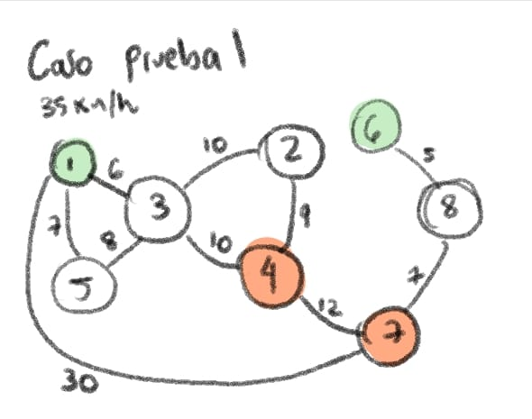

# Especificacion del problema

## Entrada:
 - Un grafo no dirigido y ponderado $G = (V, E)$ que representa la red de caminos de la Tercera Tierra, donde: 
 $V$ es el conjunto de vértices o nodos (intersecciones), tal que $|V| = n$.
 $E \subseteq V \times V$ es el conjunto de aristas (caminos que conectan las intersecciones bidireccionalmente), tal que $|E| = m$.
 - Una funcion de peso $w: E \to \mathbb{R}^+$ que asigna a cada arista $e \in E$ una longitud conocida $d$.
 - Un vértice inicial $s \in V$, que denota la posicion de partida de Lion-O.
 - Un vértice inicial $r \in V$, que denota la posicion de partida de los mutantes de Mumm-Ra.
 - Un subconjunto de nodos objetivo $K \subseteq V$, con $|K| = k$, que representa las ubicaciones de las salidas del puerto espacial.
 - Una constante $v \in \mathbb{R}^+$, que indica la velocidad maxima inmutable de la nave de los mutantes.

## Salida:

Se espera obtener un valor $S \in \mathbb{R}^+ \cup \{-1\}$, el cual es función estrictamente de los datos definidos en la entrada $(G, w, s, r, K, v)$. El valor de $S$ se define formalmente a través de la siguiente expresión:

$$
S = 
\begin{cases} 
\min(v_L) & \text{si } \exists \gamma \in \Gamma(s, K) \text{ tal que } \forall p \in \gamma, \frac{dist_\gamma(s,p)}{v_L} < \frac{dist_G(r,p)}{v} \\ 
-1 & \text{si no existe tal } v_L \text{ para ninguna trayectoria } \pi 
\end{cases}
$$

**Donde se definen los siguientes términos:**

*   $v_L \in \mathbb{R}^+$ es una velocidad constante hipotética para Lion-O. La salida $S$ busca el mínimo valor posible de esta variable que satisfaga la inecuación.
*   $\Gamma(s, K)$ es el conjunto de todas las trayectorias continuas posibles en el grafo $G$ que inician en $s$ y terminan en algún vértice $k \in K$.
*   $p$ representa cualquier punto continuo (ya sea un vértice o un punto fraccionario intermedio en una arista) que pertenezca a la trayectoria elegida $\gamma$.
*   $dist_\gamma(s,p)$ es la distancia exacta recorrida desde el vértice de inicio $s$ hasta el punto $p$ a lo largo de la ruta específica $\gamma$, evaluada según la función de peso $w$.
*   $dist_G(r,p)$ es la distancia del camino más corto posible en todo el grafo $G$ desde la posición inicial de los mutantes $r$ hasta el punto $p$, evaluada según la función de peso $w$.
*   El valor $-1$ es el indicador numérico de fallo, utilizado cuando la inecuación de distancias y tiempos resulta insatisfactible para cualquier trayectoria (es decir, la captura es inminente e inevitable sin importar la velocidad $v_L$).

# Casos de Prueba:
## Caso de Prueba 1:
***Pseudografo Ralo con 2 Puertos de Salida***
```text
8 10 2 35 
1 3 6 
4 3 10
3 5 8
1 5 7 
2 3 10
6 8 5
8 7 7
2 4 9
1 7 30
4 7 12
1 6
4 7
```

**Componentes del Caso:**
* **Grafo:** Contiene 8 intersecciones con 10 carreteras distintas cada una con sus distancias.
* **Velocidad de los enemigos $(v)$:** Los mutantes viajan a una velocidad máxima constante de 35 km/h
* **Posiciones iniciales:** Lion-O arranca su escape desde el nodo 1, mientras que los mutantes comienzan la persecución desde el nodo 6. 
* **Salidas seguras:** Las naves espaciales para escapar están ubicadas en los nodos 4 y 7.

**Explicación y Definición:**

* Este caso de prueba está diseñado para verificar que el sistema no solo evalúe una ruta segura, sino que sepa comparar múltiples opciones de salida para elegir la que exija la menor velocidad posible.
* Al analizar las posiciones en el mapa, Lion-O debe decidir entre escapar por el nodo 4 o por el nodo 7:
1. **Intento de escape por el nodo 7:** 
* Los mutantes inician en el nodo 6, por lo que tienen un camino muy corto y directo hacia el nodo 7 (pasando por el 8, recorriendo solo una distancia de 12).
* Lion-O, por su parte, está muy lejos (a una distancia mínima de 28 cruzando por los nodos 3 y 4, o 30 por la ruta directa). 
* Para ganar esta carrera, el vehículo de Lion-O tendría que viajar a velocidades extremas.
2. **Intento de escape por el nodo 4:** 
* Si Lion-O se dirige al nodo 4 (pasando por el nodo 3), solo tiene que recorrer una distancia total de 16.
* Para que los mutantes logren alcanzar esa misma intersección desde su punto de inicio, deben recorrer un trayecto más largo (nodos 6 -> 8 -> 7 -> 4) sumando una distancia de 24.

**Representación del Grafo:**



**Salida Esperada:**
```text
Lion-O can escape at a speed of 23.333333 km/h!
```

## Caso de Prueba 2:
***Pseudografo Ralo con 2 Puertos de Salida y Rutas Bloqueadas***
```text
8 12 2 69 
1 5 16 
1 8 14
1 7 12
5 3 10 
5 4 15
5 8 6
3 7 4
3 2 2
7 2 8
2 8 10
8 6 10
6 4 16
7 1
4 6
```
**Componentes del Caso:**
* **Grafo:** Contiene 8 intersecciones con 12 carreteras distintas cada una con sus distancias.
* **Velocidad de los enemigos $(v)$:** Los mutantes viajan a una velocidad máxima constante de 69 km/h
* **Posiciones iniciales:** Lion-O arranca su escape desde el nodo 7, mientras que los mutantes comienzan la persecución desde el nodo 1. 
* **Salidas seguras:** Las naves espaciales para escapar están ubicadas en los nodos 4 y 6.

**Explicación y Definición:**

* Este caso de prueba está diseñado para evaluar la capacidad del algoritmo de descartar rutas que están estratégicamente bloqueadas por el enemigo (intercepciones inevitables) y priorizar la supervivencia calculando la velocidad sobre la única ruta viable.
* Al observar el mapa y las distancias, Lion-O tiene dos nodos de salida posibles (6 y 4), pero su viabilidad es drásticamente distinta:
1. **Intento de escape por el nodo 6:** 
* Para que Lion-O llegue al nodo 6 por su ruta más corta (7 -> 3 -> 2 -> 8 -> 6), está obligado a pasar por el nodo 8, acumulando una distancia de 16 hasta ese punto.
* Sin embargo, los mutantes comienzan en el nodo 1 y tienen una conexión directa al nodo 8 con una distancia de tan solo 14. 
* Dado que los mutantes pueden llegar al nodo 8 antes que Lion-O (independientemente de la velocidad de este último), intentar huir hacia el nodo 6 garantiza la captura. El algoritmo debe descartar esta salida por completo.

2. **Intento de escape por el nodo 4:** 
* La alternativa es que Lion-O huya hacia el nodo 4 utilizando la ruta (7 -> 3 -> 5 -> 4), lo que suma una distancia total de 29.
* Para interceptarlo en esa salida, los mutantes tomarían su camino más corto (1 -> 5 -> 4), el cual suma una distancia de 31.
* Lion-O debe ser capaz de recorrer sus 29 unidades de distancia antes de que los mutantes recorran sus 31 unidades viajando a 69 km/h. La proporción entre estas distancias dicta la velocidad mínima necesaria.

**Representación del Grafo:**


**Salida Esperada:**
```text
Lion-O can escape at a speed of 64.548387 km/h!
```

## Caso de Prueba 3:
***Pseudografo Ralo con 1 Puerto de Salida y Captura Inevitable***
```text
10 14 1 120
1 5 100
2 9 200
4 7 50
1 8 90
8 5 110
10 4 30
6 3 20 
4 1 70
6 7 80
2 5 220
6 9 100
8 10 20
6 8 30
7 2 45
5 6
3
```
**Componentes del Caso:**
* **Grafo:** Contiene 10 intersecciones con 14 carreteras distintas cada una con sus distancias.
* **Velocidad de los enemigos $(v)$:** Los mutantes viajan a una velocidad máxima constante de 120 km/h
* **Posiciones iniciales:** Lion-O arranca su escape desde el nodo 5, mientras que los mutantes comienzan la persecución desde el nodo 6. 
* **Salida segura:** La nave espacial para escapar está ubicada en en nodo 3.
